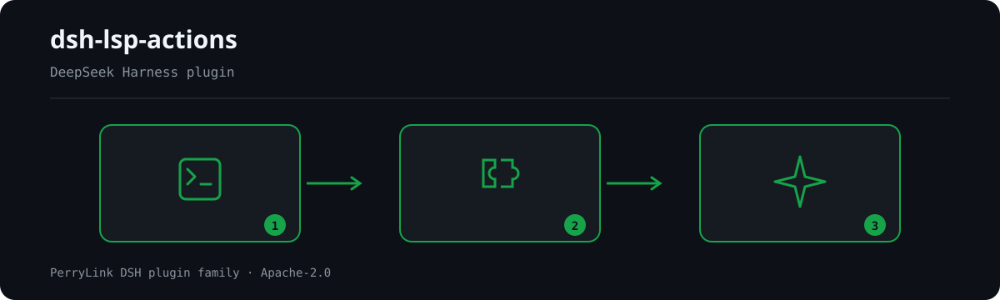

<div align="center">

# 🛰️ dsh-lsp-actions
- **Canal 1024 store**: `npm i -g dsh1024` uma vez, depois `dsh1024 plugin --profile web add dsh-lsp-actions` (conta para o ranking de instalações do [deepseek1024.com](https://deepseek1024.com)).

**A superfície de ação LSP para o DeepSeek Harness — servidores de linguagem reais, feedback real e o backend de integração IDE para editores.**

*Diagnósticos, formatação, autocompletar, ações de código, símbolos, ajuda de assinatura, dicas embutidas e renomeação para o loop do editor do seu agente — mais o protocolo estável de ações para editores (`lsp.actions.*`) que permite a qualquer editor consumi-los diretamente.*

[](LICENSE)
[](https://gitee.com/perrylink/dsh-lsp-actions)
[](https://github.com/topics/dsh-plugin)
[](https://github.com/PerryLink/dsh-plugin-doctor#verified-徽章)
[](https://dsh.market/)
[](#)
[](https://github.com/PerryLink/dsh-lsp-actions/actions)
[](https://github.com/PerryLink/dsh-lsp-actions/releases)
[](https://www.npmjs.com/package/dsh-lsp-actions)
[](https://www.npmjs.com/package/dsh-lsp-actions)
[](https://dshfind.com/pt/plugins/PerryLink/dsh-lsp-actions?ref=badge)

[English](README.md) · [简体中文](README-zh.md) · [Español](README-es.md) · [Português](README-pt.md) · [हिन्दी](README-hi.md)

```sh
dsh plugin --profile <name> add dsh-lsp-actions
```


</div>

---

**📖 Base de conhecimento do ecossistema** — dados medidos, não marketing: [guia de desenvolvimento · dados de seleção · critérios de manutenção](https://perrylink.github.io/dsh-plugin-guide/).

<!-- star-cta -->
## Install & uninstall

- **git channel** (`main` mais recente): `dsh plugin --profile web add github:PerryLink/dsh-lsp-actions` — o script `prepare` compila (`tsc --noEmitOnError`).
- **npm channel** (versões publicadas): `dsh plugin --profile web add dsh-lsp-actions`.
- **tarball channel**: execute `pnpm pack` neste repo e depois `dsh plugin --profile web add ./dsh-lsp-actions-<version>.tgz`.
- **uninstall**: `dsh plugin --profile web remove dsh-lsp-actions` (ou remova a linha do patch do perfil).

## ⭐ 如果它帮到了你

Este plugin faz parte da [família de plugins DSH](https://github.com/PerryLink) (mais de 40, todos Apache-2.0). Se for útil, **deixe uma estrela**: não desbloqueia nada, mas ajuda a próxima pessoa a encontrá-lo.

*English:* part of a 95 plugin family for DeepSeek Harness. If it is useful, **a star helps the next person find it** — nothing is gated behind it.

## What is dsh-lsp-actions?

A superfície de ação LSP para o DeepSeek Harness — servidores de linguagem reais, feedback real e o backend de integração IDE para editores.

Diagnósticos, formatação, autocompletar, ações de código, símbolos, ajuda de assinatura, dicas embutidas e renomeação para o loop do editor do seu agente — mais o protocolo estável de ações para editores (`lsp.actions.*`) que permite a qualquer editor consumi-los diretamente.



*Visão geral do fluxo: chamada → plugin → resultado. Os exemplos abaixo usam a superfície real de comandos.*


*A mesma execução, animada.*

## Compatibility

| Surface | Status |
|---|---|
| Harness | DeepSeek Harness `dsh-v0.2.1-alpha.1` (compatibilidade declarada para `>=0.1.2-rc.1 <0.2.0 \|\| >=0.1.5-alpha.1 <0.2.0 \|\| >=0.1.6-0 <0.2.0 \|\| >=0.1.7-0 <0.2.0`); o plugin não grava eventos de sessão próprios - o host registra os eventos padrão tool/call + tool/result. O seam publicado ainda tem apenas as quatro operações legacy, então o plugin mantém o próprio cliente e registra esse vintage na primeira chamada de ação. Verificado em 2026-09-24 (typecheck duplo + suíte completa + portas self-contained/artifacts). |
| Node | `^22.19.0 \|\| >=24.0.0` |
| Platforms | Todas (host puro; subprocessos + sistema de arquivos, sem rede) |
| Model | Qualquer (as ferramentas são independentes do modelo; o plugin nunca chama um modelo) |

## What you get

O `dsh-lsp-actions` é montado como uma única linha de host (`id: lsp-actions`, `name: dsh-lsp-actions`, `inject: [tools, fs, subprocess]`). O seam oficial `ctx.lsp` do DeepSeek Harness cobre a **navegação** (ir para definição, referências, implementação, hover); este plugin completa a **superfície de ação** — o loop de feedback que um agente precisa enquanto escreve e corrige código:

1. **Oito ferramentas `lsp_*`** — diagnósticos, formatação, autocompletar, ações de código, símbolos, ajuda de assinatura, dicas embutidas e renomeação, todas servidas pelos mesmos servidores de linguagem que o seu IDE usa.
2. **Protocolo de ações para editores v1** — uma superfície JSON-RPC estável (`lsp.actions.list` / `lsp.actions.run` / `lsp.events`) que permite a qualquer editor (VS Code primeiro) consumir essas capacidades diretamente.
3. **Verificação com servidor real** — uma execução real do `typescript-language-server` faz parte da suíte de testes (autocontida, CI em Node 22/24 no Linux, Windows e macOS), não apenas mocks.

## Quick start

```sh
dsh plugin --profile web add github:PerryLink/dsh-lsp-actions
```

```sh
# 1. install the bundle into your profile
dsh plugin --profile web add github:PerryLink/dsh-lsp-actions

# or from npm (published releases)
dsh plugin --profile web add dsh-lsp-actions

# 2. restart and verify the row
dsh --profile web --dump-config | grep -A3 'id: lsp-actions'
```

### Exemplos

São os pontos de entrada reais; instale e chame um.

#### Exemplo detalhado

**Comando**

~~~sh
lsp_diagnostics
~~~

**Entrada**

~~~json
{
  "file_path": "a.ts"
}
~~~

**Saída**

~~~text
a.ts:1:3  [Error] boom [ts 2304]
a.ts:3:1  [Hint] hint
~~~

*Observado em `plugins/dsh-lsp-actions/tests/render.spec.ts:32-37 (exact toBe); tool-level no-result render at plugins/dsh-lsp-actions/tests/tools.spec.ts:150-156`*

#### Ramo de falha

**Entrada**

~~~text
{"action":"format","requestId":"f1","params":{"filePath":"a.ts","workspaceRoot":"<session-workspace>"}} under a read-only permission preset
~~~

**Saída**

~~~text
{
  "requestId": "f1",
  "action": "format",
  "status": "failed",
  "error": {
    "code": "LSP_ACTION_READ_ONLY",
    "message": "[sandbox: file access denied under read-only mode]\n[sandbox: escalation available — retry this exact operation once with sandbox_permissions (the narrowest wider mode that suffices) + justification; the approval prompt asks the user]"
  }
}
~~~

*Observado em `plugins/dsh-lsp-actions/src/tools.ts:213-223; plugins/dsh-lsp-actions/src/editor/actions.ts:320-330; plugins/dsh-lsp-actions/tests/editor-protocol.spec.ts:305-325`*

#### Exemplos breves

- `lsp_format`
- `lsp_completion`

## Configuration

Todos os ajustes são campos Schemastery `Config` (alteráveis pelo cordis.yml). Uma sobrescrita direcionada por id substitui a linha inteira — repita cada chave de que precisar. O `cordis.patch.yml` documenta cada chave em linha.

| Key | Default | Meaning |
|---|---|---|
| `servers` | `{}` | Servidores de linguagem nomeados; uma tabela vazia não ativa nenhum servidor |
| `editor.enabled` | `false` | Serve o protocolo de ações para editores por JSON-RPC stdio (somente backend headless) |
| `editor.requestTimeoutMs` | `60000` | Orçamento de timeout por execução (ms) do protocolo de editor |
| `editor.diagnosticsCacheMaxFiles` | `64` | Tamanho da cache LRU de diagnósticos (em arquivos) |
| `maxDiagnostics` | `200` | Teto de diagnósticos por resultado |
| `maxCompletionItems` | `20` | Teto de itens de autocompletar por resultado |
| `maxCodeActions` | `50` | Teto de ações de código por resultado |
| `maxSymbols` | `100` | Teto de resultados de símbolos |
| `maxSignatures` | `10` | Teto de ajuda de assinatura |
| `maxInlayHints` | `200` | Teto de dicas embutidas |
| `maxResultChars` | `16000` | Teto do resultado renderizado (caracteres) |
| `maxDocumentBytes` | `4000000` | Teto de leitura de documento (bytes) |
| `timeoutMs` | `60000` | Timeout por chamada, aplicado pela política oficial de timeout |

Cada entrada de `servers` é um `LspServerEntry`: `command` (executável resolvido no PATH no carregamento) e `extensionToLanguage` (`".ts"` → `typescript`) são obrigatórios; os opcionais `fileGlobs`, `projectMarkers`, `args`, `env`, `initializationOptions`, `configuration`, `formattingOptions`, `maxMessageBytes`, `maxStderrBytes`, `killGraceMs`, `shutdownTimeoutMs`, `diagnosticsSettleMs`, `diagnosticsDebounceMs` e `idleTimeoutMs` (`0` = manter vivo o processo do servidor) ajustam o cliente stdio integrado.

O roteamento é determinístico e guiado pela configuração. Cada arquivo usa a primeira correspondência de: **(1)** uma entrada de `servers` cujos `fileGlobs` correspondam ao caminho; **(2)** o diretório ancestral mais próximo — subindo até a raiz do workspace — que contenha um arquivo de configuração de projeto declarado nos `projectMarkers` de alguma entrada, avaliado apenas entre as entradas que também mapeiam a extensão do arquivo; **(3)** a entrada cujo `extensionToLanguage` mapeia a extensão do arquivo, na ordem de configuração. Assim, um workspace com `apps/node-app/{package.json,tsconfig.json,src/main.ts}` e `apps/deno-app/{deno.json,src/main.ts}` serve cada `main.ts` com o servidor do seu próprio projeto: sem regras de caminho para manter e sem mudanças ao adicionar, renomear ou mover um projeto:

```yaml
servers:
  typescript:
    command: typescript-language-server
    args: ["--stdio"]
    extensionToLanguage: { ".ts": typescript, ".tsx": typescriptreact }
    projectMarkers: ["package.json", "tsconfig.json"]
  deno:
    command: deno
    args: ["lsp"]
    extensionToLanguage: { ".ts": typescript, ".tsx": typescriptreact }
    projectMarkers: ["deno.json", "deno.jsonc"]
```

Um marcador de projeto só decide entre servidores que já mapeiam a extensão do arquivo (nunca amplia os tipos de arquivo de uma entrada); a busca nunca sai da raiz do workspace, e a configuração de projeto de um diretório nunca se aplica a um diretório irmão. O passo **(1)** tem prioridade sobre um marcador de projeto: se os `fileGlobs` de uma entrada correspondem ao caminho, ela continua vencendo, então remova os globs de nível de projeto ao adotar `projectMarkers`; um glob `**/*.ts` remanescente continuará reivindicando esses arquivos. Estas regras regem o cliente stdio integrado; um provider do seam `ctx.lsp` montado decide seu próprio roteamento.

## Tools & surfaces

| Surface | Kind | Notes |
|---|---|---|
| `lsp_diagnostics` | tool | `<file>` — erros, avisos e dicas do compilador/analisador com severidade, intervalo, mensagem e servidor de origem (somente leitura) |
| `lsp_format` | tool | `<file> [range?]` — formata um arquivo/seleção pelo servidor de linguagem e o aplica, devolvendo o diff (grava via `fs/write-intent`) |
| `lsp_completion` | tool | `<file> <line> <character>` — sugestões de autocompletar em uma posição do cursor, incluindo o texto de inserção (somente leitura) |
| `lsp_code_action` | tool | `<file> [range?] [only?]` — correções/refatorações verificadas pelo servidor com suas edições, para um intervalo ou o primeiro diagnóstico (somente referência) |
| `lsp_symbols` | tool | `<query?> <file_path?>` — busca de símbolos por nome em todo o workspace, ou o esboço de um arquivo (somente leitura) |
| `lsp_signature` | tool | `<file> <line> <character>` — ajuda de assinatura (parâmetros e documentação) dentro de uma chamada (somente leitura) |
| `lsp_inlay_hints` | tool | `<file> [range?]` — anotações de tipo e dicas de nomes de parâmetros do servidor (somente leitura) |
| `lsp_rename` | tool | `<file> <line> <character> <new_name>` — renomeação verificada pelo servidor, aplicada em todo o workspace com diffs por arquivo (grava via `fs/write-intent`) |
| `lsp.actions.*` | protocol | Protocolo de ações para editores v1: `lsp.actions.list` / `lsp.actions.run` / `lsp.events` por JSON-RPC |
| `examples/vscode/` | extension | Extensão VS Code somente-UI mais a composição de backend headless à qual se conecta |

## Editor action protocol v1

Quando `editor.enabled: true` é definido em uma composição headless dedicada, o `dsh-lsp-actions` serve um protocolo de editor estável por JSON-RPC 2.0 delimitado por quebras de linha (o mesmo enquadramento de wire dos transportes oficiais SDK/ACP):

| Method | What it does |
|---|---|
| `lsp.actions.list` | Devolve a versão de protocolo `lsp-actions/v1`, o catálogo de ações (`diagnostics.get`, `completion.get`, `quickfix.apply`, `format` — cada uma marcada `writes`) e as sessões DSH endereçáveis |
| `lsp.actions.run` | Executa uma ação com um envelope estruturado `{ requestId, action, status, result \| error }`; os erros carregam os códigos estáveis `LSP_ACTION_*` |
| `lsp.events` | Assina as notificações `lsp.event` transmitidas: `diagnostics.updated`, `action.status`, `file.changed`, `sessions.changed` |

Todas as ações de escrita (`quickfix.apply`, `format`) passam pelos **presets de permissão oficiais e pela aprovação**: uma sessão `read-only` é recusada com `LSP_ACTION_READ_ONLY` antes de qualquer ida e volta com o servidor, as edições viajam pelo waterfall `fs/write-intent` e o par de escalada `sandbox_permissions` + `justification` se resolve pelo `approveEscalation` oficial (fail-closed quando ninguém pode decidir). Especificação de wire completa, bilíngue: [`docs/editor-protocol.md`](docs/editor-protocol.md) · [`docs/editor-protocol.zh-CN.md`](docs/editor-protocol.zh-CN.md).

**Versionamento e a promessa de compatibilidade retroativa**

- O protocolo é versionado — `lsp.actions.list` devolve `protocol: "lsp-actions/v1"`, `version: 1`. **O v1 está congelado:** nomes de campos, ids de ação, tipos de evento e códigos de erro permanecem estáveis para sempre.
- A evolução é **apenas aditiva**: novas ações, campos e tipos de evento chegam sem subir a versão; a semântica existente nunca muda no lugar; uma mudança que quebra compatibilidade é publicada sob uma nova versão de `protocol`, que os servidores podem servir lado a lado.
- Os clientes devem ignorar campos, tipos de evento e ações desconhecidos, e rotear pelo `code` de erro estável, nunca pelo texto da mensagem.

**Códigos de erro**

Cada falha carrega um `code` estável; modelos e chamadores roteiam pelo código, nunca pelo texto da mensagem.

| Code | Meaning |
|---|---|
| `LSP_ACTION_UNAVAILABLE` | Nenhuma entrada de servidor nem provider do seam trata este arquivo |
| `LSP_ACTION_UNSUPPORTED` | O servidor (ou o provider do seam) não anuncia a operação |
| `LSP_ACTION_SERVER_FAILED` | O servidor falhou (com o final do seu stderr); falhas de inicialização tentam de novo uma vez |
| `LSP_ACTION_MALFORMED_RESPONSE` | O servidor enviou uma carga estruturalmente inválida |
| `LSP_ACTION_CONFLICT` | O arquivo mudou desde que foi lido, ou as edições se sobrepõem / saem dos limites / saem do workspace |
| `LSP_ACTION_READ_ONLY` | O modo sandbox da sessão proíbe a escrita da formatação/renomeação |
| `LSP_ACTION_WORKSPACE_REQUIRED` | A sessão chamadora não tem um cwd de workspace para enraizar o servidor |
| `LSP_ACTION_NO_SYMBOL` | O servidor não encontrou um símbolo renomeável na posição do cursor |
| `LSP_ACTION_UNKNOWN` | Protocolo de editor: id de ação desconhecido, ou nenhuma ação de código coincidiu com `title`/`index` |
| `LSP_ACTION_INVALID_ARGS` | Protocolo de editor: parâmetros de ação mal formados |
| `LSP_ACTION_APPROVAL_UNAVAILABLE` | Protocolo de editor: a rota de aprovação não pôde conceder um modo sandbox mais amplo (fail-closed) |
| `LSP_PROTOCOL_VERSION_UNSUPPORTED` | Protocolo de editor: a versão de protocolo declarada não é suportada |

## VS Code extension

[`examples/vscode/`](examples/vscode/) inclui uma extensão **somente-UI** (barra lateral com as sessões DSH, a lista de diagnósticos, aplicar quickfix com um clique, abrir no intervalo e formatar) mais a composição de backend headless (`backend/cordis.yml`) à qual se conecta por JSON-RPC estilo ACP. A extensão implementa zero lógica LSP — cada capacidade e cada byte escrito pertencem ao plugin. Os passos de instalação, ajustes e o script de gravação do gif de demonstração estão em [`examples/vscode/README.md`](examples/vscode/README.md).


## Permissions & data

- **Permissões**: a formatação e a renomeação viajam pelos presets de permissão oficiais e pela aprovação — o waterfall `fs/write-intent` e o par de escalada `sandbox_permissions` / `justification` resolvido por `ctx.approval`. O plugin declara `fs:read`, `fs:write`, `subprocess:spawn` e `network:none` em seu manifesto de workshop.
- **Dados**: nada é armazenado em disco; os resultados das ferramentas vivem apenas no log da sessão (sem persistência entre sessões). O protocolo de editor mantém uma única cache LRU de diagnósticos em memória, limitada, com selo de frescor e nunca persistida entre reinícios.
- **Sem rede**: o plugin não faz requisições de rede; ele fala com os servidores de linguagem por stdio de subprocessos locais.

## Security boundaries

- **Somente leitura por padrão.** Seis das oito ferramentas são apenas de referência; somente `lsp_format` e `lsp_rename` mutam, e o fazem como mutações reais de `write`/`edit`.
- **Seams oficiais, não reimplementados.** Cada byte passa pelo waterfall `fs/write-intent` (observação → escrita protegida → observação) e pela política sandbox de cada chamada; a escalada acompanha as ferramentas oficiais `write`/`edit`.
- **Falha em alto e bom som, rápido e estruturado.** `servers` vazio + sem seam `ctx.lsp` → `LSP_ACTION_UNAVAILABLE`; sessões somente leitura → `LSP_ACTION_READ_ONLY` antes de qualquer ida e volta com o servidor; formas de comando são reportadas e nunca executadas.
- **Conflitos nunca sobrescrevem.** Um arquivo mudado em disco após a leitura falha com `LSP_ACTION_CONFLICT`; o `lsp_rename` faz o pré-voo de cada arquivo editado antes da primeira escrita.
- **Trabalho limitado.** Os tetos de resultados, os tetos de bytes e a política de timeout da plataforma limitam cada chamada; a cache de diagnósticos é uma LRU limitada.
- **Nada é cacheado no caminho do modelo.** Os resultados das ferramentas vivem apenas no log da sessão; a cache de diagnósticos nunca persiste entre reinícios.
- **Servidores ruins falham em alto e bom som.** Um executável inexistente falha no carregamento; um servidor que morre na inicialização falha a chamada com `LSP_ACTION_SERVER_FAILED` mais o final do seu stderr (após uma nova tentativa com processo novo).
- **Higiene do prompt.** O plugin não injeta persona nem prosa de prompt no system prompt da sessão — sua superfície de cara ao modelo são os oito esquemas de ferramentas.

## Architecture

As ações vão **primeiro pelo seam oficial** e caem para o cliente stdio mínimo do próprio plugin:

```text
lsp_diagnostics / lsp_format / lsp_completion / lsp_code_action /
lsp_symbols / lsp_signature / lsp_inlay_hints / lsp_rename
        │
        ▼
   ctx.lsp seam (estendido: diagnostics / formatDocument / completion)
        │  ausente · legado · sem provider para este arquivo
        ▼
   cliente stdio integrado  ←  tabela servers (ctx.subprocess.spawn + JSON-RPC)
```

A extensão do seam está proposta upstream (`upstream/lsp-action-seam.patch`, descrição do PR em `upstream/PR-description.md`). Quando for integrada, o plugin continua funcionando sem mudanças — o cliente integrado simplesmente deixa de ser usado. O cliente integrado permanece como fallback independente para a tabela `servers`. O **protocolo de editor** usa o mesmo runner, o mesmo caminho de escrita e a mesma maquinaria de permissões. Notas completas de pesquisa e design: [`docs/seam-extension-notes.md`](docs/seam-extension-notes.md).

## Known limitations

- **Documentos transitórios.** Cada ação abre o arquivo, executa uma requisição e o fecha de novo (igual ao host stdio oficial). Servidores baseados em projeto que exigem um arquivo aberto residente para requisições sem documento (o tsls recusa `workspace/symbol` sem um) são atendidos passando `file_path` para `lsp_symbols`. O tsls também responde `textDocument/signatureHelp` com `null` sob esse ciclo de vida; outros servidores (gopls, pyright, rust-analyzer) o atendem normalmente.
- **A formatação de intervalo exige o provider de intervalo do servidor.** Servidores que só anunciam formatação de documento completo falham requisições de intervalo com `LSP_ACTION_UNSUPPORTED`.
- **A renomeação aplica apenas edições de texto.** Operações de recursos (criar/excluir/renomear arquivos) na resposta de renomeação do servidor são recusadas com `LSP_ACTION_UNSUPPORTED`, e edições fora do workspace falham como `LSP_ACTION_CONFLICT` antes de qualquer escrita.

## Development

```sh
pnpm install            # node ^22.19 || >=24
pnpm run lint           # oxlint over src/ and tests/
pnpm test               # vitest: unit + fixture-server integration + editor-protocol e2e + real tsls e2e
pnpm run test:coverage  # coverage gate
pnpm build              # tsc --noEmitOnError → lib/
pnpm run prepare        # tsc --noEmitOnError (runs on install)
pnpm run prepublishOnly # tsc --noEmitOnError (runs before publish)
```

## Interoperability with other DSH plugins

Verificado contra **DSH `0.2.0-rc.2`** (o runtime para o qual este README é publicado) e o conjunto de plugins com mais estrelas pesquisado em 2026-10-05.

Este plugin **não interfere** em outros plugins, incluindo os de mais estrelas:

- **Sem colisão de nome de ferramenta.** Todas as ferramentas têm namespace; nenhuma ocupa um nome puro já pertencente a uma ferramenta embutida ou a outro plugin.
- **Sem colisão de chave de serviço.** Não fornece nenhuma chave de serviço, portanto não pode colidir em uma.
- **Sem colisão de slot.** Não registra nenhuma chave de slot de cliente, então não disputa um assento `shadows-shipped-ui`.
- **Sem colisão de rota HTTP.** Não registra nenhum prefixo `webServer`.
- **Sem colisão na camada de patch.** O patch do bundle apenas faz `insert` da própria linha; nunca sobrescreve o `config` de uma linha embutida.
- **Sem mutação global.** Não altera protótipos, não reescreve `process.env` nem substitui o dispatcher global de fetch.

**Listeners de eventos compartilhados não interferem por construção.** Observa os eventos sensíveis à ordem `fs/write-intent` com `ctx.on()` — o registro de difusão do Cordis, onde cada listener executa e nenhum pode privar outro do turno. **Todos os listeners aqui delegam via `next()`**, então a cadeia nunca é curto-circuitada:

Evidência estática: `dsh-plugin-doctor` K10–K13 retornam `pass` em todas as verificações deste repositório.

## Topics

`dsh`, `dsh-plugin`, `deepseek-harness`, `lsp`, `language-server`, `diagnostics`, `formatting`, `completion`, `code-action`, `symbols`, `signature-help`, `inlay-hints`, `rename`, `refactor`, `ide`, `editor`, `vscode`, `acp`, `json-rpc`

## Contributors

- [@PerryLink](https://github.com/PerryLink) — criador e mantenedor: o cliente de ações LSP e o ciclo de vida do servidor, as oito ferramentas, o protocolo de ações para editores, os testes, a CI e a documentação em cinco idiomas.

## PerryLink DSH Plugin Family

Este projeto faz parte da família de plugins do DeepSeek Harness da [PerryLink](https://github.com/PerryLink). O registro fica recolhido abaixo para que cada README mantenha uma primeira tela curta; expanda para ver cada linha e seu status.

<details>
<summary>Expandir todos os plugins</summary>

| Plugin | Status |
|---|---|
| **[dsh-aqua-input-check](https://github.com/PerryLink/dsh-aqua-input-check)** |  |
| **[dsh-archive-check](https://github.com/PerryLink/dsh-archive-check)** |  |
| **[dsh-auto-review](https://github.com/PerryLink/dsh-auto-review)** |  |
| **[dsh-autotier](https://github.com/PerryLink/dsh-autotier)** |  |
| **[dsh-bid-ca-precheck](https://github.com/PerryLink/dsh-bid-ca-precheck)** |  |
| **[dsh-bid-qual-check](https://github.com/PerryLink/dsh-bid-qual-check)** |  |
| **[dsh-cert-mcp](https://github.com/PerryLink/dsh-cert-mcp)** |  |
| **[dsh-checkpoint-rewind](https://github.com/PerryLink/dsh-checkpoint-rewind)** |  |
| **[dsh-click](https://github.com/PerryLink/dsh-click)** |  |
| **[dsh-composer-history](https://github.com/PerryLink/dsh-composer-history)** |  |
| **[dsh-contract-stance](https://github.com/PerryLink/dsh-contract-stance)** |  |
| **[dsh-customs-doc-check](https://github.com/PerryLink/dsh-customs-doc-check)** |  |
| **[dsh-data-quality](https://github.com/PerryLink/dsh-data-quality)** |  |
| **[dsh-demurrage-ledger](https://github.com/PerryLink/dsh-demurrage-ledger)** |  |
| **[dsh-doublecheck](https://github.com/PerryLink/dsh-doublecheck)** |  |
| **[dsh-drill-script-check](https://github.com/PerryLink/dsh-drill-script-check)** |  |
| **[dsh-eia-guide-check](https://github.com/PerryLink/dsh-eia-guide-check)** |  |
| **[dsh-emergency-plan](https://github.com/PerryLink/dsh-emergency-plan)** |  |
| **[dsh-essay-rubric-check](https://github.com/PerryLink/dsh-essay-rubric-check)** |  |
| **[dsh-evidence-check](https://github.com/PerryLink/dsh-evidence-check)** |  |
| **[dsh-export-ctl-check](https://github.com/PerryLink/dsh-export-ctl-check)** |  |
| **[dsh-fast](https://github.com/PerryLink/dsh-fast)** |  |
| **[dsh-fmea-table-check](https://github.com/PerryLink/dsh-fmea-table-check)** |  |
| **[dsh-forecast-penalty](https://github.com/PerryLink/dsh-forecast-penalty)** |  |
| **[dsh-fund-research](https://github.com/PerryLink/dsh-fund-research)** |  |
| **[dsh-github](https://github.com/PerryLink/dsh-github)** |  |
| **[dsh-gongwen-flow-check](https://github.com/PerryLink/dsh-gongwen-flow-check)** |  |
| **[dsh-gongwen-word-check](https://github.com/PerryLink/dsh-gongwen-word-check)** |  |
| **[dsh-guard-plan-qc](https://github.com/PerryLink/dsh-guard-plan-qc)** |  |
| **[dsh-hazchem-check](https://github.com/PerryLink/dsh-hazchem-check)** |  |
| **[dsh-hazplan-check](https://github.com/PerryLink/dsh-hazplan-check)** |  |
| **[dsh-hidden-risk-map](https://github.com/PerryLink/dsh-hidden-risk-map)** |  |
| **[dsh-hs-classify](https://github.com/PerryLink/dsh-hs-classify)** |  |
| **[dsh-icd-rule-check](https://github.com/PerryLink/dsh-icd-rule-check)** |  |
| **[dsh-industry-research](https://github.com/PerryLink/dsh-industry-research)** |  |
| **[dsh-lawcite-adapter](https://github.com/PerryLink/dsh-lawcite-adapter)** |  |
| **[dsh-laya](https://github.com/PerryLink/dsh-laya)** |  |
| **[dsh-lc-doc-check](https://github.com/PerryLink/dsh-lc-doc-check)** |  |
| **[dsh-learning-gap-check](https://github.com/PerryLink/dsh-learning-gap-check)** |  |
| **[dsh-library](https://github.com/PerryLink/dsh-library)** |  |
| **[dsh-local-ai](https://github.com/PerryLink/dsh-local-ai)** |  |
| **[dsh-lsp-actions](https://github.com/PerryLink/dsh-lsp-actions)** |  |
| **[dsh-mask](https://github.com/PerryLink/dsh-mask)** |  |
| **[dsh-mcp-panel](https://github.com/PerryLink/dsh-mcp-panel)** |  |
| **[dsh-medrec-qc](https://github.com/PerryLink/dsh-medrec-qc)** |  |
| **[dsh-memento](https://github.com/PerryLink/dsh-memento)** |  |
| **[dsh-nsfc-form-check](https://github.com/PerryLink/dsh-nsfc-form-check)** |  |
| **[dsh-nurse-record-check](https://github.com/PerryLink/dsh-nurse-record-check)** |  |
| **[dsh-observe](https://github.com/PerryLink/dsh-observe)** |  |
| **[dsh-origin-rvc-check](https://github.com/PerryLink/dsh-origin-rvc-check)** |  |
| **[dsh-ota-review-check](https://github.com/PerryLink/dsh-ota-review-check)** |  |
| **[dsh-output-styles](https://github.com/PerryLink/dsh-output-styles)** |  |
| **[dsh-paper-doc-adapter](https://github.com/PerryLink/dsh-paper-doc-adapter)** |  |
| **[dsh-permission-rules](https://github.com/PerryLink/dsh-permission-rules)** |  |
| **[dsh-permit-report-check](https://github.com/PerryLink/dsh-permit-report-check)** |  |
| **[dsh-pipeline-check](https://github.com/PerryLink/dsh-pipeline-check)** |  |
| **[dsh-pleading-draft](https://github.com/PerryLink/dsh-pleading-draft)** |  |
| **[dsh-plugin-doctor](https://github.com/PerryLink/dsh-plugin-doctor)** |  |
| **[dsh-plugin-guide](https://github.com/PerryLink/dsh-plugin-guide)** |  |
| **[dsh-plugin-kit](https://github.com/PerryLink/dsh-plugin-kit)** |  |
| **[dsh-plugin-upgrade](https://github.com/PerryLink/dsh-plugin-upgrade)** |  |
| **[dsh-policy-brief-draft](https://github.com/PerryLink/dsh-policy-brief-draft)** |  |
| **[dsh-power-loss-split](https://github.com/PerryLink/dsh-power-loss-split)** |  |
| **[dsh-power-ticket-check](https://github.com/PerryLink/dsh-power-ticket-check)** |  |
| **[dsh-ppap-check](https://github.com/PerryLink/dsh-ppap-check)** |  |
| **[dsh-protest-deadline](https://github.com/PerryLink/dsh-protest-deadline)** |  |
| **[dsh-railway-window](https://github.com/PerryLink/dsh-railway-window)** |  |
| **[dsh-repair-order-qc](https://github.com/PerryLink/dsh-repair-order-qc)** |  |
| **[dsh-research-report](https://github.com/PerryLink/dsh-research-report)** |  |
| **[dsh-review-reply-check](https://github.com/PerryLink/dsh-review-reply-check)** |  |
| **[dsh-rulefile-check](https://github.com/PerryLink/dsh-rulefile-check)** |  |
| **[dsh-safety-brief-check](https://github.com/PerryLink/dsh-safety-brief-check)** |  |
| **[dsh-score](https://github.com/PerryLink/dsh-score)** |  |
| **[dsh-session-sync](https://github.com/PerryLink/dsh-session-sync)** |  |
| **[dsh-site-log-check](https://github.com/PerryLink/dsh-site-log-check)** |  |
| **[dsh-skill-pack-security](https://github.com/PerryLink/dsh-skill-pack-security)** |  |
| **[dsh-soe-decision-check](https://github.com/PerryLink/dsh-soe-decision-check)** |  |
| **[dsh-soilwater-check](https://github.com/PerryLink/dsh-soilwater-check)** |  |
| **[dsh-sop-sync-check](https://github.com/PerryLink/dsh-sop-sync-check)** |  |
| **[dsh-spc-gbt-adapter](https://github.com/PerryLink/dsh-spc-gbt-adapter)** |  |
| **[dsh-talk](https://github.com/PerryLink/dsh-talk)** |  |
| **[dsh-tender-extract](https://github.com/PerryLink/dsh-tender-extract)** |  |
| **[dsh-tender-matrix](https://github.com/PerryLink/dsh-tender-matrix)** |  |
| **[dsh-test-drive](https://github.com/PerryLink/dsh-test-drive)** |  |
| **[dsh-ticktick](https://github.com/PerryLink/dsh-ticktick)** |  |
| **[dsh-translate](https://github.com/PerryLink/dsh-translate)** |  |
| **[dsh-warranty-calc](https://github.com/PerryLink/dsh-warranty-calc)** |  |
| **[dsh-budget](https://github.com/PerryLink/dsh-budget)** | 🧊 CONGELADO — ver o README do repositório |
| **[dsh-claude-move](https://github.com/PerryLink/dsh-claude-move)** | 🧊 CONGELADO — ver o README do repositório |
| **[dsh-defend](https://github.com/PerryLink/dsh-defend)** | 🧊 CONGELADO — ver o README do repositório |
| **[dsh-draw](https://github.com/PerryLink/dsh-draw)** | 🧊 CONGELADO — ver o README do repositório |
| **[dsh-reach](https://github.com/PerryLink/dsh-reach)** | 🧊 CONGELADO — ver o README do repositório |
| **[dsh-background-agents](https://github.com/PerryLink/dsh-background-agents)** | 🚫 RETIRADO — ver o README do repositório |
| **[dsh-session-pin](https://github.com/PerryLink/dsh-session-pin)** | 🚫 RETIRADO — ver o README do repositório |
| **[dsh-team-rooms](https://github.com/PerryLink/dsh-team-rooms)** | 🚫 RETIRADO — ver o README do repositório |

</details>

## License

[Apache License 2.0](LICENSE) © 2026 dsh-lsp-actions contributors

### Instalar a partir do mercado do DSH Desktop

Todos os plugins PerryLink podem ser explorados no mercado integrado do DSH Desktop: **Market → Sources → add source → colar** `https://perrylink-dsh-catalog.perrylink.workers.dev/catalog-source.json` **→ selecionar**. A instalação continua passando pela verificação de identidade npm do mercado e pela sua confirmação.
