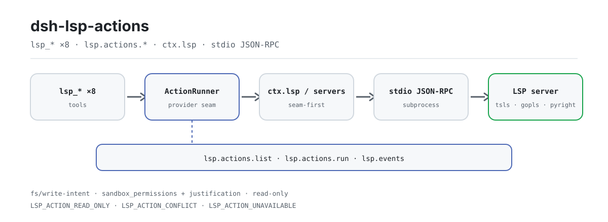

<div align="center">

<picture>
  <source media="(prefers-color-scheme: dark)" srcset="docs/assets/dsh-lsp-actions-flow-dark.svg">
  
</picture>

# dsh-lsp-actions

**Let your agent write and fix code against real language servers — diagnostics, formatting, completion, code actions, symbols, signature help, inlay hints, and rename in one action surface.**

The LSP action surface for DeepSeek Harness: the official `ctx.lsp` seam covers navigation, this plugin completes the action loop, and the stable editor action protocol (`lsp.actions.*`) lets editors such as VS Code use it as their IDE backend.

[Install](#three-step-setup) · [Configuration](#configuration) · [FAQ](#faq) · [简体中文](README.md) · [English](README.en.md) · [Español](README.es.md) · [Português](README.pt.md) · [हिन्दी](README.hi.md)

[](LICENSE)
[](#compatibility)
[](https://www.npmjs.com/package/dsh-lsp-actions)
[](https://github.com/PerryLink/dsh-lsp-actions/actions/workflows/ci.yml)
[](#compatibility)

[](https://github.com/PerryLink/dsh-lsp-actions/stargazers)
[](https://www.npmjs.com/package/dsh-lsp-actions)
[](https://dshfind.com/plugins/PerryLink/dsh-lsp-actions?ref=badge)
[](https://securityscorecards.dev/viewer/?uri=github.com/PerryLink/dsh-lsp-actions)
[](https://dsh.market/)
[](https://gitee.com/perrylink/dsh-lsp-actions)

```sh
dsh plugin --profile <name> add dsh-lsp-actions
```

</div>

<sub>Community plugin, not affiliated with DeepSeek. Canonical repository: <https://github.com/PerryLink/dsh-lsp-actions> (Gitee is a mirror).</sub>

## What it is

`dsh-lsp-actions` connects the feedback loop an agent needs while it writes code to real language servers: diagnostics, formatting, completion, code actions, symbols, signature help, inlay hints, and rename are answered by the same servers your IDE uses (`typescript-language-server`, gopls, pyright, rust-analyzer, ...). The official `ctx.lsp` seam covers navigation (go-to-definition, references, implementation, hover) only; this plugin completes the action surface — and packages it as the stable editor action protocol (`lsp.actions.*`), so editors such as VS Code can consume those capabilities without implementing LSP themselves. It mounts as a single host row (`id: lsp-actions`, `inject: [tools, fs, subprocess]`), spawns server processes lazily, and routes every write through the official `fs/write-intent` waterfall and sandbox approval.

## Three-step setup

1. **Install** (pick one channel):

   ```sh
   # git channel (latest main; the prepare script builds lib/ with tsc)
   dsh plugin --profile web add github:PerryLink/dsh-lsp-actions
   # npm channel (published releases)
   dsh plugin --profile web add dsh-lsp-actions
   # tarball channel: pnpm pack in this repo, then
   dsh plugin --profile web add ./dsh-lsp-actions-<version>.tgz
   ```

2. **Minimal config** (the default `servers: {}` activates no server; add at least one entry):

   ```yaml
   - insert:
       - id: lsp-actions
         name: dsh-lsp-actions
         config:
           servers:
             typescript:
               command: typescript-language-server
               args: ["--stdio"]
               extensionToLanguage: { ".ts": typescript, ".tsx": typescriptreact }
               projectMarkers: ["package.json", "tsconfig.json"]
   ```

3. **Verify it mounts**:

   ```sh
   dsh --profile web --dump-config | grep -A3 'id: lsp-actions'
   ```

   ```text
   > lsp_diagnostics a.ts
   a.ts:1:3  [Error] boom [ts 2304]
   ```

**Uninstall**: `dsh plugin --profile web remove dsh-lsp-actions` (or remove the row from the profile patch).

<details>
<summary>Install from the DSH Desktop market</summary>

Every PerryLink plugin is listed in the built-in DSH Desktop market: **Market → Sources → Add source → paste** `https://perrylink-dsh-catalog.perrylink.workers.dev/catalog-source.json` **→ select**. Installation still requires the market's npm identity check and your confirmation.

</details>

## Core capabilities

This plugin completes the **action surface** only: navigation still comes from the official `ctx.lsp` seam, and actions fall back to the plugin's own minimal stdio client when the seam is absent, of an older vintage, or has no provider for that file.

- **Eight `lsp_*` tools** — diagnostics, formatting, completion, code actions, symbols, signature help, inlay hints, and rename, all answered by real language servers rather than mocks.
- **Editor action protocol v1** — a stable JSON-RPC surface (`lsp.actions.list` / `lsp.actions.run` / `lsp.events`) that lets any editor (VS Code first) consume those capabilities directly.
- **Real-server verification** — the test suite includes a real `typescript-language-server` run and an editor-protocol e2e; CI runs it on Node 22/24 across Linux, Windows, and macOS.
- **Writes ride the official path** — `lsp_format` / `lsp_rename` go through the `fs/write-intent` waterfall and the per-call sandbox policy; a read-only session is refused before any server round-trip.
- **Read-only by default** — six of the eight tools are reference-only; only formatting and rename mutate.
- **Bounded** — result counts, characters, document bytes, and per-call time all have caps; the diagnostics cache is a bounded LRU.

```text
lsp_diagnostics / lsp_format / lsp_completion / lsp_code_action /
lsp_symbols / lsp_signature / lsp_inlay_hints / lsp_rename
        │
        ▼
   ctx.lsp seam (extended: diagnostics / formatDocument / completion)
        │  absent · legacy · no provider for this file
        ▼
   built-in stdio client  ←  servers table (ctx.subprocess.spawn + JSON-RPC)
```

### Tools & surfaces

| Surface | Kind | Notes |
|---|---|---|
| `lsp_diagnostics` | tool | `<file>` — compiler/analyzer errors, warnings, and hints with severity, range, message, and source server (read-only) |
| `lsp_format` | tool | `<file> [range?]` — formats a file/selection through the language server and applies it, returning the diff (writes via `fs/write-intent`) |
| `lsp_completion` | tool | `<file> <line> <character>` — completion suggestions at a cursor position, including the insertion text (read-only) |
| `lsp_code_action` | tool | `<file> [range?] [only?]` — server-verified quickfixes/refactorings with their edits, for a range or the first diagnostic (reference-only) |
| `lsp_symbols` | tool | `<query?> <file_path?>` — workspace-wide symbol search by name, or one file's outline (read-only) |
| `lsp_signature` | tool | `<file> <line> <character>` — signature help (parameters and documentation) inside a call (read-only) |
| `lsp_inlay_hints` | tool | `<file> [range?]` — type annotations and parameter-name hints from the server (read-only) |
| `lsp_rename` | tool | `<file> <line> <character> <new_name>` — server-verified rename, applied workspace-wide with per-file diffs (writes via `fs/write-intent`) |
| `lsp.actions.*` | protocol | Editor action protocol v1: `lsp.actions.list` / `lsp.actions.run` / `lsp.events` over JSON-RPC |
| `examples/vscode/` | extension | UI-only VS Code extension plus the headless backend composition it connects to |

### Examples

These are the plugin's real entry points; install once, then call one.

**Detailed example** — command `lsp_diagnostics`, input:

```json
{
  "file_path": "a.ts"
}
```

Output:

```text
a.ts:1:3  [Error] boom [ts 2304]
a.ts:3:1  [Hint] hint
```

*Observed from `plugins/dsh-lsp-actions/tests/render.spec.ts:32-37 (exact toBe); tool-level no-result render at plugins/dsh-lsp-actions/tests/tools.spec.ts:150-156`*

**Failure branch** — input:

```text
{"action":"format","requestId":"f1","params":{"filePath":"a.ts","workspaceRoot":"<session-workspace>"}} under a read-only permission preset
```

Output:

```text
{
  "requestId": "f1",
  "action": "format",
  "status": "failed",
  "error": {
    "code": "LSP_ACTION_READ_ONLY",
    "message": "[sandbox: file access denied under read-only mode]\n[sandbox: escalation available — retry this exact operation once with sandbox_permissions (the narrowest wider mode that suffices) + justification; the approval prompt asks the user]"
  }
}
```

*Observed from `plugins/dsh-lsp-actions/src/tools.ts:213-223; plugins/dsh-lsp-actions/src/editor/actions.ts:320-330; plugins/dsh-lsp-actions/tests/editor-protocol.spec.ts:305-325`*

**Brief examples**: `lsp_format` · `lsp_completion`

### Editor action protocol v1

When `editor.enabled: true` is set in a dedicated headless composition, `dsh-lsp-actions` serves a stable editor protocol over newline-delimited JSON-RPC 2.0 (the same wire framing as the official SDK/ACP transports):

| Method | What it does |
|---|---|
| `lsp.actions.list` | Returns the `lsp-actions/v1` protocol version, the action catalog (`diagnostics.get`, `completion.get`, `quickfix.apply`, `format` — each flagged `writes`), and the addressable DSH sessions |
| `lsp.actions.run` | Executes one action with a structured `{ requestId, action, status, result \| error }` envelope; errors carry the stable `LSP_ACTION_*` codes |
| `lsp.events` | Subscribes to the streamed `lsp.event` notifications: `diagnostics.updated`, `action.status`, `file.changed`, `sessions.changed` |

All write actions (`quickfix.apply`, `format`) go through the **official permission presets and approval**: a `read-only` session is refused with `LSP_ACTION_READ_ONLY` before any server round-trip, edits ride the `fs/write-intent` waterfall, and the `sandbox_permissions` + `justification` escalation pair resolves through the official `approveEscalation` ask (fail-closed when no answerer can decide). Full wire spec, bilingual: [`docs/editor-protocol.md`](docs/editor-protocol.md) · [`docs/editor-protocol.zh-CN.md`](docs/editor-protocol.zh-CN.md).

**Versioning and the backward-compatibility promise**

- The protocol is versioned — `lsp.actions.list` returns `protocol: "lsp-actions/v1"`, `version: 1`. **v1 is frozen:** field names, action ids, event kinds, and error codes stay stable forever.
- Evolution is **additive only**: new actions, fields, and event kinds arrive without a version bump; existing semantics never change in place; a breaking change ships under a new `protocol` version, which servers may serve side by side.
- Clients must ignore unknown fields, unknown event kinds, and unknown actions, and route on the stable error `code`, never on message text.

**Error codes**

Every failure carries a stable `code`; models and callers route on the code, never on message text.

| Code | Meaning |
|---|---|
| `LSP_ACTION_UNAVAILABLE` | No server entry and no seam provider handles this file |
| `LSP_ACTION_UNSUPPORTED` | The server (or seam provider) does not advertise the operation |
| `LSP_ACTION_SERVER_FAILED` | The server failed (with its stderr tail); startup failures retry once |
| `LSP_ACTION_MALFORMED_RESPONSE` | The server sent a structurally invalid payload |
| `LSP_ACTION_CONFLICT` | The file changed since it was read, or the edits overlap / go out of bounds / leave the workspace |
| `LSP_ACTION_READ_ONLY` | The session's sandbox mode forbids the formatting/rename write |
| `LSP_ACTION_WORKSPACE_REQUIRED` | The calling session has no workspace cwd to root the server in |
| `LSP_ACTION_NO_SYMBOL` | The server found no renameable symbol at the cursor position |
| `LSP_ACTION_UNKNOWN` | Editor protocol: unknown action id, or no code action matched `title`/`index` |
| `LSP_ACTION_INVALID_ARGS` | Editor protocol: malformed action parameters |
| `LSP_ACTION_APPROVAL_UNAVAILABLE` | Editor protocol: the approval path could not grant a wider sandbox mode (fail-closed) |
| `LSP_PROTOCOL_VERSION_UNSUPPORTED` | Editor protocol: the declared protocol version is not supported |

### VS Code extension

[`examples/vscode/`](examples/vscode/) ships a **UI-only** extension (sidebar with the DSH sessions, the diagnostics list, one-click quickfix apply, open-at-range, and format) plus the headless backend composition (`backend/cordis.yml`) it connects to over ACP-style JSON-RPC. The extension implements zero LSP logic — every capability and every byte written belongs to the plugin. Install steps, settings, and the demo-gif recording script are in [`examples/vscode/README.md`](examples/vscode/README.md).

### Architecture

Actions run **official-seam-first** and fall back to the plugin's own minimal stdio client. The seam extension is proposed upstream ([`upstream/lsp-action-seam.patch`](upstream/lsp-action-seam.patch), PR description in [`upstream/PR-description.md`](upstream/PR-description.md)); once it lands, the plugin keeps working unchanged — the built-in client simply stops being used. The built-in client stays as the standalone fallback for the `servers` table. The **editor protocol** rides the same runner, the same write path, and the same permission machinery.

The action backend is behind a public provider interface — `ActionRunner` (exported from the package) — implemented by the bundled runner and open to third-party providers: the eight tools consume only that interface, never a concrete client. Full research and design notes: [`docs/seam-extension-notes.md`](docs/seam-extension-notes.md).

## Configuration

All tunables are Schemastery `Config` fields (changeable from cordis.yml). An id-targeted override replaces the whole row — restate every key you need. `cordis.patch.yml` documents each key inline.

Most-used keys:

| Key | Default | Meaning |
|---|---|---|
| `servers` | `{}` | Named language servers; an empty table activates no servers |
| `editor.enabled` | `false` | Serve the editor action protocol over JSON-RPC stdio (headless backend only) |
| `maxDiagnostics` | `200` | Diagnostics cap per result |
| `maxResultChars` | `16000` | Rendered-result cap (chars) |
| `maxDocumentBytes` | `4000000` | Document-read cap (bytes) |
| `timeoutMs` | `60000` | Per-call timeout, enforced by the official timeout policy |

<details>
<summary>Full configuration table (13 keys)</summary>

| Key | Default | Meaning |
|---|---|---|
| `servers` | `{}` | Named language servers; an empty table activates no servers |
| `editor.enabled` | `false` | Serve the editor action protocol over JSON-RPC stdio (headless backend only) |
| `editor.requestTimeoutMs` | `60000` | Per-run timeout budget (ms) for the editor protocol |
| `editor.diagnosticsCacheMaxFiles` | `64` | Bounded LRU diagnostics-cache size (files) |
| `maxDiagnostics` | `200` | Diagnostics cap per result |
| `maxCompletionItems` | `20` | Completion-items cap per result |
| `maxCodeActions` | `50` | Code-actions cap per result |
| `maxSymbols` | `100` | Symbol-results cap |
| `maxSignatures` | `10` | Signature-help cap |
| `maxInlayHints` | `200` | Inlay-hints cap |
| `maxResultChars` | `16000` | Rendered-result cap (chars) |
| `maxDocumentBytes` | `4000000` | Document-read cap (bytes) |
| `timeoutMs` | `60000` | Per-call timeout, enforced by the official timeout policy |

</details>

Each `servers` entry is an `LspServerEntry`: `command` (executable resolved on PATH at load) and `extensionToLanguage` (`".ts"` → `typescript`) are required; optional `fileGlobs`, `projectMarkers`, `args`, `env`, `initializationOptions`, `configuration`, `formattingOptions`, `maxMessageBytes`, `maxStderrBytes`, `killGraceMs`, `shutdownTimeoutMs`, `diagnosticsSettleMs`, `diagnosticsDebounceMs`, and `idleTimeoutMs` (`0` = keep the server process alive, which is also the default) tune the built-in stdio client.

Routing is deterministic and configuration-driven. Every file takes the first match from: **(1)** a server entry whose `fileGlobs` match the path; **(2)** the nearest ancestor directory — walking up to the workspace root — that holds a project config file listed in some entry's `projectMarkers`, matched against the entries that also map the file's extension; **(3)** the entry whose `extensionToLanguage` maps the file's extension, in config order. A workspace holding `apps/node-app/{package.json,tsconfig.json,src/main.ts}` and `apps/deno-app/{deno.json,src/main.ts}` therefore serves each `main.ts` from its own project's server, with no path rule to maintain and nothing to change when a project is added, renamed, or moved:

```yaml
servers:
  typescript:
    command: typescript-language-server
    args: ["--stdio"]
    extensionToLanguage: { ".ts": typescript, ".tsx": typescriptreact }
    projectMarkers: ["package.json", "tsconfig.json"]
  deno:
    command: deno
    args: ["lsp"]
    extensionToLanguage: { ".ts": typescript, ".tsx": typescriptreact }
    projectMarkers: ["deno.json", "deno.jsonc"]
```

A project marker only decides among servers that already map the file's extension (it never widens an entry's file types); the walk never leaves the workspace root, and a project config in one directory never applies to a sibling directory. Step **(1)** outranks a project marker: an entry whose `fileGlobs` match the path still wins, so drop project-level globs when you adopt `projectMarkers` — a lingering `**/*.ts` glob keeps claiming those files. These rules govern the built-in stdio client — a mounted `ctx.lsp` seam provider decides its own routing.

## FAQ

<details>
<summary>What happens with the default <code>servers: {}</code>? Silent breakage?</summary>

Nothing is silent. The eight tools stay registered, but a call fails loudly with `LSP_ACTION_UNAVAILABLE` when neither a server entry nor a `ctx.lsp` seam provider handles the file. The seam is resolved per call, so a seam mounted after this plugin is served without a reload. With `editor.enabled: false` (the default) the editor protocol does not start at all.

</details>

<details>
<summary>Can a write bypass the sandbox and approval?</summary>

No. Only `lsp_format` and `lsp_rename` write, and they ride the same path as the official `write`/`edit` tools: the `fs/write-intent` waterfall (observation → guarded write → observation) and the per-call sandbox policy. A `read-only` session is refused with `LSP_ACTION_READ_ONLY` before any server round-trip; when a wider mode is needed, the `sandbox_permissions` + `justification` escalation pair goes through the official `approveEscalation` ask, and fails closed as `LSP_ACTION_APPROVAL_UNAVAILABLE` when no answerer can decide.

</details>

<details>
<summary>Does it fight other plugins over tool names, events, or slots?</summary>

No. Every tool is namespaced, it provides no service key, registers no client slot and no `webServer` prefix, and mutates no globals; the bundle patch only `insert`s its own row; the one shared event, `fs/write-intent`, is always delegated through `next()` and never short-circuits the chain. The point-by-point argument is in "Interoperability with other DSH plugins".

</details>

<details>
<summary>What if the file changes on disk after I read it?</summary>

It is never clobbered. An action fails with `LSP_ACTION_CONFLICT` when the file changed since it was read; overlapping, out-of-bounds, or out-of-workspace edits conflict the same way. `lsp_rename` pre-flights every edited file before the first write.

</details>

<details>
<summary>How big is the resource overhead?</summary>

Server processes are spawned lazily and each instance keeps its documents resident until the process is reclaimed; `idleTimeoutMs` defaults to `0` (stay alive), and a positive value reclaims the instance when idle. Result counts, characters, document bytes, and total duration are capped per call; the editor protocol's diagnostics cache is a bounded LRU (`editor.diagnosticsCacheMaxFiles`); the plugin makes no network requests.

</details>

## Security boundaries

- **Read-only by default.** Six of the eight tools are reference-only; only `lsp_format` and `lsp_rename` mutate, and they do so as real `write`/`edit` mutations.
- **Official seams, not re-implemented.** Every byte goes through the `fs/write-intent` waterfall (observation → guarded write → observation) and the per-call sandbox policy; escalation matches the official `write`/`edit` tools.
- **Fail loud, fast, structured.** Empty `servers` + no `ctx.lsp` seam → `LSP_ACTION_UNAVAILABLE`; read-only sessions → `LSP_ACTION_READ_ONLY` before any server round-trip; command forms are reported and never executed.
- **Conflicts never clobber.** A file changed on disk after it was read fails with `LSP_ACTION_CONFLICT`; `lsp_rename` pre-flights every edited file before the first write.
- **Bounded work.** Result caps, byte caps, and the platform's timeout policy bound every call; the diagnostics cache is a bounded LRU.
- **Nothing cached on the model path.** Tool results live only in the session log; the diagnostics cache never persists across restarts.
- **Bad servers fail loudly.** A missing executable fails at load; a server that dies at startup fails the call with `LSP_ACTION_SERVER_FAILED` plus its stderr tail (after one fresh-spawn retry).
- **Prompt hygiene.** The plugin injects no persona or prompt prose into the session system prompt — its model-facing surface is the eight tool schemas.

## Permissions & data

- **Permissions**: formatting and rename ride the official permission presets and approval — the `fs/write-intent` waterfall and the `sandbox_permissions` / `justification` escalation pair resolved through `ctx.approval`. The plugin declares `fs:read`, `fs:write`, `subprocess:spawn`, and `network:none` in its workshop manifest.
- **Data**: nothing is stored on disk; tool results live only in the session log (no cross-session persistence). The editor protocol keeps one bounded in-memory LRU diagnostics cache, freshness-stamped and never persisted across restarts. See [`PRIVACY.md`](PRIVACY.md) for the privacy note.
- **No network**: the plugin makes no network requests; it talks to language servers over local subprocess stdio.

## Known limitations

- **Resident documents.** Each document opens once and stays open for the server instance's lifetime — a later request with changed source sends one full-document `didChange`, and the process shutdown closes every document — so project-based servers like tsls serve `textDocument/signatureHelp` and document-free `workspace/symbol` instead of answering `null` on a freshly-closed document. The resident set is bounded by the workspace and cleared with the instance (idle eviction or plugin disposal).
- **Range formatting requires the server's range provider.** Servers that only advertise whole-document formatting fail range requests with `LSP_ACTION_UNSUPPORTED`.
- **Rename applies text edits only.** Resource operations (create/delete/rename files) in a server's rename answer are refused with `LSP_ACTION_UNSUPPORTED`, and edits outside the workspace fail as `LSP_ACTION_CONFLICT` before anything is written.

## Interoperability with other DSH plugins

Verified against **DSH `0.2.0-rc.2`** (the runtime this README ships for) and the high-star plugin set surveyed on 2026-10-05.

This plugin **does not interfere** with other plugins, including the widely installed high-star ones:

- **No tool-name collision.** Every tool is namespaced; no bare name owned by a shipped tool or another plugin is registered.
- **No service-key collision.** It provides no service key at all, so it cannot collide on one.
- **No slot collision.** It registers no client slot key, so it cannot contend for a `shadows-shipped-ui` seat.
- **No HTTP route collision.** It registers no `webServer` prefix.
- **No patch-layer collision.** The bundle patch only `insert`s its own row; it never overrides a built-in row's `config`.
- **No global mutation.** It does not patch prototypes, rewrite `process.env`, or replace the global fetch dispatcher.

**Shared event listeners are non-interfering by construction.** It observes the ordering-sensitive event `fs/write-intent` with `ctx.on()` — Cordis's broadcast registration, where every listener runs and none can starve another. **Every listener here delegates through `next()`**, so the chain is never short-circuited, and a mutation is applied to the value `next()` produced rather than returned in its place.

Static evidence: `dsh-plugin-doctor` K10–K13 report `pass` for every check on this repository.

## Compatibility

| Surface | Status |
|---|---|
| Harness | DeepSeek Harness `dsh-v0.2.1-alpha.1` (`engines.dsh`: `>=0.2.1-0 <0.3.0 \|\| >=0.2.2-0 <0.3.0`); the plugin writes no session events itself — the host records the standard tool/call + tool/result events. The released seam still carries only the four legacy operations, so the plugin keeps its own client and records that vintage on the first action call. Verified 2026-09-24 (dual typecheck rulers + full test suite + self-contained/artifacts gates). |
| Node | `^22.19.0 \|\| >=24.9.0` |
| Platforms | All (pure host; subprocess + filesystem, no network) |
| Model | Any (tools are model-agnostic; the plugin never calls a model) |

## Ecosystem & quality

- [Gitee mirror](https://gitee.com/perrylink/dsh-lsp-actions) (sync mirror; GitHub is canonical)
- [dshfind plugin page](https://dshfind.com/plugins/PerryLink/dsh-lsp-actions) (installs and ranking)
- [OpenSSF Scorecard report](https://securityscorecards.dev/viewer/?uri=github.com/PerryLink/dsh-lsp-actions) (driven by [.github/workflows/scorecard.yml](.github/workflows/scorecard.yml))
- [dsh-plugin-doctor verification report](https://github.com/PerryLink/dsh-plugin-doctor#verified-徽章) (K10–K13 all `pass`)
- [DSH Market](https://dsh.market/) (listed)
- **1024 store channel**: `npm i -g dsh1024` once, then `dsh1024 plugin --profile web add dsh-lsp-actions` (counts toward the [deepseek1024.com](https://deepseek1024.com) install ranking)
- [Ecosystem knowledge base](https://perrylink.github.io/dsh-plugin-guide/) — measured data, not marketing: plugin development guide · plugin-selection data · maintenance criteria

## Development

```sh
pnpm install            # node ^22.19 || >=24.9
pnpm run lint           # oxlint over src/ and tests/
pnpm test               # vitest: unit + fixture-server integration + editor-protocol e2e + real tsls e2e
pnpm run test:coverage  # coverage gate
pnpm build              # tsc --noEmitOnError && node scripts/fix-dts.mjs → lib/
pnpm run prepare        # build (runs on install)
pnpm run prepublishOnly # build (runs before publish)
pnpm run check:readmes  # five-language README consistency gate
pnpm run verify:self-contained  # dependency specs resolve from the registry
pnpm run verify:artifacts       # shipped files present + artifacts importable
pnpm run check:lockfile         # lockfile drift check
```

Repository layout:

```text
src/            plugin body: servers / client / runner / tools / editor / seam
tests/          vitest: unit + fixture server + editor-protocol e2e + real tsls e2e
examples/vscode UI-only VS Code extension + the headless backend it connects to
docs/           editor protocol (bilingual) + seam-extension research + assets/
scripts/        build-artifact fixes and mechanical gates (readme sync / self-contained / artifacts)
upstream/       upstream proposal for the seam extension (patch + PR description)
verify/         editor-backend smoke scripts and scratch composition
```

The README images are generated programmatically by [`scripts/gen-readme-assets.py`](scripts/gen-readme-assets.py) (Python + Pillow; light and dark SVG heroes) and are safe to re-run.

Topics: `dsh`, `dsh-plugin`, `deepseek-harness`, `lsp`, `language-server`, `diagnostics`, `formatting`, `completion`, `code-action`, `symbols`, `signature-help`, `inlay-hints`, `rename`, `refactor`, `ide`, `editor`, `vscode`, `acp`, `json-rpc`

## Family & thanks

This project is part of the DeepSeek Harness plugin family from [PerryLink](https://github.com/PerryLink) (all Apache-2.0). If it is useful, **a star helps the next person find it** — nothing is gated behind it.

- [@PerryLink](https://github.com/PerryLink) — creator and maintainer: the LSP action client and server lifecycle, all eight tools, the editor action protocol, tests, CI, and the five-language docs.

<details>
<summary>Expand all plugins</summary>

| Plugin | Status |
|---|---|
| **[dsh-aqua-input-check](https://github.com/PerryLink/dsh-aqua-input-check)** |  |
| **[dsh-archive-check](https://github.com/PerryLink/dsh-archive-check)** |  |
| **[dsh-auto-review](https://github.com/PerryLink/dsh-auto-review)** |  |
| **[dsh-autotier](https://github.com/PerryLink/dsh-autotier)** | 🧊 FROZEN — see the repo README |
| **[dsh-bid-ca-precheck](https://github.com/PerryLink/dsh-bid-ca-precheck)** |  |
| **[dsh-bid-qual-check](https://github.com/PerryLink/dsh-bid-qual-check)** |  |
| **[dsh-cert-mcp](https://github.com/PerryLink/dsh-cert-mcp)** | 🧊 FROZEN — see the repo README |
| **[dsh-checkpoint-rewind](https://github.com/PerryLink/dsh-checkpoint-rewind)** |  |
| **[dsh-click](https://github.com/PerryLink/dsh-click)** |  |
| **[dsh-composer-history](https://github.com/PerryLink/dsh-composer-history)** |  |
| **[dsh-contract-stance](https://github.com/PerryLink/dsh-contract-stance)** |  |
| **[dsh-customs-doc-check](https://github.com/PerryLink/dsh-customs-doc-check)** |  |
| **[dsh-data-quality](https://github.com/PerryLink/dsh-data-quality)** | 🧊 FROZEN — see the repo README |
| **[dsh-demurrage-ledger](https://github.com/PerryLink/dsh-demurrage-ledger)** |  |
| **[dsh-doublecheck](https://github.com/PerryLink/dsh-doublecheck)** |  |
| **[dsh-drill-script-check](https://github.com/PerryLink/dsh-drill-script-check)** |  |
| **[dsh-eia-guide-check](https://github.com/PerryLink/dsh-eia-guide-check)** |  |
| **[dsh-emergency-plan](https://github.com/PerryLink/dsh-emergency-plan)** |  |
| **[dsh-essay-rubric-check](https://github.com/PerryLink/dsh-essay-rubric-check)** |  |
| **[dsh-evidence-check](https://github.com/PerryLink/dsh-evidence-check)** |  |
| **[dsh-export-ctl-check](https://github.com/PerryLink/dsh-export-ctl-check)** |  |
| **[dsh-fast](https://github.com/PerryLink/dsh-fast)** |  |
| **[dsh-fmea-table-check](https://github.com/PerryLink/dsh-fmea-table-check)** |  |
| **[dsh-forecast-penalty](https://github.com/PerryLink/dsh-forecast-penalty)** |  |
| **[dsh-fund-research](https://github.com/PerryLink/dsh-fund-research)** |  |
| **[dsh-github](https://github.com/PerryLink/dsh-github)** |  |
| **[dsh-gongwen-flow-check](https://github.com/PerryLink/dsh-gongwen-flow-check)** |  |
| **[dsh-gongwen-word-check](https://github.com/PerryLink/dsh-gongwen-word-check)** |  |
| **[dsh-guard-plan-qc](https://github.com/PerryLink/dsh-guard-plan-qc)** |  |
| **[dsh-hazchem-check](https://github.com/PerryLink/dsh-hazchem-check)** |  |
| **[dsh-hazplan-check](https://github.com/PerryLink/dsh-hazplan-check)** |  |
| **[dsh-hidden-risk-map](https://github.com/PerryLink/dsh-hidden-risk-map)** |  |
| **[dsh-hs-classify](https://github.com/PerryLink/dsh-hs-classify)** |  |
| **[dsh-icd-rule-check](https://github.com/PerryLink/dsh-icd-rule-check)** |  |
| **[dsh-industry-research](https://github.com/PerryLink/dsh-industry-research)** |  |
| **[dsh-lawcite-adapter](https://github.com/PerryLink/dsh-lawcite-adapter)** |  |
| **[dsh-laya](https://github.com/PerryLink/dsh-laya)** |  |
| **[dsh-lc-doc-check](https://github.com/PerryLink/dsh-lc-doc-check)** |  |
| **[dsh-learning-gap-check](https://github.com/PerryLink/dsh-learning-gap-check)** |  |
| **[dsh-library](https://github.com/PerryLink/dsh-library)** |  |
| **[dsh-local-ai](https://github.com/PerryLink/dsh-local-ai)** |  |
| **[dsh-lsp-actions](https://github.com/PerryLink/dsh-lsp-actions)** |  |
| **[dsh-mask](https://github.com/PerryLink/dsh-mask)** |  |
| **[dsh-mcp-panel](https://github.com/PerryLink/dsh-mcp-panel)** |  |
| **[dsh-medrec-qc](https://github.com/PerryLink/dsh-medrec-qc)** |  |
| **[dsh-memento](https://github.com/PerryLink/dsh-memento)** | 🧊 FROZEN — see the repo README |
| **[dsh-nsfc-form-check](https://github.com/PerryLink/dsh-nsfc-form-check)** |  |
| **[dsh-nurse-record-check](https://github.com/PerryLink/dsh-nurse-record-check)** |  |
| **[dsh-observe](https://github.com/PerryLink/dsh-observe)** |  |
| **[dsh-origin-rvc-check](https://github.com/PerryLink/dsh-origin-rvc-check)** |  |
| **[dsh-ota-review-check](https://github.com/PerryLink/dsh-ota-review-check)** |  |
| **[dsh-output-styles](https://github.com/PerryLink/dsh-output-styles)** |  |
| **[dsh-paper-doc-adapter](https://github.com/PerryLink/dsh-paper-doc-adapter)** |  |
| **[dsh-permission-rules](https://github.com/PerryLink/dsh-permission-rules)** |  |
| **[dsh-permit-report-check](https://github.com/PerryLink/dsh-permit-report-check)** |  |
| **[dsh-pipeline-check](https://github.com/PerryLink/dsh-pipeline-check)** |  |
| **[dsh-pleading-draft](https://github.com/PerryLink/dsh-pleading-draft)** |  |
| **[dsh-plugin-doctor](https://github.com/PerryLink/dsh-plugin-doctor)** | 🚫 RETIRED (repo archived) |
| **[dsh-plugin-guide](https://github.com/PerryLink/dsh-plugin-guide)** |  |
| **[dsh-plugin-kit](https://github.com/PerryLink/dsh-plugin-kit)** | 🚫 RETIRED (repo archived) |
| **[dsh-plugin-upgrade](https://github.com/PerryLink/dsh-plugin-upgrade)** | 🚫 RETIRED (repo archived) |
| **[dsh-policy-brief-draft](https://github.com/PerryLink/dsh-policy-brief-draft)** |  |
| **[dsh-power-loss-split](https://github.com/PerryLink/dsh-power-loss-split)** |  |
| **[dsh-power-ticket-check](https://github.com/PerryLink/dsh-power-ticket-check)** |  |
| **[dsh-ppap-check](https://github.com/PerryLink/dsh-ppap-check)** |  |
| **[dsh-protest-deadline](https://github.com/PerryLink/dsh-protest-deadline)** |  |
| **[dsh-railway-window](https://github.com/PerryLink/dsh-railway-window)** |  |
| **[dsh-repair-order-qc](https://github.com/PerryLink/dsh-repair-order-qc)** |  |
| **[dsh-research-report](https://github.com/PerryLink/dsh-research-report)** |  |
| **[dsh-review-reply-check](https://github.com/PerryLink/dsh-review-reply-check)** |  |
| **[dsh-rulefile-check](https://github.com/PerryLink/dsh-rulefile-check)** |  |
| **[dsh-safety-brief-check](https://github.com/PerryLink/dsh-safety-brief-check)** |  |
| **[dsh-score](https://github.com/PerryLink/dsh-score)** | 🧊 FROZEN — see the repo README |
| **[dsh-session-sync](https://github.com/PerryLink/dsh-session-sync)** |  |
| **[dsh-site-log-check](https://github.com/PerryLink/dsh-site-log-check)** |  |
| **[dsh-skill-pack-security](https://github.com/PerryLink/dsh-skill-pack-security)** |  |
| **[dsh-soe-decision-check](https://github.com/PerryLink/dsh-soe-decision-check)** |  |
| **[dsh-soilwater-check](https://github.com/PerryLink/dsh-soilwater-check)** |  |
| **[dsh-sop-sync-check](https://github.com/PerryLink/dsh-sop-sync-check)** |  |
| **[dsh-spc-gbt-adapter](https://github.com/PerryLink/dsh-spc-gbt-adapter)** |  |
| **[dsh-talk](https://github.com/PerryLink/dsh-talk)** |  |
| **[dsh-tender-extract](https://github.com/PerryLink/dsh-tender-extract)** |  |
| **[dsh-tender-matrix](https://github.com/PerryLink/dsh-tender-matrix)** |  |
| **[dsh-test-drive](https://github.com/PerryLink/dsh-test-drive)** |  |
| **[dsh-ticktick](https://github.com/PerryLink/dsh-ticktick)** | 🚫 RETIRED (repo archived) |
| **[dsh-translate](https://github.com/PerryLink/dsh-translate)** |  |
| **[dsh-warranty-calc](https://github.com/PerryLink/dsh-warranty-calc)** |  |
| **[dsh-budget](https://github.com/PerryLink/dsh-budget)** | 🧊 FROZEN — see the repo README |
| **[dsh-claude-move](https://github.com/PerryLink/dsh-claude-move)** | 🧊 FROZEN — see the repo README |
| **[dsh-defend](https://github.com/PerryLink/dsh-defend)** | 🧊 FROZEN — see the repo README |
| **[dsh-draw](https://github.com/PerryLink/dsh-draw)** | 🧊 FROZEN — see the repo README |
| **[dsh-reach](https://github.com/PerryLink/dsh-reach)** | 🧊 FROZEN — see the repo README |
| **[dsh-background-agents](https://github.com/PerryLink/dsh-background-agents)** | 🚫 RETIRED (repo archived) |
| **[dsh-session-pin](https://github.com/PerryLink/dsh-session-pin)** | 🚫 RETIRED (repo archived) |
| **[dsh-team-rooms](https://github.com/PerryLink/dsh-team-rooms)** | 🚫 RETIRED (repo archived) |

</details>

## License

[LICENSE](LICENSE) (Apache License 2.0) © 2026 dsh-lsp-actions contributors

<p align="center"><sub>Apache-2.0 · Community plugin, not affiliated with DeepSeek.</sub></p>
