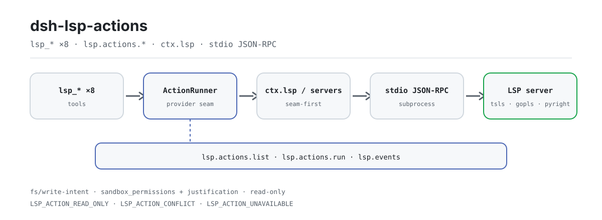

<div align="center">

<picture>
  <source media="(prefers-color-scheme: dark)" srcset="docs/assets/dsh-lsp-actions-flow-dark.svg">
  
</picture>

# dsh-lsp-actions

**Deja que tu agente escriba y corrija código contra servidores de lenguaje reales: diagnósticos, formato, autocompletado, acciones de código, símbolos, ayuda de firma, sugerencias en línea y renombrado en una sola superficie de acciones.**

La superficie de acciones LSP para DeepSeek Harness: el seam oficial `ctx.lsp` cubre la navegación, este plugin completa el bucle de acciones y el protocolo estable de acciones del editor (`lsp.actions.*`) permite que editores como VS Code lo usen como backend de IDE.

[Instalar](#instalación-en-tres-pasos) · [Configuración](#configuración) · [FAQ](#faq) · [简体中文](README.md) · [English](README.en.md) · [Español](README.es.md) · [Português](README.pt.md) · [हिन्दी](README.hi.md)

[](LICENSE)
[](#compatibilidad)
[](https://www.npmjs.com/package/dsh-lsp-actions)
[](https://github.com/PerryLink/dsh-lsp-actions/actions/workflows/ci.yml)
[](#compatibilidad)

[](https://github.com/PerryLink/dsh-lsp-actions/stargazers)
[](https://www.npmjs.com/package/dsh-lsp-actions)
[](https://dshfind.com/plugins/PerryLink/dsh-lsp-actions?ref=badge)
[](https://securityscorecards.dev/viewer/?uri=github.com/PerryLink/dsh-lsp-actions)
[](https://dsh.market/)
[](https://gitee.com/perrylink/dsh-lsp-actions)

```sh
dsh plugin --profile <name> add dsh-lsp-actions
```

</div>

<sub>Plugin de la comunidad, no afiliado a DeepSeek. Repositorio canónico: <https://github.com/PerryLink/dsh-lsp-actions> (Gitee es un espejo).</sub>

## Qué es

`dsh-lsp-actions` conecta el bucle de retroalimentación que un agente necesita mientras escribe código con servidores de lenguaje reales: diagnósticos, formato, autocompletado, acciones de código, símbolos, ayuda de firma, sugerencias en línea y renombrado los responde el mismo servidor que usa tu IDE (`typescript-language-server`, gopls, pyright, rust-analyzer…). El seam oficial `ctx.lsp` cubre solo la navegación (ir a definición, referencias, implementación, hover); este plugin completa la superficie de acciones y la empaqueta como el protocolo estable de acciones del editor (`lsp.actions.*`), para que editores como VS Code consuman esas capacidades sin implementar LSP por su cuenta. Se monta como una única fila host (`id: lsp-actions`, `inject: [tools, fs, subprocess]`), lanza los procesos de servidor de forma perezosa y hace pasar cada escritura por el waterfall oficial `fs/write-intent` y por la aprobación del sandbox.

## Instalación en tres pasos

1. **Instalar** (elige un canal):

   ```sh
   # canal git (main más reciente; el script prepare compila lib/ con tsc)
   dsh plugin --profile web add github:PerryLink/dsh-lsp-actions
   # canal npm (versiones publicadas)
   dsh plugin --profile web add dsh-lsp-actions
   # canal tarball: pnpm pack en este repositorio y luego
   dsh plugin --profile web add ./dsh-lsp-actions-<version>.tgz
   ```

2. **Configuración mínima** (el valor por defecto `servers: {}` no activa ningún servidor; añade al menos una entrada):

   ```yaml
   - insert:
       - id: lsp-actions
         name: dsh-lsp-actions
         config:
           servers:
             typescript:
               command: typescript-language-server
               args: ["--stdio"]
               extensionToLanguage: { ".ts": typescript, ".tsx": typescriptreact }
               projectMarkers: ["package.json", "tsconfig.json"]
   ```

3. **Comprobar que se monta**:

   ```sh
   dsh --profile web --dump-config | grep -A3 'id: lsp-actions'
   ```

   ```text
   > lsp_diagnostics a.ts
   a.ts:1:3  [Error] boom [ts 2304]
   ```

**Desinstalar**: `dsh plugin --profile web remove dsh-lsp-actions` (o elimina la fila del patch del perfil).

<details>
<summary>Instalar desde el mercado de DSH Desktop</summary>

Todos los plugins de PerryLink aparecen en el mercado integrado de DSH Desktop: **Mercado → Fuentes → Añadir fuente → pega** `https://perrylink-dsh-catalog.perrylink.workers.dev/catalog-source.json` **→ selecciona**. La instalación sigue requiriendo la verificación de identidad npm del mercado y tu confirmación.

</details>

## Capacidades clave

Este plugin completa **solo la superficie de acciones**: la navegación sigue viniendo del seam oficial `ctx.lsp`, y las acciones caen al cliente stdio mínimo propio cuando el seam falta, es de una versión anterior o no tiene proveedor para ese archivo.

- **Ocho herramientas `lsp_*`** — diagnósticos, formato, autocompletado, acciones de código, símbolos, ayuda de firma, sugerencias en línea y renombrado, todos respondidos por servidores de lenguaje reales, no por mocks.
- **Protocolo de acciones del editor v1** — una superficie JSON-RPC estable (`lsp.actions.list` / `lsp.actions.run` / `lsp.events`) que permite a cualquier editor (VS Code primero) consumir esas capacidades directamente.
- **Verificación con servidor real** — la suite incluye una ejecución real de `typescript-language-server` y un e2e del protocolo del editor; la CI lo corre en Node 22/24 sobre Linux, Windows y macOS.
- **Las escrituras van por la vía oficial** — `lsp_format` / `lsp_rename` pasan por el waterfall `fs/write-intent` y por la política de sandbox de cada llamada; una sesión `read-only` se rechaza antes de cualquier ida y vuelta con el servidor.
- **Solo lectura por defecto** — seis de las ocho herramientas son de referencia; solo el formato y el renombrado modifican.
- **Acotado** — número de resultados, caracteres, bytes de documento y tiempo por llamada tienen límite; la caché de diagnósticos es una LRU acotada.

```text
lsp_diagnostics / lsp_format / lsp_completion / lsp_code_action /
lsp_symbols / lsp_signature / lsp_inlay_hints / lsp_rename
        │
        ▼
   ctx.lsp seam (extendido: diagnostics / formatDocument / completion)
        │  ausente · versión antigua · sin proveedor para este archivo
        ▼
   cliente stdio integrado  ←  tabla servers (ctx.subprocess.spawn + JSON-RPC)
```

### Herramientas y superficies

| Superficie | Tipo | Notas |
|---|---|---|
| `lsp_diagnostics` | tool | `<file>` — errores, advertencias y pistas del compilador/analizador con severidad, rango, mensaje y servidor de origen (solo lectura) |
| `lsp_format` | tool | `<file> [range?]` — formatea un archivo o una selección con el servidor de lenguaje y la aplica, devolviendo el diff (escribe vía `fs/write-intent`) |
| `lsp_completion` | tool | `<file> <line> <character>` — sugerencias de autocompletado en una posición del cursor, incluido el texto de inserción (solo lectura) |
| `lsp_code_action` | tool | `<file> [range?] [only?]` — quickfixes y refactorizaciones verificados por el servidor con sus ediciones, para un rango o el primer diagnóstico (solo referencia) |
| `lsp_symbols` | tool | `<query?> <file_path?>` — búsqueda de símbolos por nombre en todo el workspace, o el esquema de un archivo (solo lectura) |
| `lsp_signature` | tool | `<file> <line> <character>` — ayuda de firma (parámetros y documentación) dentro de una llamada (solo lectura) |
| `lsp_inlay_hints` | tool | `<file> [range?]` — anotaciones de tipo y nombres de parámetro que entrega el servidor (solo lectura) |
| `lsp_rename` | tool | `<file> <line> <character> <new_name>` — renombrado verificado por el servidor, aplicado en todo el workspace con diffs por archivo (escribe vía `fs/write-intent`) |
| `lsp.actions.*` | protocol | Protocolo de acciones del editor v1: `lsp.actions.list` / `lsp.actions.run` / `lsp.events` sobre JSON-RPC |
| `examples/vscode/` | extension | Extensión de VS Code solo UI más la composición headless del backend a la que se conecta |

### Ejemplos

Estos son los puntos de entrada reales del plugin; instala una vez y llama a uno.

**Ejemplo detallado** — comando `lsp_diagnostics`, entrada:

```json
{
  "file_path": "a.ts"
}
```

Salida:

```text
a.ts:1:3  [Error] boom [ts 2304]
a.ts:3:1  [Hint] hint
```

*Observed from `plugins/dsh-lsp-actions/tests/render.spec.ts:32-37 (exact toBe); tool-level no-result render at plugins/dsh-lsp-actions/tests/tools.spec.ts:150-156`*

**Rama de fallo** — entrada:

```text
{"action":"format","requestId":"f1","params":{"filePath":"a.ts","workspaceRoot":"<session-workspace>"}} under a read-only permission preset
```

Salida:

```text
{
  "requestId": "f1",
  "action": "format",
  "status": "failed",
  "error": {
    "code": "LSP_ACTION_READ_ONLY",
    "message": "[sandbox: file access denied under read-only mode]\n[sandbox: escalation available — retry this exact operation once with sandbox_permissions (the narrowest wider mode that suffices) + justification; the approval prompt asks the user]"
  }
}
```

*Observed from `plugins/dsh-lsp-actions/src/tools.ts:213-223; plugins/dsh-lsp-actions/src/editor/actions.ts:320-330; plugins/dsh-lsp-actions/tests/editor-protocol.spec.ts:305-325`*

**Ejemplos breves**: `lsp_format` · `lsp_completion`

### Protocolo de acciones del editor v1

Con `editor.enabled: true` en una composición headless dedicada, `dsh-lsp-actions` sirve un protocolo de editor estable sobre JSON-RPC 2.0 delimitado por saltos de línea (el mismo framing que los transportes oficiales SDK/ACP):

| Método | Qué hace |
|---|---|
| `lsp.actions.list` | Devuelve la versión de protocolo `lsp-actions/v1`, el catálogo de acciones (`diagnostics.get`, `completion.get`, `quickfix.apply`, `format`, cada una marcada con `writes`) y las sesiones DSH direccionables |
| `lsp.actions.run` | Ejecuta una acción con un sobre estructurado `{ requestId, action, status, result \| error }`; los errores llevan los códigos estables `LSP_ACTION_*` |
| `lsp.events` | Se suscribe a las notificaciones `lsp.event` en streaming: `diagnostics.updated`, `action.status`, `file.changed`, `sessions.changed` |

Todas las acciones de escritura (`quickfix.apply`, `format`) pasan por los **presets de permisos y la aprobación oficiales**: una sesión `read-only` se rechaza con `LSP_ACTION_READ_ONLY` antes de cualquier ida y vuelta con el servidor, las ediciones viajan por el waterfall `fs/write-intent`, y el par de escalado `sandbox_permissions` + `justification` se resuelve mediante el ask oficial `approveEscalation` (fail-closed cuando ningún respondiente puede decidir). Especificación completa del protocolo, bilingüe: [`docs/editor-protocol.md`](docs/editor-protocol.md) · [`docs/editor-protocol.zh-CN.md`](docs/editor-protocol.zh-CN.md).

**Versionado y promesa de compatibilidad hacia atrás**

- El protocolo está versionado — `lsp.actions.list` devuelve `protocol: "lsp-actions/v1"`, `version: 1`. **v1 está congelado:** los nombres de campo, los ids de acción, los tipos de evento y los códigos de error permanecen estables para siempre.
- La evolución es **solo aditiva**: nuevas acciones, campos y tipos de evento llegan sin subir la versión; la semántica existente nunca cambia en su sitio; un cambio incompatible se publica bajo una nueva versión de `protocol`, que los servidores pueden servir en paralelo.
- Los clientes deben ignorar campos, tipos de evento y acciones desconocidos, y enrutar por el `code` estable del error, nunca por el texto del mensaje.

**Códigos de error**

Cada fallo lleva un `code` estable; los modelos y los llamadores enrutan por el código, nunca por el texto del mensaje.

| Código | Significado |
|---|---|
| `LSP_ACTION_UNAVAILABLE` | Ninguna entrada de servidor ni proveedor del seam maneja este archivo |
| `LSP_ACTION_UNSUPPORTED` | El servidor (o proveedor del seam) no anuncia la operación |
| `LSP_ACTION_SERVER_FAILED` | El servidor falló (con la cola de stderr); los fallos de arranque se reintentan una vez |
| `LSP_ACTION_MALFORMED_RESPONSE` | El servidor envió un payload estructuralmente inválido |
| `LSP_ACTION_CONFLICT` | El archivo cambió desde que se leyó, o las ediciones se solapan / salen de rango / salen del workspace |
| `LSP_ACTION_READ_ONLY` | El modo de sandbox de la sesión prohíbe la escritura de formato/renombrado |
| `LSP_ACTION_WORKSPACE_REQUIRED` | La sesión llamadora no tiene un cwd de workspace donde enraizar el servidor |
| `LSP_ACTION_NO_SYMBOL` | El servidor no encontró ningún símbolo renombrable en la posición del cursor |
| `LSP_ACTION_UNKNOWN` | Protocolo del editor: id de acción desconocido, o ninguna acción de código coincide con `title`/`index` |
| `LSP_ACTION_INVALID_ARGS` | Protocolo del editor: parámetros de acción malformados |
| `LSP_ACTION_APPROVAL_UNAVAILABLE` | Protocolo del editor: la vía de aprobación no pudo conceder un modo de sandbox más amplio (fail-closed) |
| `LSP_PROTOCOL_VERSION_UNSUPPORTED` | Protocolo del editor: la versión de protocolo declarada no está soportada |

### Extensión de VS Code

[`examples/vscode/`](examples/vscode/) incluye una extensión **solo UI** (barra lateral con las sesiones DSH, la lista de diagnósticos, aplicación de quickfix con un clic, apertura en el rango y formato) más la composición headless del backend (`backend/cordis.yml`) a la que se conecta por JSON-RPC estilo ACP. La extensión no implementa nada de LSP: cada capacidad y cada byte escrito pertenecen al plugin. Los pasos de instalación, los ajustes y el script de grabación del gif de demostración están en [`examples/vscode/README.md`](examples/vscode/README.md).

### Arquitectura

Las acciones van **primero al seam oficial** y caen al cliente stdio mínimo propio si no hay coincidencia. La extensión del seam está propuesta aguas arriba ([`upstream/lsp-action-seam.patch`](upstream/lsp-action-seam.patch), descripción del PR en [`upstream/PR-description.md`](upstream/PR-description.md)); cuando aterrice, el plugin seguirá funcionando sin cambios: el cliente integrado simplemente dejará de usarse. El cliente integrado se queda como respaldo independiente para la tabla `servers`. El **protocolo del editor** usa el mismo runner, la misma vía de escritura y la misma maquinaria de permisos.

El backend de acciones está detrás de una interfaz pública de proveedor — `ActionRunner` (exportada por el paquete) — implementada por el runner integrado y abierta a proveedores de terceros: las ocho herramientas consumen solo esa interfaz, nunca un cliente concreto. Notas completas de investigación y diseño: [`docs/seam-extension-notes.md`](docs/seam-extension-notes.md).

## Configuración

Todos los ajustes son campos Schemastery `Config` (modificables desde cordis.yml). Una sobrescritura dirigida por id reemplaza la fila entera: vuelve a declarar todas las claves que necesites. `cordis.patch.yml` documenta cada clave en línea.

Claves más usadas:

| Clave | Valor por defecto | Significado |
|---|---|---|
| `servers` | `{}` | Servidores de lenguaje con nombre; una tabla vacía no activa ninguno |
| `editor.enabled` | `false` | Sirve el protocolo de acciones del editor por JSON-RPC stdio (solo backend headless) |
| `maxDiagnostics` | `200` | Límite de diagnósticos por resultado |
| `maxResultChars` | `16000` | Límite del resultado renderizado (caracteres) |
| `maxDocumentBytes` | `4000000` | Límite de lectura de documento (bytes) |
| `timeoutMs` | `60000` | Tiempo máximo por llamada, aplicado por la política de timeout oficial |

<details>
<summary>Tabla de configuración completa (13 claves)</summary>

| Clave | Valor por defecto | Significado |
|---|---|---|
| `servers` | `{}` | Servidores de lenguaje con nombre; una tabla vacía no activa ninguno |
| `editor.enabled` | `false` | Sirve el protocolo de acciones del editor por JSON-RPC stdio (solo backend headless) |
| `editor.requestTimeoutMs` | `60000` | Presupuesto de timeout por ejecución (ms) del protocolo del editor |
| `editor.diagnosticsCacheMaxFiles` | `64` | Tamaño de la caché LRU de diagnósticos (archivos) |
| `maxDiagnostics` | `200` | Límite de diagnósticos por resultado |
| `maxCompletionItems` | `20` | Límite de elementos de autocompletado por resultado |
| `maxCodeActions` | `50` | Límite de acciones de código por resultado |
| `maxSymbols` | `100` | Límite de resultados de símbolos |
| `maxSignatures` | `10` | Límite de la ayuda de firma |
| `maxInlayHints` | `200` | Límite de sugerencias en línea |
| `maxResultChars` | `16000` | Límite del resultado renderizado (caracteres) |
| `maxDocumentBytes` | `4000000` | Límite de lectura de documento (bytes) |
| `timeoutMs` | `60000` | Tiempo máximo por llamada, aplicado por la política de timeout oficial |

</details>

Cada entrada de `servers` es un `LspServerEntry`: `command` (ejecutable resuelto en PATH al cargar) y `extensionToLanguage` (`".ts"` → `typescript`) son obligatorios; los opcionales `fileGlobs`, `projectMarkers`, `args`, `env`, `initializationOptions`, `configuration`, `formattingOptions`, `maxMessageBytes`, `maxStderrBytes`, `killGraceMs`, `shutdownTimeoutMs`, `diagnosticsSettleMs`, `diagnosticsDebounceMs` e `idleTimeoutMs` (`0` = mantener vivo el proceso del servidor, que es además el valor por defecto) ajustan el cliente stdio integrado.

El enrutado es determinista y guiado por la configuración. Cada archivo toma la primera coincidencia de: **(1)** una entrada de servidor cuyos `fileGlobs` coincidan con la ruta; **(2)** el directorio ancestro más cercano — subiendo hasta la raíz del workspace — que contenga un archivo de configuración de proyecto listado en los `projectMarkers` de alguna entrada, comparado solo contra las entradas que además mapean la extensión del archivo; **(3)** la entrada cuyo `extensionToLanguage` mapea la extensión del archivo, en orden de configuración. Un workspace con `apps/node-app/{package.json,tsconfig.json,src/main.ts}` y `apps/deno-app/{deno.json,src/main.ts}` sirve así cada `main.ts` desde el servidor de su propio proyecto, sin reglas de ruta que mantener y sin nada que cambiar cuando un proyecto se añade, renombra o mueve:

```yaml
servers:
  typescript:
    command: typescript-language-server
    args: ["--stdio"]
    extensionToLanguage: { ".ts": typescript, ".tsx": typescriptreact }
    projectMarkers: ["package.json", "tsconfig.json"]
  deno:
    command: deno
    args: ["lsp"]
    extensionToLanguage: { ".ts": typescript, ".tsx": typescriptreact }
    projectMarkers: ["deno.json", "deno.jsonc"]
```

Un marcador de proyecto solo decide entre servidores que ya mapean la extensión del archivo (nunca amplía los tipos de archivo de una entrada); el recorrido nunca sale de la raíz del workspace, y la configuración de proyecto de un directorio nunca se aplica a un directorio hermano. El paso **(1)** tiene prioridad sobre el marcador de proyecto: una entrada cuyos `fileGlobs` coincidan con la ruta sigue ganando, así que elimina los globs de nivel de proyecto cuando adoptes `projectMarkers`; un `**/*.ts` residual seguirá reclamando esos archivos. Estas reglas gobiernan el cliente stdio integrado; un proveedor del seam `ctx.lsp` montado decide su propio enrutado.

## FAQ

<details>
<summary>¿Qué pasa con el valor por defecto <code>servers: {}</code>? ¿Falla en silencio?</summary>

Nada es silencioso. Las ocho herramientas siguen registradas, pero una llamada falla de forma ruidosa con `LSP_ACTION_UNAVAILABLE` cuando ni una entrada de servidor ni un proveedor del seam `ctx.lsp` manejan el archivo. El seam se resuelve en cada llamada, así que un seam montado después de este plugin se atiende sin recargar. Con `editor.enabled: false` (el valor por defecto) el protocolo del editor no arranca en absoluto.

</details>

<details>
<summary>¿Puede una escritura saltarse el sandbox y la aprobación?</summary>

No. Solo escriben `lsp_format` y `lsp_rename`, y lo hacen por la misma vía que las herramientas oficiales `write`/`edit`: el waterfall `fs/write-intent` (observación → escritura protegida → observación) y la política de sandbox de cada llamada. Una sesión `read-only` se rechaza con `LSP_ACTION_READ_ONLY` antes de cualquier ida y vuelta con el servidor; cuando hace falta un modo más amplio, el par de escalado `sandbox_permissions` + `justification` pasa por el ask oficial `approveEscalation` y falla cerrado como `LSP_ACTION_APPROVAL_UNAVAILABLE` si ningún respondiente puede decidir.

</details>

<details>
<summary>¿Compite con otros plugins por nombres de herramienta, eventos o slots?</summary>

No. Cada herramienta lleva espacio de nombres, no provee ninguna clave de servicio, no registra slots de cliente ni prefijos `webServer`, y no muta globales; el patch del bundle solo `insert`a su propia fila; el único evento compartido, `fs/write-intent`, siempre se delega por `next()` y nunca cortocircuita la cadena. El argumento punto por punto está en «Interoperabilidad con otros plugins DSH».

</details>

<details>
<summary>¿Y si el archivo cambia en disco después de leerlo?</summary>

Nunca se pisa. La acción falla con `LSP_ACTION_CONFLICT` cuando el archivo cambió desde que se leyó; las ediciones solapadas, fuera de rango o fuera del workspace conflictúan igual. `lsp_rename` comprueba cada archivo afectado antes de la primera escritura.

</details>

<details>
<summary>¿Cuánta sobrecarga de recursos hay?</summary>

Los procesos de servidor se lanzan de forma perezosa y cada instancia mantiene sus documentos residentes hasta que el proceso se reclama; `idleTimeoutMs` vale `0` por defecto (permanecer vivo), y un valor positivo reclama la instancia cuando está inactiva. El número de resultados, los caracteres, los bytes de documento y la duración total están acotados por llamada; la caché de diagnósticos del protocolo del editor es una LRU acotada (`editor.diagnosticsCacheMaxFiles`); el plugin no hace ninguna petición de red.

</details>

## Límites de seguridad

- **Solo lectura por defecto.** Seis de las ocho herramientas son de referencia; solo `lsp_format` y `lsp_rename` modifican, y lo hacen como mutaciones reales `write`/`edit`.
- **Seams oficiales, no reimplementados.** Cada byte pasa por el waterfall `fs/write-intent` (observación → escritura protegida → observación) y por la política de sandbox de cada llamada; el escalado coincide con las herramientas oficiales `write`/`edit`.
- **Fallo ruidoso, rápido y estructurado.** `servers` vacío + sin seam `ctx.lsp` → `LSP_ACTION_UNAVAILABLE`; sesiones de solo lectura → `LSP_ACTION_READ_ONLY` antes de cualquier ida y vuelta con el servidor; las formas de comando se informan y nunca se ejecutan.
- **Los conflictos nunca pisan.** Un archivo cambiado en disco después de leerse falla con `LSP_ACTION_CONFLICT`; `lsp_rename` comprueba cada archivo afectado antes de la primera escritura.
- **Trabajo acotado.** Los límites de resultados, de bytes y la política de timeout de la plataforma acotan cada llamada; la caché de diagnósticos es una LRU acotada.
- **Nada en caché en la ruta del modelo.** Los resultados de herramientas viven solo en el log de sesión; la caché de diagnósticos nunca persiste entre reinicios.
- **Los servidores malos fallan de forma ruidosa.** Un ejecutable ausente falla al cargar; un servidor que muere al arrancar falla la llamada con `LSP_ACTION_SERVER_FAILED` más la cola de su stderr (tras un reintento con proceso nuevo).
- **Higiene del prompt.** El plugin no inyecta persona ni prosa de prompt en el system prompt de la sesión: su superficie hacia el modelo son los ocho esquemas de herramienta.

## Permisos y datos

- **Permisos**: el formato y el renombrado usan los presets de permisos y la aprobación oficiales — el waterfall `fs/write-intent` y el par de escalado `sandbox_permissions` / `justification` resuelto por `ctx.approval`. El plugin declara `fs:read`, `fs:write`, `subprocess:spawn` y `network:none` en su manifest de workshop.
- **Datos**: no se guarda nada en disco; los resultados de herramientas viven solo en el log de sesión (sin persistencia entre sesiones). El protocolo del editor mantiene una única caché LRU de diagnósticos en memoria, acotada, con marca de frescura y nunca persistida entre reinicios. La nota de privacidad está en [`PRIVACY.md`](PRIVACY.md).
- **Sin red**: el plugin no hace peticiones de red; habla con los servidores de lenguaje por stdio de subproceso local.

## Limitaciones conocidas

- **Documentos residentes.** Cada documento se abre una vez y permanece abierto durante toda la vida de la instancia del servidor: una petición posterior con el fuente cambiado envía un `didChange` de documento completo, y el apagado del proceso cierra todos los documentos. Así, servidores basados en proyecto como tsls atienden `textDocument/signatureHelp` y `workspace/symbol` sin documento abierto en lugar de responder `null` sobre un documento recién cerrado. El conjunto residente está acotado por el workspace y se limpia con la instancia (desalojo por inactividad o disposición del plugin).
- **El formato de rango requiere el proveedor de rango del servidor.** Los servidores que solo anuncian formato de documento completo fallan las peticiones de rango con `LSP_ACTION_UNSUPPORTED`.
- **El renombrado solo aplica ediciones de texto.** Las operaciones de recurso (crear/borrar/renombrar archivos) en la respuesta de renombrado de un servidor se rechazan con `LSP_ACTION_UNSUPPORTED`, y las ediciones fuera del workspace fallan como `LSP_ACTION_CONFLICT` antes de escribir nada.

## Interoperabilidad con otros plugins DSH

Verificado contra **DSH `0.2.0-rc.2`** (el runtime para el que se publica este README) y el conjunto de plugins de muchas estrellas sondeado el 2026-10-05.

Este plugin **no interfiere** con otros plugins, incluidos los de muchas estrellas ampliamente instalados:

- **Sin colisión de nombres de herramienta.** Cada herramienta lleva espacio de nombres; no se registra ningún nombre desnudo que pertenezca a una herramienta incluida o a otro plugin.
- **Sin colisión de claves de servicio.** No provee ninguna clave de servicio, así que no puede colisionar en una.
- **Sin colisión de slots.** No registra ninguna clave de slot de cliente, así que no puede competir por un asiento de `shadows-shipped-ui`.
- **Sin colisión de rutas HTTP.** No registra ningún prefijo `webServer`.
- **Sin colisión de capa de patch.** El patch del bundle solo `insert`a su propia fila; nunca sobrescribe el `config` de una fila integrada.
- **Sin mutación global.** No parchea prototipos, no reescribe `process.env` ni reemplaza el dispatcher global de fetch.

**Los listeners de eventos compartidos no interfieren por construcción.** Observa el evento sensible al orden `fs/write-intent` con `ctx.on()` — el registro de broadcast de Cordis, donde cada listener se ejecuta y ninguno puede dejar sin turno a otro. **Cada listener de aquí delega por `next()`**, así que la cadena nunca se cortocircuita, y la mutación se aplica al valor que produjo `next()` en lugar de devolverse en su lugar.

Evidencia estática: `dsh-plugin-doctor` K10–K13 informan `pass` en todas las comprobaciones de este repositorio.

## Compatibilidad

| Superficie | Estado |
|---|---|
| Harness | DeepSeek Harness `dsh-v0.2.1-alpha.1` (`engines.dsh`: `>=0.2.1-0 <0.3.0 \|\| >=0.2.2-0 <0.3.0`); el plugin no escribe eventos de sesión por su cuenta: el host registra los eventos estándar tool/call + tool/result. El seam publicado aún solo lleva las cuatro operaciones legacy, así que el plugin conserva su propio cliente y registra esa vintage en la primera llamada de acción. Verificado el 2026-09-24 (reglas duales de typecheck + suite completa + puertas self-contained/artifacts). |
| Node | `^22.19.0 \|\| >=24.9.0` |
| Plataformas | Todas (host puro; subproceso + sistema de archivos, sin red) |
| Modelo | Cualquiera (las herramientas son agnósticas al modelo; el plugin nunca llama a un modelo) |

## Ecosistema y calidad

- [Espejo en Gitee](https://gitee.com/perrylink/dsh-lsp-actions) (espejo sincronizado; GitHub es la referencia)
- [Página del plugin en dshfind](https://dshfind.com/plugins/PerryLink/dsh-lsp-actions) (instalaciones y ranking)
- [Informe OpenSSF Scorecard](https://securityscorecards.dev/viewer/?uri=github.com/PerryLink/dsh-lsp-actions) (impulsado por [.github/workflows/scorecard.yml](.github/workflows/scorecard.yml))
- [Informe de verificación de dsh-plugin-doctor](https://github.com/PerryLink/dsh-plugin-doctor#verified-徽章) (K10–K13 todos `pass`)
- [DSH Market](https://dsh.market/) (listado)
- **Canal de la tienda 1024**: `npm i -g dsh1024` una vez y luego `dsh1024 plugin --profile web add dsh-lsp-actions` (cuenta para el ranking de instalaciones de [deepseek1024.com](https://deepseek1024.com))
- [Base de conocimiento del ecosistema](https://perrylink.github.io/dsh-plugin-guide/): datos medidos, no marketing: guía de desarrollo de plugins · datos de selección de plugins · criterios de mantenimiento

## Desarrollo

```sh
pnpm install            # node ^22.19 || >=24.9
pnpm run lint           # oxlint sobre src/ y tests/
pnpm test               # vitest: unidad + integración con servidor fixture + e2e del protocolo del editor + e2e real de tsls
pnpm run test:coverage  # puerta de cobertura
pnpm build              # tsc --noEmitOnError && node scripts/fix-dts.mjs → lib/
pnpm run prepare        # build (se ejecuta al instalar)
pnpm run prepublishOnly # build (se ejecuta antes de publicar)
pnpm run check:readmes  # puerta de consistencia de los README en cinco idiomas
pnpm run verify:self-contained  # los specs de dependencias resuelven desde el registry
pnpm run verify:artifacts       # archivos publicados presentes + artefactos importables
pnpm run check:lockfile         # comprobación de deriva del lockfile
```

Estructura del repositorio:

```text
src/            cuerpo del plugin: servers / client / runner / tools / editor / seam
tests/          vitest: unidad + servidor fixture + e2e del protocolo del editor + e2e real de tsls
examples/vscode extensión de VS Code solo UI + el backend headless al que se conecta
docs/           protocolo del editor (bilingüe) + investigación del seam + assets/
scripts/        arreglos de artefactos y puertas mecánicas (readme sync / self-contained / artifacts)
upstream/       propuesta aguas arriba para la extensión del seam (patch + descripción del PR)
verify/         scripts de humo del backend del editor y composición scratch
```

Las imágenes del README las genera [`scripts/gen-readme-assets.py`](scripts/gen-readme-assets.py) de forma programática (Python + Pillow; héroes SVG claro y oscuro) y se pueden volver a ejecutar sin riesgo.

Topics: `dsh`, `dsh-plugin`, `deepseek-harness`, `lsp`, `language-server`, `diagnostics`, `formatting`, `completion`, `code-action`, `symbols`, `signature-help`, `inlay-hints`, `rename`, `refactor`, `ide`, `editor`, `vscode`, `acp`, `json-rpc`

## Familia y agradecimientos

Este proyecto forma parte de la familia de plugins de DeepSeek Harness de [PerryLink](https://github.com/PerryLink) (todos Apache-2.0). Si te resulta útil, **una estrella ayuda a que la siguiente persona lo encuentre**: no desbloquea ninguna función.

- [@PerryLink](https://github.com/PerryLink) — creador y mantenedor: el cliente de acciones LSP y el ciclo de vida de los servidores, las ocho herramientas, el protocolo de acciones del editor, los tests, la CI y la documentación en cinco idiomas.

<details>
<summary>Expandir todos los plugins</summary>

| Plugin | Estado |
|---|---|
| **[dsh-aqua-input-check](https://github.com/PerryLink/dsh-aqua-input-check)** |  |
| **[dsh-archive-check](https://github.com/PerryLink/dsh-archive-check)** |  |
| **[dsh-auto-review](https://github.com/PerryLink/dsh-auto-review)** |  |
| **[dsh-autotier](https://github.com/PerryLink/dsh-autotier)** | 🧊 CONGELADO — ver el README del repo |
| **[dsh-bid-ca-precheck](https://github.com/PerryLink/dsh-bid-ca-precheck)** |  |
| **[dsh-bid-qual-check](https://github.com/PerryLink/dsh-bid-qual-check)** |  |
| **[dsh-cert-mcp](https://github.com/PerryLink/dsh-cert-mcp)** | 🧊 CONGELADO — ver el README del repo |
| **[dsh-checkpoint-rewind](https://github.com/PerryLink/dsh-checkpoint-rewind)** |  |
| **[dsh-click](https://github.com/PerryLink/dsh-click)** |  |
| **[dsh-composer-history](https://github.com/PerryLink/dsh-composer-history)** |  |
| **[dsh-contract-stance](https://github.com/PerryLink/dsh-contract-stance)** |  |
| **[dsh-customs-doc-check](https://github.com/PerryLink/dsh-customs-doc-check)** |  |
| **[dsh-data-quality](https://github.com/PerryLink/dsh-data-quality)** | 🧊 CONGELADO — ver el README del repo |
| **[dsh-demurrage-ledger](https://github.com/PerryLink/dsh-demurrage-ledger)** |  |
| **[dsh-doublecheck](https://github.com/PerryLink/dsh-doublecheck)** |  |
| **[dsh-drill-script-check](https://github.com/PerryLink/dsh-drill-script-check)** |  |
| **[dsh-eia-guide-check](https://github.com/PerryLink/dsh-eia-guide-check)** |  |
| **[dsh-emergency-plan](https://github.com/PerryLink/dsh-emergency-plan)** |  |
| **[dsh-essay-rubric-check](https://github.com/PerryLink/dsh-essay-rubric-check)** |  |
| **[dsh-evidence-check](https://github.com/PerryLink/dsh-evidence-check)** |  |
| **[dsh-export-ctl-check](https://github.com/PerryLink/dsh-export-ctl-check)** |  |
| **[dsh-fast](https://github.com/PerryLink/dsh-fast)** |  |
| **[dsh-fmea-table-check](https://github.com/PerryLink/dsh-fmea-table-check)** |  |
| **[dsh-forecast-penalty](https://github.com/PerryLink/dsh-forecast-penalty)** |  |
| **[dsh-fund-research](https://github.com/PerryLink/dsh-fund-research)** |  |
| **[dsh-github](https://github.com/PerryLink/dsh-github)** |  |
| **[dsh-gongwen-flow-check](https://github.com/PerryLink/dsh-gongwen-flow-check)** |  |
| **[dsh-gongwen-word-check](https://github.com/PerryLink/dsh-gongwen-word-check)** |  |
| **[dsh-guard-plan-qc](https://github.com/PerryLink/dsh-guard-plan-qc)** |  |
| **[dsh-hazchem-check](https://github.com/PerryLink/dsh-hazchem-check)** |  |
| **[dsh-hazplan-check](https://github.com/PerryLink/dsh-hazplan-check)** |  |
| **[dsh-hidden-risk-map](https://github.com/PerryLink/dsh-hidden-risk-map)** |  |
| **[dsh-hs-classify](https://github.com/PerryLink/dsh-hs-classify)** |  |
| **[dsh-icd-rule-check](https://github.com/PerryLink/dsh-icd-rule-check)** |  |
| **[dsh-industry-research](https://github.com/PerryLink/dsh-industry-research)** |  |
| **[dsh-lawcite-adapter](https://github.com/PerryLink/dsh-lawcite-adapter)** |  |
| **[dsh-laya](https://github.com/PerryLink/dsh-laya)** |  |
| **[dsh-lc-doc-check](https://github.com/PerryLink/dsh-lc-doc-check)** |  |
| **[dsh-learning-gap-check](https://github.com/PerryLink/dsh-learning-gap-check)** |  |
| **[dsh-library](https://github.com/PerryLink/dsh-library)** |  |
| **[dsh-local-ai](https://github.com/PerryLink/dsh-local-ai)** |  |
| **[dsh-lsp-actions](https://github.com/PerryLink/dsh-lsp-actions)** |  |
| **[dsh-mask](https://github.com/PerryLink/dsh-mask)** |  |
| **[dsh-mcp-panel](https://github.com/PerryLink/dsh-mcp-panel)** |  |
| **[dsh-medrec-qc](https://github.com/PerryLink/dsh-medrec-qc)** |  |
| **[dsh-memento](https://github.com/PerryLink/dsh-memento)** | 🧊 CONGELADO — ver el README del repo |
| **[dsh-nsfc-form-check](https://github.com/PerryLink/dsh-nsfc-form-check)** |  |
| **[dsh-nurse-record-check](https://github.com/PerryLink/dsh-nurse-record-check)** |  |
| **[dsh-observe](https://github.com/PerryLink/dsh-observe)** |  |
| **[dsh-origin-rvc-check](https://github.com/PerryLink/dsh-origin-rvc-check)** |  |
| **[dsh-ota-review-check](https://github.com/PerryLink/dsh-ota-review-check)** |  |
| **[dsh-output-styles](https://github.com/PerryLink/dsh-output-styles)** |  |
| **[dsh-paper-doc-adapter](https://github.com/PerryLink/dsh-paper-doc-adapter)** |  |
| **[dsh-permission-rules](https://github.com/PerryLink/dsh-permission-rules)** |  |
| **[dsh-permit-report-check](https://github.com/PerryLink/dsh-permit-report-check)** |  |
| **[dsh-pipeline-check](https://github.com/PerryLink/dsh-pipeline-check)** |  |
| **[dsh-pleading-draft](https://github.com/PerryLink/dsh-pleading-draft)** |  |
| **[dsh-plugin-doctor](https://github.com/PerryLink/dsh-plugin-doctor)** | 🚫 RETIRADO (repo archivado) |
| **[dsh-plugin-guide](https://github.com/PerryLink/dsh-plugin-guide)** |  |
| **[dsh-plugin-kit](https://github.com/PerryLink/dsh-plugin-kit)** | 🚫 RETIRADO (repo archivado) |
| **[dsh-plugin-upgrade](https://github.com/PerryLink/dsh-plugin-upgrade)** | 🚫 RETIRADO (repo archivado) |
| **[dsh-policy-brief-draft](https://github.com/PerryLink/dsh-policy-brief-draft)** |  |
| **[dsh-power-loss-split](https://github.com/PerryLink/dsh-power-loss-split)** |  |
| **[dsh-power-ticket-check](https://github.com/PerryLink/dsh-power-ticket-check)** |  |
| **[dsh-ppap-check](https://github.com/PerryLink/dsh-ppap-check)** |  |
| **[dsh-protest-deadline](https://github.com/PerryLink/dsh-protest-deadline)** |  |
| **[dsh-railway-window](https://github.com/PerryLink/dsh-railway-window)** |  |
| **[dsh-repair-order-qc](https://github.com/PerryLink/dsh-repair-order-qc)** |  |
| **[dsh-research-report](https://github.com/PerryLink/dsh-research-report)** |  |
| **[dsh-review-reply-check](https://github.com/PerryLink/dsh-review-reply-check)** |  |
| **[dsh-rulefile-check](https://github.com/PerryLink/dsh-rulefile-check)** |  |
| **[dsh-safety-brief-check](https://github.com/PerryLink/dsh-safety-brief-check)** |  |
| **[dsh-score](https://github.com/PerryLink/dsh-score)** | 🧊 CONGELADO — ver el README del repo |
| **[dsh-session-sync](https://github.com/PerryLink/dsh-session-sync)** |  |
| **[dsh-site-log-check](https://github.com/PerryLink/dsh-site-log-check)** |  |
| **[dsh-skill-pack-security](https://github.com/PerryLink/dsh-skill-pack-security)** |  |
| **[dsh-soe-decision-check](https://github.com/PerryLink/dsh-soe-decision-check)** |  |
| **[dsh-soilwater-check](https://github.com/PerryLink/dsh-soilwater-check)** |  |
| **[dsh-sop-sync-check](https://github.com/PerryLink/dsh-sop-sync-check)** |  |
| **[dsh-spc-gbt-adapter](https://github.com/PerryLink/dsh-spc-gbt-adapter)** |  |
| **[dsh-talk](https://github.com/PerryLink/dsh-talk)** |  |
| **[dsh-tender-extract](https://github.com/PerryLink/dsh-tender-extract)** |  |
| **[dsh-tender-matrix](https://github.com/PerryLink/dsh-tender-matrix)** |  |
| **[dsh-test-drive](https://github.com/PerryLink/dsh-test-drive)** |  |
| **[dsh-ticktick](https://github.com/PerryLink/dsh-ticktick)** | 🚫 RETIRADO (repo archivado) |
| **[dsh-translate](https://github.com/PerryLink/dsh-translate)** |  |
| **[dsh-warranty-calc](https://github.com/PerryLink/dsh-warranty-calc)** |  |
| **[dsh-budget](https://github.com/PerryLink/dsh-budget)** | 🧊 CONGELADO — ver el README del repo |
| **[dsh-claude-move](https://github.com/PerryLink/dsh-claude-move)** | 🧊 CONGELADO — ver el README del repo |
| **[dsh-defend](https://github.com/PerryLink/dsh-defend)** | 🧊 CONGELADO — ver el README del repo |
| **[dsh-draw](https://github.com/PerryLink/dsh-draw)** | 🧊 CONGELADO — ver el README del repo |
| **[dsh-reach](https://github.com/PerryLink/dsh-reach)** | 🧊 CONGELADO — ver el README del repo |
| **[dsh-background-agents](https://github.com/PerryLink/dsh-background-agents)** | 🚫 RETIRADO (repo archivado) |
| **[dsh-session-pin](https://github.com/PerryLink/dsh-session-pin)** | 🚫 RETIRADO (repo archivado) |
| **[dsh-team-rooms](https://github.com/PerryLink/dsh-team-rooms)** | 🚫 RETIRADO (repo archivado) |

</details>

## Licencia

[LICENSE](LICENSE) (Apache License 2.0) © 2026 dsh-lsp-actions contributors

<p align="center"><sub>Apache-2.0 · Plugin de la comunidad, no afiliado a DeepSeek.</sub></p>
