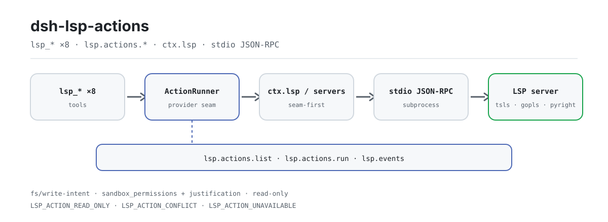

<div align="center">

<picture>
  <source media="(prefers-color-scheme: dark)" srcset="docs/assets/dsh-lsp-actions-flow-dark.svg">
  
</picture>

# dsh-lsp-actions

**अपने एजेंट को असली लैंग्वेज सर्वर पर कोड लिखने और ठीक करने दें — डायग्नोस्टिक्स, फ़ॉर्मेटिंग, कम्प्लीशन, कोड एक्शन, सिंबल, सिग्नेचर हेल्प, इनले हिंट और रीनेम, सब एक ही एक्शन सतह पर।**

DeepSeek Harness के लिए LSP एक्शन सतह: आधिकारिक `ctx.lsp` seam नेविगेशन संभालता है, यह प्लगइन एक्शन लूप पूरा करता है, और स्थिर एडिटर एक्शन प्रोटोकॉल (`lsp.actions.*`) की बदौलत VS Code जैसे एडिटर इसे सीधे अपना IDE बैकएंड बना सकते हैं।

[इंस्टॉल](#तीन-चरणों-में-शुरुआत) · [कॉन्फ़िगरेशन](#कॉन्फ़िगरेशन) · [FAQ](#faq) · [简体中文](README.md) · [English](README.en.md) · [Español](README.es.md) · [Português](README.pt.md) · [हिन्दी](README.hi.md)

[](LICENSE)
[](#संगतता)
[](https://www.npmjs.com/package/dsh-lsp-actions)
[](https://github.com/PerryLink/dsh-lsp-actions/actions/workflows/ci.yml)
[](#संगतता)

[](https://github.com/PerryLink/dsh-lsp-actions/stargazers)
[](https://www.npmjs.com/package/dsh-lsp-actions)
[](https://dshfind.com/plugins/PerryLink/dsh-lsp-actions?ref=badge)
[](https://securityscorecards.dev/viewer/?uri=github.com/PerryLink/dsh-lsp-actions)
[](https://dsh.market/)
[](https://gitee.com/perrylink/dsh-lsp-actions)

```sh
dsh plugin --profile <name> add dsh-lsp-actions
```

</div>

<sub>समुदाय प्लगइन, DeepSeek से संबद्ध नहीं। आधिकारिक रेपो: <https://github.com/PerryLink/dsh-lsp-actions> (Gitee एक मिरर है)।</sub>

## यह क्या है

`dsh-lsp-actions` उस फ़ीडबैक लूप को असली लैंग्वेज सर्वर से जोड़ता है जो एजेंट को कोड लिखते और सुधारते समय चाहिए: डायग्नोस्टिक्स, फ़ॉर्मेटिंग, कम्प्लीशन, कोड एक्शन, सिंबल, सिग्नेचर हेल्प, इनले हिंट और रीनेम — सब वही सर्वर उत्तर देते हैं जो आपका IDE इस्तेमाल करता है (`typescript-language-server`, gopls, pyright, rust-analyzer…)। आधिकारिक `ctx.lsp` seam केवल नेविगेशन (go-to-definition, references, implementation, hover) कवर करता है; यह प्लगइन एक्शन सतह पूरी करता है और उसे स्थिर एडिटर एक्शन प्रोटोकॉल (`lsp.actions.*`) के रूप में पैक करता है, ताकि VS Code जैसे एडिटर बिना खुद LSP लागू किए इन क्षमताओं का उपभोग कर सकें। यह एक ही host पंक्ति के रूप में माउंट होता है (`id: lsp-actions`, `inject: [tools, fs, subprocess]`), सर्वर प्रोसेस को ज़रूरत पर लेज़ी तरीके से शुरू करता है, और हर लेखन को आधिकारिक `fs/write-intent` waterfall तथा sandbox स्वीकृति से गुज़ारता है।

## तीन चरणों में शुरुआत

1. **इंस्टॉल करें** (तीन में से एक चैनल):

   ```sh
   # git चैनल (नवीनतम main; prepare स्क्रिप्ट tsc से lib/ बनाती है)
   dsh plugin --profile web add github:PerryLink/dsh-lsp-actions
   # npm चैनल (प्रकाशित संस्करण)
   dsh plugin --profile web add dsh-lsp-actions
   # tarball चैनल: इस रेपो में pnpm pack के बाद
   dsh plugin --profile web add ./dsh-lsp-actions-<version>.tgz
   ```

2. **न्यूनतम कॉन्फ़िग** (डिफ़ॉल्ट `servers: {}` कोई सर्वर सक्रिय नहीं करता; कम से कम एक एंट्री जोड़ें):

   ```yaml
   - insert:
       - id: lsp-actions
         name: dsh-lsp-actions
         config:
           servers:
             typescript:
               command: typescript-language-server
               args: ["--stdio"]
               extensionToLanguage: { ".ts": typescript, ".tsx": typescriptreact }
               projectMarkers: ["package.json", "tsconfig.json"]
   ```

3. **जाँचें कि माउंट हुआ**:

   ```sh
   dsh --profile web --dump-config | grep -A3 'id: lsp-actions'
   ```

   ```text
   > lsp_diagnostics a.ts
   a.ts:1:3  [Error] boom [ts 2304]
   ```

**अनइंस्टॉल**: `dsh plugin --profile web remove dsh-lsp-actions` (या profile patch से वह पंक्ति हटा दें)।

<details>
<summary>DSH Desktop मार्केट से इंस्टॉल करें</summary>

हर PerryLink प्लगइन DSH Desktop के अंतर्निहित मार्केट में सूचीबद्ध है: **Market → Sources → Add source → चिपकाएँ** `https://perrylink-dsh-catalog.perrylink.workers.dev/catalog-source.json` **→ चुनें**। इंस्टॉल के लिए अब भी मार्केट की npm पहचान जाँच और आपकी पुष्टि ज़रूरी है।

</details>

## मुख्य क्षमताएँ

यह प्लगइन **केवल एक्शन सतह** पूरी करता है: नेविगेशन अब भी आधिकारिक `ctx.lsp` seam से आता है, और जब seam अनुपस्थित हो, पुराने संस्करण का हो, या उस फ़ाइल के लिए कोई provider न हो, तो एक्शन प्लगइन के अपने न्यूनतम stdio क्लाइंट पर गिर जाते हैं।

- **आठ `lsp_*` टूल** — डायग्नोस्टिक्स, फ़ॉर्मेटिंग, कम्प्लीशन, कोड एक्शन, सिंबल, सिग्नेचर हेल्प, इनले हिंट और रीनेम, सब असली लैंग्वेज सर्वर उत्तर देते हैं, mock नहीं।
- **एडिटर एक्शन प्रोटोकॉल v1** — स्थिर JSON-RPC सतह (`lsp.actions.list` / `lsp.actions.run` / `lsp.events`) जो किसी भी एडिटर (पहले VS Code) को ये क्षमताएँ सीधे उपभोग करने देती है।
- **असली सर्वर से सत्यापन** — टेस्ट सूट में असली `typescript-language-server` रन और एडिटर प्रोटोकॉल का e2e शामिल है; CI इसे Node 22/24 पर Linux, Windows और macOS में चलाती है।
- **लेखन आधिकारिक रास्ते से** — `lsp_format` / `lsp_rename` `fs/write-intent` waterfall और प्रति-कॉल sandbox नीति से गुज़रते हैं; read-only सेशन किसी भी सर्वर राउंड-ट्रिप से पहले अस्वीकार हो जाता है।
- **डिफ़ॉल्ट रूप से केवल पढ़ें** — आठ में से छह टूल केवल संदर्भ के लिए हैं; केवल फ़ॉर्मेटिंग और रीनेम बदलाव करते हैं।
- **सीमित** — परिणाम संख्या, अक्षर, दस्तावेज़ बाइट और प्रति-कॉल समय की सीमा है; डायग्नोस्टिक्स कैश सीमित LRU है।

```text
lsp_diagnostics / lsp_format / lsp_completion / lsp_code_action /
lsp_symbols / lsp_signature / lsp_inlay_hints / lsp_rename
        │
        ▼
   ctx.lsp seam (विस्तारित: diagnostics / formatDocument / completion)
        │  अनुपस्थित · पुराना संस्करण · इस फ़ाइल के लिए कोई provider नहीं
        ▼
   अंतर्निहित stdio क्लाइंट  ←  servers तालिका (ctx.subprocess.spawn + JSON-RPC)
```

### कमांड और टूल सतह

| सतह | प्रकार | टिप्पणी |
|---|---|---|
| `lsp_diagnostics` | tool | `<file>` — कम्पाइलर/विश्लेषक की त्रुटियाँ, चेतावनियाँ और संकेत, गंभीरता, रेंज, संदेश और स्रोत सर्वर के साथ (केवल पढ़ें) |
| `lsp_format` | tool | `<file> [range?]` — लैंग्वेज सर्वर से फ़ाइल/चयन को फ़ॉर्मेट कर लागू करता है और diff लौटाता है (`fs/write-intent` से लिखता है) |
| `lsp_completion` | tool | `<file> <line> <character>` — कर्सर स्थिति पर कम्प्लीशन सुझाव, इन्सर्शन टेक्स्ट सहित (केवल पढ़ें) |
| `lsp_code_action` | tool | `<file> [range?] [only?]` — सर्वर-सत्यापित quickfix/refactoring उनके edits सहित, किसी रेंज या पहले डायग्नोस्टिक के लिए (केवल संदर्भ) |
| `lsp_symbols` | tool | `<query?> <file_path?>` — नाम से पूरे workspace में सिंबल खोज, या किसी एक फ़ाइल की रूपरेखा (केवल पढ़ें) |
| `lsp_signature` | tool | `<file> <line> <character>` — किसी कॉल के भीतर सिग्नेचर हेल्प (पैरामीटर और दस्तावेज़) (केवल पढ़ें) |
| `lsp_inlay_hints` | tool | `<file> [range?]` — सर्वर से टाइप एनोटेशन और पैरामीटर-नाम संकेत (केवल पढ़ें) |
| `lsp_rename` | tool | `<file> <line> <character> <new_name>` — सर्वर-सत्यापित रीनेम, पूरे workspace में लागू और प्रति-फ़ाइल diff के साथ (`fs/write-intent` से लिखता है) |
| `lsp.actions.*` | protocol | एडिटर एक्शन प्रोटोकॉल v1: JSON-RPC पर `lsp.actions.list` / `lsp.actions.run` / `lsp.events` |
| `examples/vscode/` | extension | केवल-UI VS Code एक्सटेंशन और वह headless बैकएंड कम्पोज़िशन जिससे यह जुड़ता है |

### उदाहरण

ये प्लगइन के असली प्रवेश-बिंदु हैं; एक बार इंस्टॉल करें, फिर कोई एक कॉल करें।

**विस्तृत उदाहरण** — कमांड `lsp_diagnostics`, इनपुट:

```json
{
  "file_path": "a.ts"
}
```

आउटपुट:

```text
a.ts:1:3  [Error] boom [ts 2304]
a.ts:3:1  [Hint] hint
```

*Observed from `plugins/dsh-lsp-actions/tests/render.spec.ts:32-37 (exact toBe); tool-level no-result render at plugins/dsh-lsp-actions/tests/tools.spec.ts:150-156`*

**विफलता शाखा** — इनपुट:

```text
{"action":"format","requestId":"f1","params":{"filePath":"a.ts","workspaceRoot":"<session-workspace>"}} under a read-only permission preset
```

आउटपुट:

```text
{
  "requestId": "f1",
  "action": "format",
  "status": "failed",
  "error": {
    "code": "LSP_ACTION_READ_ONLY",
    "message": "[sandbox: file access denied under read-only mode]\n[sandbox: escalation available — retry this exact operation once with sandbox_permissions (the narrowest wider mode that suffices) + justification; the approval prompt asks the user]"
  }
}
```

*Observed from `plugins/dsh-lsp-actions/src/tools.ts:213-223; plugins/dsh-lsp-actions/src/editor/actions.ts:320-330; plugins/dsh-lsp-actions/tests/editor-protocol.spec.ts:305-325`*

**संक्षिप्त उदाहरण**: `lsp_format` · `lsp_completion`

### एडिटर एक्शन प्रोटोकॉल v1

किसी समर्पित headless कम्पोज़िशन में `editor.enabled: true` सेट करने पर `dsh-lsp-actions` न्यूलाइन-डिलिमिटेड JSON-RPC 2.0 (आधिकारिक SDK/ACP ट्रांसपोर्ट जैसा ही wire framing) पर स्थिर एडिटर प्रोटोकॉल परोसता है:

| मेथड | क्या करता है |
|---|---|
| `lsp.actions.list` | `lsp-actions/v1` प्रोटोकॉल संस्करण, एक्शन कैटलॉग (`diagnostics.get`, `completion.get`, `quickfix.apply`, `format`, हर एक `writes` फ़्लैग सहित) और पता योग्य DSH सेशन लौटाता है |
| `lsp.actions.run` | एक एक्शन चलाता है और संरचित `{ requestId, action, status, result \| error }` envelope लौटाता है; त्रुटियाँ स्थिर `LSP_ACTION_*` कोड लेकर आती हैं |
| `lsp.events` | स्ट्रीमिंग `lsp.event` सूचनाओं की सदस्यता लेता है: `diagnostics.updated`, `action.status`, `file.changed`, `sessions.changed` |

सभी लेखन एक्शन (`quickfix.apply`, `format`) **आधिकारिक अनुमति presets और स्वीकृति** से गुज़रते हैं: `read-only` सेशन किसी भी सर्वर राउंड-ट्रिप से पहले `LSP_ACTION_READ_ONLY` के साथ अस्वीकार होता है, edits `fs/write-intent` waterfall से जाते हैं, और `sandbox_permissions` + `justification` एस्केलेशन जोड़ी आधिकारिक `approveEscalation` ask से तय होती है (कोई उत्तरदाता निर्णय न ले सके तो fail-closed)। पूरा wire स्पेक, द्विभाषी: [`docs/editor-protocol.md`](docs/editor-protocol.md) · [`docs/editor-protocol.zh-CN.md`](docs/editor-protocol.zh-CN.md)।

**संस्करण और पिछड़ी-संगतता का वादा**

- प्रोटोकॉल संस्करणित है — `lsp.actions.list` `protocol: "lsp-actions/v1"`, `version: 1` लौटाता है। **v1 फ़्रोज़न है:** फ़ील्ड नाम, एक्शन id, इवेंट प्रकार और त्रुटि कोड हमेशा स्थिर रहते हैं।
- विकास **केवल योगात्मक** है: नए एक्शन, फ़ील्ड और इवेंट प्रकार बिना संस्करण बढ़ाए आते हैं; मौजूदा अर्थ कभी जगह पर नहीं बदलते; असंगत बदलाव नए `protocol` संस्करण के अंतर्गत आता है, जिसे सर्वर साथ-साथ परोस सकते हैं।
- क्लाइंट को अज्ञात फ़ील्ड, अज्ञात इवेंट प्रकार और अज्ञात एक्शन अनदेखा करने चाहिए, और स्थिर त्रुटि `code` पर रूट करना चाहिए, संदेश टेक्स्ट पर कभी नहीं।

**त्रुटि कोड**

हर विफलता एक स्थिर `code` लेकर आती है; मॉडल और कॉलर कोड पर रूट करते हैं, संदेश टेक्स्ट पर कभी नहीं।

| कोड | अर्थ |
|---|---|
| `LSP_ACTION_UNAVAILABLE` | इस फ़ाइल के लिए न कोई सर्वर एंट्री है न seam provider |
| `LSP_ACTION_UNSUPPORTED` | सर्वर (या seam provider) यह ऑपरेशन विज्ञापित नहीं करता |
| `LSP_ACTION_SERVER_FAILED` | सर्वर विफल हुआ (stderr की पूँछ सहित); स्टार्टअप विफलता एक बार पुनः प्रयास करती है |
| `LSP_ACTION_MALFORMED_RESPONSE` | सर्वर ने संरचनात्मक रूप से अमान्य payload भेजा |
| `LSP_ACTION_CONFLICT` | पढ़ने के बाद फ़ाइल बदल गई, या edits ओवरलैप / सीमा से बाहर / workspace से बाहर जाते हैं |
| `LSP_ACTION_READ_ONLY` | सेशन का sandbox मोड फ़ॉर्मेटिंग/रीनेम लेखन मना करता है |
| `LSP_ACTION_WORKSPACE_REQUIRED` | कॉल करने वाले सेशन के पास सर्वर को जड़ देने के लिए workspace cwd नहीं है |
| `LSP_ACTION_NO_SYMBOL` | सर्वर को कर्सर स्थिति पर कोई रीनेम-योग्य सिंबल नहीं मिला |
| `LSP_ACTION_UNKNOWN` | एडिटर प्रोटोकॉल: अज्ञात एक्शन id, या कोई कोड एक्शन `title`/`index` से मेल नहीं खाता |
| `LSP_ACTION_INVALID_ARGS` | एडिटर प्रोटोकॉल: एक्शन पैरामीटर अमान्य |
| `LSP_ACTION_APPROVAL_UNAVAILABLE` | एडिटर प्रोटोकॉल: स्वीकृति मार्ग व्यापक sandbox मोड नहीं दे सका (fail-closed) |
| `LSP_PROTOCOL_VERSION_UNSUPPORTED` | एडिटर प्रोटोकॉल: घोषित प्रोटोकॉल संस्करण समर्थित नहीं है |

### VS Code एक्सटेंशन

[`examples/vscode/`](examples/vscode/) में एक **केवल-UI** एक्सटेंशन है (साइडबार: DSH सेशन, डायग्नोस्टिक्स सूची, एक क्लिक में quickfix लागू करना, रेंज पर खोलना और फ़ॉर्मेट) तथा वह headless बैकएंड कम्पोज़िशन (`backend/cordis.yml`) जिससे यह ACP-शैली JSON-RPC पर जुड़ता है। एक्सटेंशन कोई LSP लॉजिक लागू नहीं करता — हर क्षमता और लिखा गया हर बाइट प्लगइन का है। इंस्टॉल चरण, सेटिंग्स और डेमो gif रिकॉर्डिंग स्क्रिप्ट [`examples/vscode/README.md`](examples/vscode/README.md) में हैं।

### आर्किटेक्चर

एक्शन **पहले आधिकारिक seam** पर जाते हैं और मेल न मिलने पर प्लगइन के अपने न्यूनतम stdio क्लाइंट पर गिरते हैं। seam विस्तार upstream में प्रस्तावित है ([`upstream/lsp-action-seam.patch`](upstream/lsp-action-seam.patch), PR विवरण [`upstream/PR-description.md`](upstream/PR-description.md) में); लागू होने पर प्लगइन बिना बदलाव के काम करता रहेगा — अंतर्निहित क्लाइंट का उपयोग बस बंद हो जाएगा। अंतर्निहित क्लाइंट `servers` तालिका के लिए स्वतंत्र fallback बना रहता है। **एडिटर प्रोटोकॉल** वही runner, वही लेखन पथ और वही अनुमति मशीनरी इस्तेमाल करता है।

एक्शन बैकएंड एक सार्वजनिक provider इंटरफ़ेस — `ActionRunner` (पैकेज से निर्यात) — के पीछे है, जिसे अंतर्निहित runner लागू करता है और जो तीसरे पक्ष के providers के लिए खुला है: आठ टूल केवल उसी इंटरफ़ेस का उपभोग करते हैं, किसी ठोस क्लाइंट का कभी नहीं। पूरी शोध और डिज़ाइन टिप्पणियाँ: [`docs/seam-extension-notes.md`](docs/seam-extension-notes.md)।

## कॉन्फ़िगरेशन

सभी समायोज्य Schemastery `Config` फ़ील्ड हैं (cordis.yml से बदले जा सकते हैं)। id-लक्षित override पूरी पंक्ति बदल देता है — जो भी कुंजियाँ चाहिए, सब दोबारा लिखें। `cordis.patch.yml` हर कुंजी को इनलाइन समझाता है।

सबसे अधिक उपयोग होने वाली कुंजियाँ:

| कुंजी | डिफ़ॉल्ट | अर्थ |
|---|---|---|
| `servers` | `{}` | नामित लैंग्वेज सर्वर; खाली तालिका कोई सर्वर सक्रिय नहीं करती |
| `editor.enabled` | `false` | JSON-RPC stdio पर एडिटर एक्शन प्रोटोकॉल परोसें (केवल headless बैकएंड) |
| `maxDiagnostics` | `200` | प्रति परिणाम डायग्नोस्टिक्स सीमा |
| `maxResultChars` | `16000` | रेंडर किए गए परिणाम की सीमा (अक्षर) |
| `maxDocumentBytes` | `4000000` | दस्तावेज़ पढ़ने की सीमा (बाइट) |
| `timeoutMs` | `60000` | प्रति-कॉल समय-सीमा, आधिकारिक timeout नीति से लागू |

<details>
<summary>पूरी कॉन्फ़िगरेशन तालिका (13 कुंजियाँ)</summary>

| कुंजी | डिफ़ॉल्ट | अर्थ |
|---|---|---|
| `servers` | `{}` | नामित लैंग्वेज सर्वर; खाली तालिका कोई सर्वर सक्रिय नहीं करती |
| `editor.enabled` | `false` | JSON-RPC stdio पर एडिटर एक्शन प्रोटोकॉल परोसें (केवल headless बैकएंड) |
| `editor.requestTimeoutMs` | `60000` | एडिटर प्रोटोकॉल के प्रति-रन timeout बजट (ms) |
| `editor.diagnosticsCacheMaxFiles` | `64` | सीमित LRU डायग्नोस्टिक्स कैश आकार (फ़ाइलें) |
| `maxDiagnostics` | `200` | प्रति परिणाम डायग्नोस्टिक्स सीमा |
| `maxCompletionItems` | `20` | प्रति परिणाम कम्प्लीशन आइटम सीमा |
| `maxCodeActions` | `50` | प्रति परिणाम कोड एक्शन सीमा |
| `maxSymbols` | `100` | सिंबल परिणाम सीमा |
| `maxSignatures` | `10` | सिग्नेचर हेल्प सीमा |
| `maxInlayHints` | `200` | इनले हिंट सीमा |
| `maxResultChars` | `16000` | रेंडर किए गए परिणाम की सीमा (अक्षर) |
| `maxDocumentBytes` | `4000000` | दस्तावेज़ पढ़ने की सीमा (बाइट) |
| `timeoutMs` | `60000` | प्रति-कॉल समय-सीमा, आधिकारिक timeout नीति से लागू |

</details>

हर `servers` एंट्री एक `LspServerEntry` है: `command` (लोड पर PATH से हल किया गया executable) और `extensionToLanguage` (`".ts"` → `typescript`) अनिवार्य हैं; वैकल्पिक `fileGlobs`, `projectMarkers`, `args`, `env`, `initializationOptions`, `configuration`, `formattingOptions`, `maxMessageBytes`, `maxStderrBytes`, `killGraceMs`, `shutdownTimeoutMs`, `diagnosticsSettleMs`, `diagnosticsDebounceMs` और `idleTimeoutMs` (`0` = सर्वर प्रोसेस को जीवित रखें, जो डिफ़ॉल्ट भी है) अंतर्निहित stdio क्लाइंट को ट्यून करते हैं।

रूटिंग नियतात्मक और कॉन्फ़िगरेशन-चालित है। हर फ़ाइल पहला मेल इस क्रम से लेती है: **(1)** ऐसी सर्वर एंट्री जिसकी `fileGlobs` पथ से मेल खाती हों; **(2)** workspace रूट तक ऊपर जाते हुए निकटतम पूर्वज डायरेक्टरी जिसमें किसी एंट्री के `projectMarkers` में सूचीबद्ध प्रोजेक्ट कॉन्फ़िग फ़ाइल हो — केवल उन्हीं एंट्रियों के विरुद्ध जो फ़ाइल का एक्सटेंशन भी मैप करती हैं; **(3)** वह एंट्री जिसकी `extensionToLanguage` फ़ाइल का एक्सटेंशन मैप करती है, कॉन्फ़िग क्रम में। इसलिए `apps/node-app/{package.json,tsconfig.json,src/main.ts}` और `apps/deno-app/{deno.json,src/main.ts}` वाला workspace हर `main.ts` को उसके अपने प्रोजेक्ट के सर्वर से परोसता है — कोई पथ नियम बनाए रखने की ज़रूरत नहीं, और प्रोजेक्ट जोड़े, नाम बदले या हटे तो कुछ बदलना नहीं पड़ता:

```yaml
servers:
  typescript:
    command: typescript-language-server
    args: ["--stdio"]
    extensionToLanguage: { ".ts": typescript, ".tsx": typescriptreact }
    projectMarkers: ["package.json", "tsconfig.json"]
  deno:
    command: deno
    args: ["lsp"]
    extensionToLanguage: { ".ts": typescript, ".tsx": typescriptreact }
    projectMarkers: ["deno.json", "deno.jsonc"]
```

प्रोजेक्ट मार्कर केवल उन सर्वरों में से चुनता है जो पहले से फ़ाइल का एक्सटेंशन मैप करते हैं (यह किसी एंट्री के फ़ाइल प्रकार कभी नहीं बढ़ाता); ऊपर की खोज कभी workspace रूट से बाहर नहीं जाती, और एक डायरेक्टरी का प्रोजेक्ट कॉन्फ़िग किसी भाई डायरेक्टरी पर लागू नहीं होता। चरण **(1)** प्रोजेक्ट मार्कर से ऊपर है: जिस एंट्री की `fileGlobs` पथ से मेल खाती है वही जीतती है, इसलिए `projectMarkers` अपनाते समय प्रोजेक्ट-स्तरीय globs हटा दें — बचा हुआ `**/*.ts` उन फ़ाइलों पर दावा करता रहेगा। ये नियम अंतर्निहित stdio क्लाइंट पर लागू हैं; माउंटेड `ctx.lsp` seam provider अपनी रूटिंग खुद तय करता है।

## FAQ

<details>
<summary>डिफ़ॉल्ट <code>servers: {}</code> के साथ क्या होता है? क्या चुपचाप विफल होता है?</summary>

कुछ भी चुपचाप नहीं होता। आठों टूल पंजीकृत रहते हैं, लेकिन जब इस फ़ाइल के लिए न कोई सर्वर एंट्री हो और न `ctx.lsp` seam provider, तो कॉल `LSP_ACTION_UNAVAILABLE` के साथ ज़ोर से विफल होती है। seam हर कॉल पर हल होता है, इसलिए इस प्लगइन के बाद माउंट किया गया seam भी बिना रीलोड परोसा जाता है। `editor.enabled: false` (डिफ़ॉल्ट) पर एडिटर प्रोटोकॉल शुरू ही नहीं होता।

</details>

<details>
<summary>क्या कोई लेखन sandbox और स्वीकृति को दरकिनार कर सकता है?</summary>

नहीं। केवल `lsp_format` और `lsp_rename` लिखते हैं, और वे आधिकारिक `write`/`edit` टूल जैसे ही रास्ते से जाते हैं: `fs/write-intent` waterfall (अवलोकन → संरक्षित लेखन → अवलोकन) और प्रति-कॉल sandbox नीति। `read-only` सेशन किसी भी सर्वर राउंड-ट्रिप से पहले `LSP_ACTION_READ_ONLY` के साथ अस्वीकार होता है; व्यापक मोड की ज़रूरत पड़ने पर `sandbox_permissions` + `justification` एस्केलेशन जोड़ी आधिकारिक `approveEscalation` ask से जाती है और कोई उत्तरदाता निर्णय न ले सके तो `LSP_ACTION_APPROVAL_UNAVAILABLE` के रूप में fail-closed होती है।

</details>

<details>
<summary>क्या यह दूसरे प्लगइनों से टूल नाम, इवेंट या slot पर टकराता है?</summary>

नहीं। हर टूल नेमस्पेस्ड है, यह कोई सर्विस कुंजी नहीं देता, कोई क्लाइंट slot या `webServer` prefix पंजीकृत नहीं करता, और कोई global नहीं बदलता; bundle patch केवल अपनी पंक्ति `insert` करता है; एकमात्र साझा इवेंट `fs/write-intent` हमेशा `next()` से सौंपा जाता है और श्रृंखला को कभी शॉर्ट-सर्किट नहीं करता। बिंदु-दर-बिंदु तर्क «अन्य DSH प्लगइनों के साथ इंटरऑपरेबिलिटी» में है।

</details>

<details>
<summary>अगर पढ़ने के बाद फ़ाइल डिस्क पर बदल जाए तो?</summary>

वह कभी अधिलिखित नहीं होती। पढ़ने के बाद फ़ाइल बदलने पर एक्शन `LSP_ACTION_CONFLICT` के साथ विफल होता है; ओवरलैपिंग, सीमा-बाहर या workspace-बाहर edits भी वैसे ही टकराव पैदा करते हैं। `lsp_rename` पहले लेखन से पहले हर प्रभावित फ़ाइल की पूर्व-जाँच करता है।

</details>

<details>
<summary>संसाधन खर्च कितना है?</summary>

सर्वर प्रोसेस ज़रूरत पर लेज़ी तरीके से शुरू होते हैं और हर इंस्टेंस अपने दस्तावेज़ तब तक निवासी रखता है जब तक प्रोसेस मुक्त न हो; `idleTimeoutMs` डिफ़ॉल्ट रूप से `0` है (जीवित रहें), और धनात्मक मान निष्क्रिय होने पर इंस्टेंस मुक्त कर देता है। परिणाम संख्या, अक्षर, दस्तावेज़ बाइट और कुल अवधि प्रति-कॉल सीमित हैं; एडिटर प्रोटोकॉल का डायग्नोस्टिक्स कैश सीमित LRU है (`editor.diagnosticsCacheMaxFiles`); प्लगइन कोई नेटवर्क अनुरोध नहीं करता।

</details>

## सुरक्षा सीमाएँ

- **डिफ़ॉल्ट रूप से केवल पढ़ें।** आठ में से छह टूल केवल संदर्भ के लिए हैं; केवल `lsp_format` और `lsp_rename` बदलाव करते हैं, और वे असली `write`/`edit` बदलावों की तरह करते हैं।
- **आधिकारिक seams, दोबारा लागू नहीं।** हर बाइट `fs/write-intent` waterfall (अवलोकन → संरक्षित लेखन → अवलोकन) और प्रति-कॉल sandbox नीति से गुज़रती है; एस्केलेशन आधिकारिक `write`/`edit` टूल से मेल खाता है।
- **ज़ोर से, तेज़, संरचित विफलता।** खाली `servers` + कोई `ctx.lsp` seam नहीं → `LSP_ACTION_UNAVAILABLE`; read-only सेशन → किसी भी सर्वर राउंड-ट्रिप से पहले `LSP_ACTION_READ_ONLY`; कमांड रूपों की रिपोर्ट होती है, उन्हें कभी चलाया नहीं जाता।
- **टकराव कभी अधिलिखित नहीं करते।** पढ़ने के बाद डिस्क पर बदली फ़ाइल `LSP_ACTION_CONFLICT` के साथ विफल होती है; `lsp_rename` पहले लेखन से पहले हर प्रभावित फ़ाइल की पूर्व-जाँच करता है।
- **सीमित कार्य।** परिणाम सीमाएँ, बाइट सीमाएँ और प्लेटफ़ॉर्म की timeout नीति हर कॉल को सीमित करती हैं; डायग्नोस्टिक्स कैश सीमित LRU है।
- **मॉडल पथ पर कुछ भी कैश नहीं।** टूल परिणाम केवल सेशन लॉग में रहते हैं; डायग्नोस्टिक्स कैश कभी रीस्टार्ट के पार नहीं टिकता।
- **खराब सर्वर ज़ोर से विफल होते हैं।** अनुपस्थित executable लोड पर विफल होता है; स्टार्टअप पर मरने वाला सर्वर कॉल को `LSP_ACTION_SERVER_FAILED` और अपनी stderr पूँछ के साथ विफल करता है (एक नए प्रोसेस के साथ एक पुनः प्रयास के बाद)।
- **प्रॉम्प्ट स्वच्छता।** प्लगइन सेशन सिस्टम प्रॉम्प्ट में कोई persona या प्रॉम्प्ट गद्य नहीं डालता — मॉडल की ओर उसकी सतह केवल आठ टूल स्कीमा हैं।

## अनुमतियाँ और डेटा

- **अनुमतियाँ**: फ़ॉर्मेटिंग और रीनेम आधिकारिक अनुमति presets और स्वीकृति से चलते हैं — `fs/write-intent` waterfall और `sandbox_permissions` / `justification` एस्केलेशन जोड़ी, जिसे `ctx.approval` तय करता है। प्लगइन अपने workshop manifest में `fs:read`, `fs:write`, `subprocess:spawn` और `network:none` घोषित करता है।
- **डेटा**: डिस्क पर कुछ भी संग्रहीत नहीं होता; टूल परिणाम केवल सेशन लॉग में रहते हैं (कोई क्रॉस-सेशन दृढ़ता नहीं)। एडिटर प्रोटोकॉल एक सीमित इन-मेमोरी LRU डायग्नोस्टिक्स कैश रखता है, ताज़गी-चिह्नित और रीस्टार्ट के पार कभी दृढ़ नहीं। गोपनीयता टिप्पणी [`PRIVACY.md`](PRIVACY.md) में है।
- **कोई नेटवर्क नहीं**: प्लगइन कोई नेटवर्क अनुरोध नहीं करता; यह स्थानीय सबप्रोसेस stdio पर लैंग्वेज सर्वर से बात करता है।

## ज्ञात सीमाएँ

- **निवासी दस्तावेज़।** हर दस्तावेज़ एक बार खुलता है और सर्वर इंस्टेंस के पूरे जीवनकाल तक खुला रहता है — बदले स्रोत के साथ बाद का अनुरोध एक पूर्ण-दस्तावेज़ `didChange` भेजता है, और प्रोसेस बंद होने पर सभी दस्तावेज़ बंद हो जाते हैं। इसलिए tsls जैसे प्रोजेक्ट-आधारित सर्वर `textDocument/signatureHelp` और दस्तावेज़-मुक्त `workspace/symbol` का उत्तर देते हैं, बजाय ताज़ा बंद दस्तावेज़ पर `null` लौटाने के। निवासी सेट workspace तक सीमित है और इंस्टेंस के साथ साफ़ होता है (निष्क्रिय निष्कासन या प्लगइन डिस्पोज़ल)।
- **रेंज फ़ॉर्मेटिंग के लिए सर्वर का range provider ज़रूरी।** केवल पूर्ण-दस्तावेज़ फ़ॉर्मेटिंग विज्ञापित करने वाले सर्वर रेंज अनुरोधों को `LSP_ACTION_UNSUPPORTED` के साथ विफल करते हैं।
- **रीनेम केवल टेक्स्ट edits लागू करता है।** सर्वर के रीनेम उत्तर में resource ऑपरेशन (फ़ाइल बनाना/हटाना/नाम बदलना) `LSP_ACTION_UNSUPPORTED` के साथ अस्वीकार होते हैं, और workspace से बाहर के edits कुछ भी लिखे जाने से पहले `LSP_ACTION_CONFLICT` के रूप में विफल होते हैं।

## अन्य DSH प्लगइनों के साथ इंटरऑपरेबिलिटी

**DSH `0.2.0-rc.2`** (यह README जिस रनटाइम के लिए है) और 2026-10-05 को सर्वे किए गए उच्च-स्टार प्लगइन सेट के विरुद्ध सत्यापित।

यह प्लगइन अन्य प्लगइनों में **हस्तक्षेप नहीं करता**, उन व्यापक रूप से इंस्टॉल उच्च-स्टार प्लगइनों में भी नहीं:

- **कोई टूल-नाम टकराव नहीं।** हर टूल नेमस्पेस्ड है; किसी शिप्ड टूल या दूसरे प्लगइन के स्वामित्व वाला कोई नंगा नाम पंजीकृत नहीं होता।
- **कोई सर्विस-कुंजी टकराव नहीं।** यह कोई सर्विस कुंजी देता ही नहीं, इसलिए उस पर टकरा नहीं सकता।
- **कोई slot टकराव नहीं।** यह कोई क्लाइंट slot कुंजी पंजीकृत नहीं करता, इसलिए `shadows-shipped-ui` सीट के लिए प्रतिस्पर्धा नहीं कर सकता।
- **कोई HTTP रूट टकराव नहीं।** यह कोई `webServer` prefix पंजीकृत नहीं करता।
- **कोई patch-लेयर टकराव नहीं।** bundle patch केवल अपनी पंक्ति `insert` करता है; किसी अंतर्निहित पंक्ति का `config` कभी अधिलिखित नहीं करता।
- **कोई global परिवर्तन नहीं।** यह prototypes को patch नहीं करता, `process.env` नहीं लिखता, और global fetch dispatcher नहीं बदलता।

**साझा इवेंट लिसनर रचना से ही अहस्तक्षेपकारी हैं।** यह क्रम-संवेदी इवेंट `fs/write-intent` को `ctx.on()` से सुनता है — Cordis का broadcast पंजीकरण, जहाँ हर लिसनर चलता है और कोई किसी को भूखा नहीं मार सकता। **यहाँ हर लिसनर `next()` से सौंपता है**, इसलिए श्रृंखला कभी शॉर्ट-सर्किट नहीं होती, और बदलाव `next()` के उत्पादित मान पर लागू होता है, उसकी जगह लौटाए जाने के बजाय।

स्थिर प्रमाण: इस रेपो पर `dsh-plugin-doctor` K10–K13 हर जाँच में `pass` रिपोर्ट करते हैं।

## संगतता

| सतह | स्थिति |
|---|---|
| Harness | DeepSeek Harness `dsh-v0.2.1-alpha.1` (`engines.dsh`: `>=0.2.1-0 <0.3.0 \|\| >=0.2.2-0 <0.3.0`); प्लगइन स्वयं कोई सेशन इवेंट नहीं लिखता — होस्ट मानक tool/call + tool/result इवेंट दर्ज करता है। प्रकाशित seam अभी भी केवल चार legacy ऑपरेशन ले जाता है, इसलिए प्लगइन अपना क्लाइंट रखता है और पहले एक्शन कॉल पर वह vintage दर्ज करता है। 2026-09-24 को सत्यापित (दोहरी typecheck रूलर + पूरा टेस्ट सूट + self-contained/artifacts गेट)। |
| Node | `^22.19.0 \|\| >=24.9.0` |
| प्लेटफ़ॉर्म | सभी (शुद्ध host; सबप्रोसेस + फ़ाइलसिस्टम, कोई नेटवर्क नहीं) |
| मॉडल | कोई भी (टूल मॉडल-अज्ञेय हैं; प्लगइन कभी मॉडल नहीं बुलाता) |

## इकोसिस्टम और गुणवत्ता

- [Gitee मिरर](https://gitee.com/perrylink/dsh-lsp-actions) (सिंक मिरर; GitHub आधिकारिक है)
- [dshfind प्लगइन पेज](https://dshfind.com/plugins/PerryLink/dsh-lsp-actions) (इंस्टॉल और रैंकिंग)
- [OpenSSF Scorecard रिपोर्ट](https://securityscorecards.dev/viewer/?uri=github.com/PerryLink/dsh-lsp-actions) ([.github/workflows/scorecard.yml](.github/workflows/scorecard.yml) से संचालित)
- [dsh-plugin-doctor सत्यापन रिपोर्ट](https://github.com/PerryLink/dsh-plugin-doctor#verified-徽章) (K10–K13 सभी `pass`)
- [DSH Market](https://dsh.market/) (सूचीबद्ध)
- **1024 स्टोर चैनल**: एक बार `npm i -g dsh1024`, फिर `dsh1024 plugin --profile web add dsh-lsp-actions` ([deepseek1024.com](https://deepseek1024.com) की इंस्टॉल रैंकिंग में गिना जाता है)
- [इकोसिस्टम ज्ञानकोश](https://perrylink.github.io/dsh-plugin-guide/): मापा गया डेटा, मार्केटिंग नहीं: प्लगइन डेवलपमेंट गाइड · प्लगइन-चयन डेटा · रखरखाव मानदंड

## डेवलपमेंट

```sh
pnpm install            # node ^22.19 || >=24.9
pnpm run lint           # src/ और tests/ पर oxlint
pnpm test               # vitest: यूनिट + fixture-server इंटीग्रेशन + एडिटर प्रोटोकॉल e2e + असली tsls e2e
pnpm run test:coverage  # कवरेज गेट
pnpm build              # tsc --noEmitOnError && node scripts/fix-dts.mjs → lib/
pnpm run prepare        # build (इंस्टॉल पर चलता है)
pnpm run prepublishOnly # build (प्रकाशन से पहले चलता है)
pnpm run check:readmes  # पाँच-भाषा README संगति गेट
pnpm run verify:self-contained  # डिपेंडेंसी spec registry से हल होते हैं
pnpm run verify:artifacts       # प्रकाशित फ़ाइलें मौजूद + artifacts import योग्य
pnpm run check:lockfile         # lockfile ड्रिफ्ट जाँच
```

रेपो लेआउट:

```text
src/            प्लगइन का मुख्य भाग: servers / client / runner / tools / editor / seam
tests/          vitest: यूनिट + fixture सर्वर + एडिटर प्रोटोकॉल e2e + असली tsls e2e
examples/vscode केवल-UI VS Code एक्सटेंशन + वह headless बैकएंड जिससे यह जुड़ता है
docs/           एडिटर प्रोटोकॉल (द्विभाषी) + seam विस्तार शोध + assets/
scripts/        artifact सुधार और यांत्रिक गेट (readme sync / self-contained / artifacts)
upstream/       seam विस्तार का upstream प्रस्ताव (patch + PR विवरण)
verify/         एडिटर बैकएंड स्मोक स्क्रिप्ट और scratch कम्पोज़िशन
```

README की छवियाँ [`scripts/gen-readme-assets.py`](scripts/gen-readme-assets.py) से प्रोग्रामेटिक रूप से बनती हैं (Python + Pillow; हल्का और गहरा दोनों SVG हीरो) और बिना जोखिम दोबारा चलाई जा सकती हैं।

Topics: `dsh`, `dsh-plugin`, `deepseek-harness`, `lsp`, `language-server`, `diagnostics`, `formatting`, `completion`, `code-action`, `symbols`, `signature-help`, `inlay-hints`, `rename`, `refactor`, `ide`, `editor`, `vscode`, `acp`, `json-rpc`

## परिवार और आभार

यह परियोजना [PerryLink](https://github.com/PerryLink) के DeepSeek Harness प्लगइन परिवार का हिस्सा है (सभी Apache-2.0)। अगर यह उपयोगी है, तो **एक स्टार अगले व्यक्ति को इसे खोजने में मदद करता है** — इसके पीछे कोई सुविधा नहीं है।

- [@PerryLink](https://github.com/PerryLink) — निर्माता और अनुरक्षक: LSP एक्शन क्लाइंट और सर्वर जीवनचक्र, आठों टूल, एडिटर एक्शन प्रोटोकॉल, टेस्ट, CI और पाँच-भाषा दस्तावेज़।

<details>
<summary>सभी प्लगइन विस्तृत करें</summary>

| प्लगइन | स्थिति |
|---|---|
| **[dsh-aqua-input-check](https://github.com/PerryLink/dsh-aqua-input-check)** |  |
| **[dsh-archive-check](https://github.com/PerryLink/dsh-archive-check)** |  |
| **[dsh-auto-review](https://github.com/PerryLink/dsh-auto-review)** |  |
| **[dsh-autotier](https://github.com/PerryLink/dsh-autotier)** | 🧊 फ़्रोज़न — रेपो README देखें |
| **[dsh-bid-ca-precheck](https://github.com/PerryLink/dsh-bid-ca-precheck)** |  |
| **[dsh-bid-qual-check](https://github.com/PerryLink/dsh-bid-qual-check)** |  |
| **[dsh-cert-mcp](https://github.com/PerryLink/dsh-cert-mcp)** | 🧊 फ़्रोज़न — रेपो README देखें |
| **[dsh-checkpoint-rewind](https://github.com/PerryLink/dsh-checkpoint-rewind)** |  |
| **[dsh-click](https://github.com/PerryLink/dsh-click)** |  |
| **[dsh-composer-history](https://github.com/PerryLink/dsh-composer-history)** |  |
| **[dsh-contract-stance](https://github.com/PerryLink/dsh-contract-stance)** |  |
| **[dsh-customs-doc-check](https://github.com/PerryLink/dsh-customs-doc-check)** |  |
| **[dsh-data-quality](https://github.com/PerryLink/dsh-data-quality)** | 🧊 फ़्रोज़न — रेपो README देखें |
| **[dsh-demurrage-ledger](https://github.com/PerryLink/dsh-demurrage-ledger)** |  |
| **[dsh-doublecheck](https://github.com/PerryLink/dsh-doublecheck)** |  |
| **[dsh-drill-script-check](https://github.com/PerryLink/dsh-drill-script-check)** |  |
| **[dsh-eia-guide-check](https://github.com/PerryLink/dsh-eia-guide-check)** |  |
| **[dsh-emergency-plan](https://github.com/PerryLink/dsh-emergency-plan)** |  |
| **[dsh-essay-rubric-check](https://github.com/PerryLink/dsh-essay-rubric-check)** |  |
| **[dsh-evidence-check](https://github.com/PerryLink/dsh-evidence-check)** |  |
| **[dsh-export-ctl-check](https://github.com/PerryLink/dsh-export-ctl-check)** |  |
| **[dsh-fast](https://github.com/PerryLink/dsh-fast)** |  |
| **[dsh-fmea-table-check](https://github.com/PerryLink/dsh-fmea-table-check)** |  |
| **[dsh-forecast-penalty](https://github.com/PerryLink/dsh-forecast-penalty)** |  |
| **[dsh-fund-research](https://github.com/PerryLink/dsh-fund-research)** |  |
| **[dsh-github](https://github.com/PerryLink/dsh-github)** |  |
| **[dsh-gongwen-flow-check](https://github.com/PerryLink/dsh-gongwen-flow-check)** |  |
| **[dsh-gongwen-word-check](https://github.com/PerryLink/dsh-gongwen-word-check)** |  |
| **[dsh-guard-plan-qc](https://github.com/PerryLink/dsh-guard-plan-qc)** |  |
| **[dsh-hazchem-check](https://github.com/PerryLink/dsh-hazchem-check)** |  |
| **[dsh-hazplan-check](https://github.com/PerryLink/dsh-hazplan-check)** |  |
| **[dsh-hidden-risk-map](https://github.com/PerryLink/dsh-hidden-risk-map)** |  |
| **[dsh-hs-classify](https://github.com/PerryLink/dsh-hs-classify)** |  |
| **[dsh-icd-rule-check](https://github.com/PerryLink/dsh-icd-rule-check)** |  |
| **[dsh-industry-research](https://github.com/PerryLink/dsh-industry-research)** |  |
| **[dsh-lawcite-adapter](https://github.com/PerryLink/dsh-lawcite-adapter)** |  |
| **[dsh-laya](https://github.com/PerryLink/dsh-laya)** |  |
| **[dsh-lc-doc-check](https://github.com/PerryLink/dsh-lc-doc-check)** |  |
| **[dsh-learning-gap-check](https://github.com/PerryLink/dsh-learning-gap-check)** |  |
| **[dsh-library](https://github.com/PerryLink/dsh-library)** |  |
| **[dsh-local-ai](https://github.com/PerryLink/dsh-local-ai)** |  |
| **[dsh-lsp-actions](https://github.com/PerryLink/dsh-lsp-actions)** |  |
| **[dsh-mask](https://github.com/PerryLink/dsh-mask)** |  |
| **[dsh-mcp-panel](https://github.com/PerryLink/dsh-mcp-panel)** |  |
| **[dsh-medrec-qc](https://github.com/PerryLink/dsh-medrec-qc)** |  |
| **[dsh-memento](https://github.com/PerryLink/dsh-memento)** | 🧊 फ़्रोज़न — रेपो README देखें |
| **[dsh-nsfc-form-check](https://github.com/PerryLink/dsh-nsfc-form-check)** |  |
| **[dsh-nurse-record-check](https://github.com/PerryLink/dsh-nurse-record-check)** |  |
| **[dsh-observe](https://github.com/PerryLink/dsh-observe)** |  |
| **[dsh-origin-rvc-check](https://github.com/PerryLink/dsh-origin-rvc-check)** |  |
| **[dsh-ota-review-check](https://github.com/PerryLink/dsh-ota-review-check)** |  |
| **[dsh-output-styles](https://github.com/PerryLink/dsh-output-styles)** |  |
| **[dsh-paper-doc-adapter](https://github.com/PerryLink/dsh-paper-doc-adapter)** |  |
| **[dsh-permission-rules](https://github.com/PerryLink/dsh-permission-rules)** |  |
| **[dsh-permit-report-check](https://github.com/PerryLink/dsh-permit-report-check)** |  |
| **[dsh-pipeline-check](https://github.com/PerryLink/dsh-pipeline-check)** |  |
| **[dsh-pleading-draft](https://github.com/PerryLink/dsh-pleading-draft)** |  |
| **[dsh-plugin-doctor](https://github.com/PerryLink/dsh-plugin-doctor)** | 🚫 रिटायर्ड (रेपो संग्रहीत) |
| **[dsh-plugin-guide](https://github.com/PerryLink/dsh-plugin-guide)** |  |
| **[dsh-plugin-kit](https://github.com/PerryLink/dsh-plugin-kit)** | 🚫 रिटायर्ड (रेपो संग्रहीत) |
| **[dsh-plugin-upgrade](https://github.com/PerryLink/dsh-plugin-upgrade)** | 🚫 रिटायर्ड (रेपो संग्रहीत) |
| **[dsh-policy-brief-draft](https://github.com/PerryLink/dsh-policy-brief-draft)** |  |
| **[dsh-power-loss-split](https://github.com/PerryLink/dsh-power-loss-split)** |  |
| **[dsh-power-ticket-check](https://github.com/PerryLink/dsh-power-ticket-check)** |  |
| **[dsh-ppap-check](https://github.com/PerryLink/dsh-ppap-check)** |  |
| **[dsh-protest-deadline](https://github.com/PerryLink/dsh-protest-deadline)** |  |
| **[dsh-railway-window](https://github.com/PerryLink/dsh-railway-window)** |  |
| **[dsh-repair-order-qc](https://github.com/PerryLink/dsh-repair-order-qc)** |  |
| **[dsh-research-report](https://github.com/PerryLink/dsh-research-report)** |  |
| **[dsh-review-reply-check](https://github.com/PerryLink/dsh-review-reply-check)** |  |
| **[dsh-rulefile-check](https://github.com/PerryLink/dsh-rulefile-check)** |  |
| **[dsh-safety-brief-check](https://github.com/PerryLink/dsh-safety-brief-check)** |  |
| **[dsh-score](https://github.com/PerryLink/dsh-score)** | 🧊 फ़्रोज़न — रेपो README देखें |
| **[dsh-session-sync](https://github.com/PerryLink/dsh-session-sync)** |  |
| **[dsh-site-log-check](https://github.com/PerryLink/dsh-site-log-check)** |  |
| **[dsh-skill-pack-security](https://github.com/PerryLink/dsh-skill-pack-security)** |  |
| **[dsh-soe-decision-check](https://github.com/PerryLink/dsh-soe-decision-check)** |  |
| **[dsh-soilwater-check](https://github.com/PerryLink/dsh-soilwater-check)** |  |
| **[dsh-sop-sync-check](https://github.com/PerryLink/dsh-sop-sync-check)** |  |
| **[dsh-spc-gbt-adapter](https://github.com/PerryLink/dsh-spc-gbt-adapter)** |  |
| **[dsh-talk](https://github.com/PerryLink/dsh-talk)** |  |
| **[dsh-tender-extract](https://github.com/PerryLink/dsh-tender-extract)** |  |
| **[dsh-tender-matrix](https://github.com/PerryLink/dsh-tender-matrix)** |  |
| **[dsh-test-drive](https://github.com/PerryLink/dsh-test-drive)** |  |
| **[dsh-ticktick](https://github.com/PerryLink/dsh-ticktick)** | 🚫 रिटायर्ड (रेपो संग्रहीत) |
| **[dsh-translate](https://github.com/PerryLink/dsh-translate)** |  |
| **[dsh-warranty-calc](https://github.com/PerryLink/dsh-warranty-calc)** |  |
| **[dsh-budget](https://github.com/PerryLink/dsh-budget)** | 🧊 फ़्रोज़न — रेपो README देखें |
| **[dsh-claude-move](https://github.com/PerryLink/dsh-claude-move)** | 🧊 फ़्रोज़न — रेपो README देखें |
| **[dsh-defend](https://github.com/PerryLink/dsh-defend)** | 🧊 फ़्रोज़न — रेपो README देखें |
| **[dsh-draw](https://github.com/PerryLink/dsh-draw)** | 🧊 फ़्रोज़न — रेपो README देखें |
| **[dsh-reach](https://github.com/PerryLink/dsh-reach)** | 🧊 फ़्रोज़न — रेपो README देखें |
| **[dsh-background-agents](https://github.com/PerryLink/dsh-background-agents)** | 🚫 रिटायर्ड (रेपो संग्रहीत) |
| **[dsh-session-pin](https://github.com/PerryLink/dsh-session-pin)** | 🚫 रिटायर्ड (रेपो संग्रहीत) |
| **[dsh-team-rooms](https://github.com/PerryLink/dsh-team-rooms)** | 🚫 रिटायर्ड (रेपो संग्रहीत) |

</details>

## लाइसेंस

[LICENSE](LICENSE) (Apache License 2.0) © 2026 dsh-lsp-actions contributors

<p align="center"><sub>Apache-2.0 · समुदाय प्लगइन, DeepSeek से संबद्ध नहीं।</sub></p>
