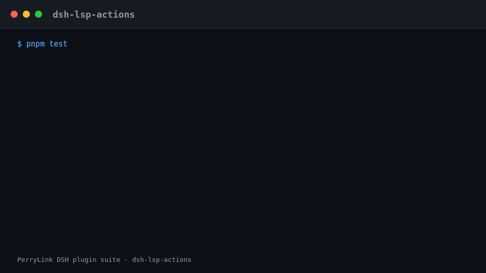

<div align="center">

# 🛰️ dsh-lsp-actions
- **1024 store channel**: `npm i -g dsh1024` once, then `dsh1024 plugin --profile web add dsh-lsp-actions` (counts toward the [deepseek1024.com](https://deepseek1024.com) install ranking).
[](https://gitee.com/perrylink/dsh-lsp-actions)
[](https://dshfind.com/plugins/PerryLink/dsh-lsp-actions?ref=badge)
[](https://api.securityscorecards.dev/projects/github.com/PerryLink/dsh-lsp-actions)

**The LSP action surface for DeepSeek Harness — real language servers, real feedback, and the IDE integration backend for editors.**

*Diagnostics, formatting, completion, code actions, symbols, signature help, inlay hints, and rename for your agent's editor loop — plus the stable editor action protocol (`lsp.actions.*`) that lets any editor consume them directly.*

[](LICENSE)
[](https://github.com/topics/dsh-plugin)
[](https://github.com/PerryLink/dsh-plugin-doctor#verified-徽章)
[](https://dsh.market/)
[](#)
[](https://github.com/PerryLink/dsh-lsp-actions/actions)
[](https://github.com/PerryLink/dsh-lsp-actions/releases)
[](https://www.npmjs.com/package/dsh-lsp-actions)
[](https://www.npmjs.com/package/dsh-lsp-actions)

[English](README.md) · [简体中文](README-zh.md) · [Español](README-es.md) · [Português](README-pt.md) · [हिन्दी](README-hi.md)

```sh
dsh plugin --profile <name> add dsh-lsp-actions
```


</div>

---

**📖 Ecosystem knowledge base** — measured data, not marketing: [plugin development guide · plugin-selection data · maintenance criteria](https://perrylink.github.io/dsh-plugin-guide/).

<!-- star-cta -->
## Install & uninstall

- **git channel** (latest `main`): `dsh plugin --profile web add github:PerryLink/dsh-lsp-actions` — the `prepare` script builds (`tsc --noEmitOnError && node scripts/fix-dts.mjs`).
- **npm channel** (published releases): `dsh plugin --profile web add dsh-lsp-actions`.
- **tarball channel**: `pnpm pack` in this repo, then `dsh plugin --profile web add ./dsh-lsp-actions-<version>.tgz`.
- **uninstall**: `dsh plugin --profile web remove dsh-lsp-actions` (or remove the row from the profile patch).

## ⭐ 如果它帮到了你

这个插件是 [DSH 插件家族](https://github.com/PerryLink)的一员（95 个，全部 Apache-2.0）。如果你在用，**给个 star** —— 它不会解锁任何功能，但会让下一个人在搜索里更容易找到它。

*English:* part of a 95 plugin family for DeepSeek Harness. If it is useful, **a star helps the next person find it** — nothing is gated behind it.


## What is dsh-lsp-actions?

The LSP action surface for DeepSeek Harness — real language servers, real feedback, and the IDE integration backend for editors.

Diagnostics, formatting, completion, code actions, symbols, signature help, inlay hints, and rename for your agent's editor loop — plus the stable editor action protocol (`lsp.actions.*`) that lets any editor consume them directly.


*The same run, animated.*

## Compatibility

| Surface | Status |
|---|---|
| Harness | DeepSeek Harness `dsh-v0.2.1-alpha.1` (compat declared for `>=0.1.2-rc.1 <0.2.0 \|\| >=0.1.5-alpha.1 <0.2.0 \|\| >=0.1.6-0 <0.2.0 \|\| >=0.1.7-0 <0.2.0`); the plugin writes no session events itself - the host records the standard tool/call + tool/result events. The released seam still carries only the four legacy operations, so the plugin keeps its own client and records that vintage on the first action call. Verified 2026-09-24 (dual typecheck rulers + full test suite + self-contained/artifacts gates). |
| Node | `^22.19.0 \|\| >=24.0.0` |
| Platforms | All (pure host; subprocess + filesystem, no network) |
| Model | Any (tools are model-agnostic; the plugin never calls a model) |

## What you get

`dsh-lsp-actions` mounts as a single host row (`id: lsp-actions`, `name: dsh-lsp-actions`, `inject: [tools, fs, subprocess]`). The official DeepSeek Harness `ctx.lsp` seam covers **navigation** (go-to-definition, references, implementation, hover); this plugin completes the **action surface** — the feedback loop an agent needs while it writes and fixes code:

1. **Eight `lsp_*` tools** — diagnostics, formatting, completion, code actions, symbols, signature help, inlay hints, and rename, all served by the same language servers your IDE uses.
2. **Editor action protocol v1** — a stable JSON-RPC surface (`lsp.actions.list` / `lsp.actions.run` / `lsp.events`) that lets any editor (VS Code first) consume those capabilities directly.
3. **Real-server verification** — a real `typescript-language-server` run is part of the test suite (self-contained, CI on Node 22/24 across Linux, Windows, and macOS), not just mocks.

## Quick start

```sh
dsh plugin --profile web add github:PerryLink/dsh-lsp-actions
```

```sh
# 1. install the bundle into your profile
dsh plugin --profile web add github:PerryLink/dsh-lsp-actions

# or from npm (published releases)
dsh plugin --profile web add dsh-lsp-actions

# 2. restart and verify the row
dsh --profile web --dump-config | grep -A3 'id: lsp-actions'
```

## Configuration

All tunables are Schemastery `Config` fields (changeable from cordis.yml). An id-targeted override replaces the whole row — restate every key you need. `cordis.patch.yml` documents each key inline.

| Key | Default | Meaning |
|---|---|---|
| `servers` | `{}` | Named language servers; an empty table activates no servers |
| `editor.enabled` | `false` | Serve the editor action protocol over JSON-RPC stdio (headless backend only) |
| `editor.requestTimeoutMs` | `60000` | Per-run timeout budget (ms) for the editor protocol |
| `editor.diagnosticsCacheMaxFiles` | `64` | Bounded LRU diagnostics-cache size (files) |
| `maxDiagnostics` | `200` | Diagnostics cap per result |
| `maxCompletionItems` | `20` | Completion-items cap per result |
| `maxCodeActions` | `50` | Code-actions cap per result |
| `maxSymbols` | `100` | Symbol-results cap |
| `maxSignatures` | `10` | Signature-help cap |
| `maxInlayHints` | `200` | Inlay-hints cap |
| `maxResultChars` | `16000` | Rendered-result cap (chars) |
| `maxDocumentBytes` | `4000000` | Document-read cap (bytes) |
| `timeoutMs` | `60000` | Per-call timeout, enforced by the official timeout policy |

Each `servers` entry is an `LspServerEntry`: `command` (executable resolved on PATH at load) and `extensionToLanguage` (`".ts"` → `typescript`) are required; optional `fileGlobs`, `projectMarkers`, `args`, `env`, `initializationOptions`, `configuration`, `formattingOptions`, `maxMessageBytes`, `maxStderrBytes`, `killGraceMs`, `shutdownTimeoutMs`, `diagnosticsSettleMs`, `diagnosticsDebounceMs`, and `idleTimeoutMs` (`0` = keep the server process alive) tune the built-in stdio client.

Routing is deterministic and configuration-driven. Every file takes the first match from: **(1)** a server entry whose `fileGlobs` match the path; **(2)** the nearest ancestor directory — walking up to the workspace root — that holds a project config file listed in some entry's `projectMarkers`, matched against the entries that also map the file's extension; **(3)** the entry whose `extensionToLanguage` maps the file's extension, in config order. A workspace holding `apps/node-app/{package.json,tsconfig.json,src/main.ts}` and `apps/deno-app/{deno.json,src/main.ts}` therefore serves each `main.ts` from its own project's server, with no path rule to maintain and nothing to change when a project is added, renamed, or moved:

```yaml
servers:
  typescript:
    command: typescript-language-server
    args: ["--stdio"]
    extensionToLanguage: { ".ts": typescript, ".tsx": typescriptreact }
    projectMarkers: ["package.json", "tsconfig.json"]
  deno:
    command: deno
    args: ["lsp"]
    extensionToLanguage: { ".ts": typescript, ".tsx": typescriptreact }
    projectMarkers: ["deno.json", "deno.jsonc"]
```

A project marker only decides among servers that already map the file's extension (it never widens an entry's file types); the walk never leaves the workspace root, and a project config in one directory never applies to a sibling directory. Step **(1)** outranks a project marker: an entry whose `fileGlobs` match the path still wins, so drop project-level globs when you adopt `projectMarkers` — a lingering `**/*.ts` glob keeps claiming those files. These rules govern the built-in stdio client — a mounted `ctx.lsp` seam provider decides its own routing.

## Tools & surfaces

| Surface | Kind | Notes |
|---|---|---|
| `lsp_diagnostics` | tool | `<file>` — compiler/analyzer errors, warnings, and hints with severity, range, message, and source server (read-only) |
| `lsp_format` | tool | `<file> [range?]` — formats a file/selection through the language server and applies it, returning the diff (writes via `fs/write-intent`) |
| `lsp_completion` | tool | `<file> <line> <character>` — completion suggestions at a cursor position, including the insertion text (read-only) |
| `lsp_code_action` | tool | `<file> [range?] [only?]` — server-verified quickfixes/refactorings with their edits, for a range or the first diagnostic (reference-only) |
| `lsp_symbols` | tool | `<query?> <file_path?>` — workspace-wide symbol search by name, or one file's outline (read-only) |
| `lsp_signature` | tool | `<file> <line> <character>` — signature help (parameters and documentation) inside a call (read-only) |
| `lsp_inlay_hints` | tool | `<file> [range?]` — type annotations and parameter-name hints from the server (read-only) |
| `lsp_rename` | tool | `<file> <line> <character> <new_name>` — server-verified rename, applied workspace-wide with per-file diffs (writes via `fs/write-intent`) |
| `lsp.actions.*` | protocol | Editor action protocol v1: `lsp.actions.list` / `lsp.actions.run` / `lsp.events` over JSON-RPC |
| `examples/vscode/` | extension | UI-only VS Code extension plus the headless backend composition it connects to |

## Editor action protocol v1

When `editor.enabled: true` is set in a dedicated headless composition, `dsh-lsp-actions` serves a stable editor protocol over newline-delimited JSON-RPC 2.0 (the same wire framing as the official SDK/ACP transports):

| Method | What it does |
|---|---|
| `lsp.actions.list` | Returns the `lsp-actions/v1` protocol version, the action catalog (`diagnostics.get`, `completion.get`, `quickfix.apply`, `format` — each flagged `writes`), and the addressable DSH sessions |
| `lsp.actions.run` | Executes one action with a structured `{ requestId, action, status, result \| error }` envelope; errors carry the stable `LSP_ACTION_*` codes |
| `lsp.events` | Subscribes to the streamed `lsp.event` notifications: `diagnostics.updated`, `action.status`, `file.changed`, `sessions.changed` |

All write actions (`quickfix.apply`, `format`) go through the **official permission presets and approval**: a `read-only` session is refused with `LSP_ACTION_READ_ONLY` before any server round-trip, edits ride the `fs/write-intent` waterfall, and the `sandbox_permissions` + `justification` escalation pair resolves through the official `approveEscalation` ask (fail-closed when no answerer can decide). Full wire spec, bilingual: [`docs/editor-protocol.md`](docs/editor-protocol.md) · [`docs/editor-protocol.zh-CN.md`](docs/editor-protocol.zh-CN.md).

**Versioning and the backward-compatibility promise**

- The protocol is versioned — `lsp.actions.list` returns `protocol: "lsp-actions/v1"`, `version: 1`. **v1 is frozen:** field names, action ids, event kinds, and error codes stay stable forever.
- Evolution is **additive only**: new actions, fields, and event kinds arrive without a version bump; existing semantics never change in place; a breaking change ships under a new `protocol` version, which servers may serve side by side.
- Clients must ignore unknown fields, unknown event kinds, and unknown actions, and route on the stable error `code`, never on message text.

**Error codes**

Every failure carries a stable `code`; models and callers route on the code, never on message text.

| Code | Meaning |
|---|---|
| `LSP_ACTION_UNAVAILABLE` | No server entry and no seam provider handles this file |
| `LSP_ACTION_UNSUPPORTED` | The server (or seam provider) does not advertise the operation |
| `LSP_ACTION_SERVER_FAILED` | The server failed (with its stderr tail); startup failures retry once |
| `LSP_ACTION_MALFORMED_RESPONSE` | The server sent a structurally invalid payload |
| `LSP_ACTION_CONFLICT` | The file changed since it was read, or the edits overlap / go out of bounds / leave the workspace |
| `LSP_ACTION_READ_ONLY` | The session's sandbox mode forbids the formatting/rename write |
| `LSP_ACTION_WORKSPACE_REQUIRED` | The calling session has no workspace cwd to root the server in |
| `LSP_ACTION_NO_SYMBOL` | The server found no renameable symbol at the cursor position |
| `LSP_ACTION_UNKNOWN` | Editor protocol: unknown action id, or no code action matched `title`/`index` |
| `LSP_ACTION_INVALID_ARGS` | Editor protocol: malformed action parameters |
| `LSP_ACTION_APPROVAL_UNAVAILABLE` | Editor protocol: the approval path could not grant a wider sandbox mode (fail-closed) |
| `LSP_PROTOCOL_VERSION_UNSUPPORTED` | Editor protocol: the declared protocol version is not supported |

## VS Code extension

[`examples/vscode/`](examples/vscode/) ships a **UI-only** extension (sidebar with the DSH sessions, the diagnostics list, one-click quickfix apply, open-at-range, and format) plus the headless backend composition (`backend/cordis.yml`) it connects to over ACP-style JSON-RPC. The extension implements zero LSP logic — every capability and every byte written belongs to the plugin. Install steps, settings, and the demo-gif recording script are in [`examples/vscode/README.md`](examples/vscode/README.md).



## Permissions & data

- **Permissions**: formatting and rename ride the official permission presets and approval — the `fs/write-intent` waterfall and the `sandbox_permissions` / `justification` escalation pair resolved through `ctx.approval`. The plugin declares `fs:read`, `fs:write`, `subprocess:spawn`, and `network:none` in its workshop manifest.
- **Data**: nothing is stored on disk; tool results live only in the session log (no cross-session persistence). The editor protocol keeps one bounded in-memory LRU diagnostics cache, freshness-stamped and never persisted across restarts.
- **No network**: the plugin makes no network requests; it talks to language servers over local subprocess stdio.

## Security boundaries

- **Read-only by default.** Six of the eight tools are reference-only; only `lsp_format` and `lsp_rename` mutate, and they do so as real `write`/`edit` mutations.
- **Official seams, not re-implemented.** Every byte goes through the `fs/write-intent` waterfall (observation → guarded write → observation) and the per-call sandbox policy; escalation matches the official `write`/`edit` tools.
- **Fail loud, fast, structured.** Empty `servers` + no `ctx.lsp` seam → `LSP_ACTION_UNAVAILABLE`; read-only sessions → `LSP_ACTION_READ_ONLY` before any server round-trip; command forms are reported and never executed.
- **Conflicts never clobber.** A file changed on disk after it was read fails with `LSP_ACTION_CONFLICT`; `lsp_rename` pre-flights every edited file before the first write.
- **Bounded work.** Result caps, byte caps, and the platform's timeout policy bound every call; the diagnostics cache is a bounded LRU.
- **Nothing cached on the model path.** Tool results live only in the session log; the diagnostics cache never persists across restarts.
- **Bad servers fail loudly.** A missing executable fails at load; a server that dies at startup fails the call with `LSP_ACTION_SERVER_FAILED` plus its stderr tail (after one fresh-spawn retry).
- **Prompt hygiene.** The plugin injects no persona or prompt prose into the session system prompt — its model-facing surface is the eight tool schemas.

## Architecture

Actions run **official-seam-first** and fall back to the plugin's own minimal stdio client:

```text
lsp_diagnostics / lsp_format / lsp_completion / lsp_code_action /
lsp_symbols / lsp_signature / lsp_inlay_hints / lsp_rename
        │
        ▼
   ctx.lsp seam (extended: diagnostics / formatDocument / completion)
        │  absent · legacy · no provider for this file
        ▼
   built-in stdio client  ←  servers table (ctx.subprocess.spawn + JSON-RPC)
```

The seam extension is proposed upstream (`upstream/lsp-action-seam.patch`, PR description in `upstream/PR-description.md`). Once it lands, the plugin keeps working unchanged — the built-in client simply stops being used. The built-in client stays as the standalone fallback for the `servers` table. The **editor protocol** rides the same runner, the same write path, and the same permission machinery. Full research and design notes: [`docs/seam-extension-notes.md`](docs/seam-extension-notes.md).

The action backend is behind a public provider interface — `ActionRunner` (exported from the package) — implemented by the bundled runner and open to third-party providers: the eight tools consume only that interface, never a concrete client.

## Known limitations

- **Resident documents.** Each document opens once and stays open for the server instance's lifetime — a later request with changed source sends one full-document `didChange`, and the process shutdown closes every document — so project-based servers like tsls serve `textDocument/signatureHelp` and document-free `workspace/symbol` instead of answering `null` on a freshly-closed document. The resident set is bounded by the workspace and cleared with the instance (idle eviction or plugin disposal).
- **Range formatting requires the server's range provider.** Servers that only advertise whole-document formatting fail range requests with `LSP_ACTION_UNSUPPORTED`.
- **Rename applies text edits only.** Resource operations (create/delete/rename files) in a server's rename answer are refused with `LSP_ACTION_UNSUPPORTED`, and edits outside the workspace fail as `LSP_ACTION_CONFLICT` before anything is written.

## Development

```sh
pnpm install            # node ^22.19 || >=24
pnpm run lint           # oxlint over src/ and tests/
pnpm test               # vitest: unit + fixture-server integration + editor-protocol e2e + real tsls e2e
pnpm run test:coverage  # coverage gate
pnpm build              # tsc --noEmitOnError && node scripts/fix-dts.mjs → lib/
pnpm run prepare        # tsc --noEmitOnError && node scripts/fix-dts.mjs (runs on install)
pnpm run prepublishOnly # tsc --noEmitOnError && node scripts/fix-dts.mjs (runs before publish)
```

## Interoperability with other DSH plugins

Verified against **DSH `0.2.0-rc.2`** (the runtime this README ships for) and the high-star plugin set surveyed on 2026-10-05.

This plugin **does not interfere** with other plugins, including the widely installed high-star ones:

- **No tool-name collision.** Every tool is namespaced; no bare name owned by a shipped tool or another plugin is registered.
- **No service-key collision.** It provides no service key at all, so it cannot collide on one.
- **No slot collision.** It registers no client slot key, so it cannot contend for a `shadows-shipped-ui` seat.
- **No HTTP route collision.** It registers no `webServer` prefix.
- **No patch-layer collision.** The bundle patch only `insert`s its own row; it never overrides a built-in row's `config`.
- **No global mutation.** It does not patch prototypes, rewrite `process.env`, or replace the global fetch dispatcher.

**Shared event listeners are non-interfering by construction.** It observes the ordering-sensitive event `fs/write-intent` with `ctx.on()` — Cordis's broadcast registration, where every listener runs and none can starve another. **Every listener here delegates through `next()`**, so the chain is never short-circuited, and a mutation is applied to the value `next()` produced rather than returned in its place:

Static evidence: `dsh-plugin-doctor` K10–K13 report `pass` for every check on this repository.

## Topics

`dsh`, `dsh-plugin`, `deepseek-harness`, `lsp`, `language-server`, `diagnostics`, `formatting`, `completion`, `code-action`, `symbols`, `signature-help`, `inlay-hints`, `rename`, `refactor`, `ide`, `editor`, `vscode`, `acp`, `json-rpc`

## Contributors

- [@PerryLink](https://github.com/PerryLink) — creator and maintainer: the LSP action client and server lifecycle, all eight tools, the editor action protocol, tests, CI, and the five-language docs.

## PerryLink DSH Plugin Family

This project is one of the **87 actively maintained** DeepSeek Harness plugins from [PerryLink](https://github.com/PerryLink). The family roster is **95** plugins in total — **5 frozen**, **3 retired** — and stays collapsed below so every README keeps a short first screen. Expand it to see every row, with the reason in the Status column.

<details>
<summary>Expand all 95 plugins</summary>

| Plugin | One-liner | Status |
|---|---|---|
| **[dsh-aqua-input-check](https://github.com/PerryLink/dsh-aqua-input-check)** | 水产养殖投入品记录核对（按投入品用量、休药期与起捕间隔核对记录自洽，仅提示差异，不作出定性结论） |  |
| **[dsh-archive-check](https://github.com/PerryLink/dsh-archive-check)** | 档案归档完整性与保管期限核对（依据《档案法》及配套规定，仅提示差异，不作出定性结论） |  |
| **[dsh-auto-review](https://github.com/PerryLink/dsh-auto-review)** | Second-model auto-review on the approval chain, fail-closed by default |  |
| **[dsh-autotier](https://github.com/PerryLink/dsh-autotier)** | Automatic strong/cheap model-tier routing with deterministic risk guards and a `/tier` command |  |
| **[dsh-background-agents](https://github.com/PerryLink/dsh-background-agents)** | Durable background child agents with a Web UI sidebar, messaging and interrupt | 🚫 RETIRED — see the repo README |
| **[dsh-bid-ca-precheck](https://github.com/PerryLink/dsh-bid-ca-precheck)** | 投标文件符合性预检（按招标文件逐条核对响应情况，仅提示差异，不作出定性结论） |  |
| **[dsh-bid-qual-check](https://github.com/PerryLink/dsh-bid-qual-check)** | 投标人资格条件核对（按资格条件与证明材料核对逐条响应，仅提示差异，不作出定性结论） |  |
| **[dsh-budget](https://github.com/PerryLink/dsh-budget)** | Cost governance for DeepSeek Harness: budgets, carbon, and latency in one panel. | 🧊 FROZEN — see the repo README |
| **[dsh-cert-mcp](https://github.com/PerryLink/dsh-cert-mcp)** | Read-only MCP server exposing the certification registry: grades, snapshots and five-dimension evidence |  |
| **[dsh-checkpoint-rewind](https://github.com/PerryLink/dsh-checkpoint-rewind)** | Claude Code /rewind-equivalent: snapshots, session forks, one-shot restore |  |
| **[dsh-claude-move](https://github.com/PerryLink/dsh-claude-move)** | Migrate Claude Code sessions, memory, skills and CLAUDE.md into DSH | 🧊 FROZEN — see the repo README |
| **[dsh-click](https://github.com/PerryLink/dsh-click)** | Cross-platform native desktop control for DeepSeek Harness — Windows first. |  |
| **[dsh-composer-history](https://github.com/PerryLink/dsh-composer-history)** | Terminal-style input history for the web composer: arrows, Ctrl+R search |  |
| **[dsh-contract-stance](https://github.com/PerryLink/dsh-contract-stance)** | 合同条款立场台账核对（按立场、风险等级与退让底线核对台账自洽，仅提示差异，不作出定性结论） |  |
| **[dsh-customs-doc-check](https://github.com/PerryLink/dsh-customs-doc-check)** | 报关单证一致性核对（按公开的报关单填制规范核对单证间字段一致性，仅提示差异，不作出定性结论） |  |
| **[dsh-data-quality](https://github.com/PerryLink/dsh-data-quality)** | Dataset quality checks and citation cross-checks (the optional numeric bridge consumed here) |  |
| **[dsh-defend](https://github.com/PerryLink/dsh-defend)** | Prompt-injection, jailbreak, and secret-leak defense for DeepSeek Harness. | 🧊 FROZEN — see the repo README |
| **[dsh-demurrage-ledger](https://github.com/PerryLink/dsh-demurrage-ledger)** | 滞箱费台账核对（按免箱期与费率核对超期天数与金额的自洽性，仅提示差异，不作出定性结论） |  |
| **[dsh-doublecheck](https://github.com/PerryLink/dsh-doublecheck)** | Engineering-discipline guard: requirements grill, test gates, adversary review |  |
| **[dsh-draw](https://github.com/PerryLink/dsh-draw)** | Unified static-image generation routing for DeepSeek Harness. | 🧊 FROZEN — see the repo README |
| **[dsh-drill-script-check](https://github.com/PerryLink/dsh-drill-script-check)** | 应急演练脚本核对（按阶段、响应分级、指挥与资源要素核对脚本齐备，仅提示差异，不作出定性结论） |  |
| **[dsh-eia-guide-check](https://github.com/PerryLink/dsh-eia-guide-check)** | 环评导则适用性核对（按要素、导则名称与执行标准核对台账自洽，仅提示差异，不作出定性结论） |  |
| **[dsh-emergency-plan](https://github.com/PerryLink/dsh-emergency-plan)** | 应急预案要素齐备性与条款级页码定位（依据 GB/T 29639-2020 等公开文件，仅提示差异，不作出定性结论） |  |
| **[dsh-essay-rubric-check](https://github.com/PerryLink/dsh-essay-rubric-check)** | 作文量表评分核对（按评分项、原文定位与分值算术核对评分自洽，仅提示差异，不作出定性结论） |  |
| **[dsh-evidence-check](https://github.com/PerryLink/dsh-evidence-check)** | 证据清单齐备性核对（按待证事实与证据要素核对清单自洽，仅提示差异，不作出定性结论） |  |
| **[dsh-export-ctl-check](https://github.com/PerryLink/dsh-export-ctl-check)** | 出口管制物项核对（按管制清单、最终用途与许可证核对台账齐备，仅提示差异，不作出定性结论） |  |
| **[dsh-fast](https://github.com/PerryLink/dsh-fast)** | Read-only performance diagnostics for DeepSeek Harness. |  |
| **[dsh-fmea-table-check](https://github.com/PerryLink/dsh-fmea-table-check)** | FMEA 分析表要素齐备性与风险顺序数一致性核对（按公开的 FMEA 方法标准核对表内自洽，仅提示差异，不作出定性结论） |  |
| **[dsh-forecast-penalty](https://github.com/PerryLink/dsh-forecast-penalty)** | 预测准确率考核核对（按准确率、门槛与考核单价核对考核费用的算术自洽，仅提示差异，不作出定性结论） |  |
| **[dsh-fund-research](https://github.com/PerryLink/dsh-fund-research)** | Deterministic research reports for Chinese public mutual funds |  |
| **[dsh-github](https://github.com/PerryLink/dsh-github)** | GitHub PR/issues integration for DSH, every write gated by approval |  |
| **[dsh-gongwen-flow-check](https://github.com/PerryLink/dsh-gongwen-flow-check)** | 公文流转与办理时限核对（按公开的公文处理规范核对环节完整性与时限，仅提示差异，不作出定性结论） |  |
| **[dsh-gongwen-word-check](https://github.com/PerryLink/dsh-gongwen-word-check)** | 公文格式要素核对（按公开的党政机关公文格式标准核对版头与主体要素，仅提示差异，不作出定性结论） |  |
| **[dsh-guard-plan-qc](https://github.com/PerryLink/dsh-guard-plan-qc)** | 劳动保护与安全防护用品配置表核对（按公开的配备标准核对品名规格与配置数量，仅提示差异，不作出定性结论） |  |
| **[dsh-hazchem-check](https://github.com/PerryLink/dsh-hazchem-check)** | 危险化学品临界量与重大危险源辨识核对（按储存量与临界量核对台账自洽，仅提示差异，不作出定性结论） |  |
| **[dsh-hazplan-check](https://github.com/PerryLink/dsh-hazplan-check)** | HAZOP 分析表要素齐备性与偏差推导一致性核对（依据公开的危险与可操作性分析标准，仅提示差异，不作出定性结论） |  |
| **[dsh-hidden-risk-map](https://github.com/PerryLink/dsh-hidden-risk-map)** | 安全隐患台账→《工贸企业重大事故隐患判定标准》（应急管理部令第10号）条款映射提示（仅提示差异，不作出定性结论） |  |
| **[dsh-hs-classify](https://github.com/PerryLink/dsh-hs-classify)** | 商品归类层级一致性核对（按章、品目、子目与商品编号的层级关系核对自洽，仅提示差异，不作出定性结论） |  |
| **[dsh-icd-rule-check](https://github.com/PerryLink/dsh-icd-rule-check)** | ICD 合并编码与星剑号配对提示（依据 GB/T 14396-2016 与公开的 ICD 使用说明，仅提示差异，不作出定性结论） |  |
| **[dsh-industry-research](https://github.com/PerryLink/dsh-industry-research)** | Industry research orchestration that seals its deliverables through this plugin's `ctx.researchReport.assemble` |  |
| **[dsh-lawcite-adapter](https://github.com/PerryLink/dsh-lawcite-adapter)** | 法条引用与文书要素核对（按名称、条号、原文与效力状态核对引用可核验性，仅提示差异，不作出定性结论） |  |
| **[dsh-laya](https://github.com/PerryLink/dsh-laya)** | Laya typed decisions (`noul`/`choice`/`score`) as a first-class Cordis service and model-visible tools |  |
| **[dsh-lc-doc-check](https://github.com/PerryLink/dsh-lc-doc-check)** | 信用证单据条款核对（按单据种类、份数、期限与不符点核对交单自洽，仅提示差异，不作出定性结论） |  |
| **[dsh-learning-gap-check](https://github.com/PerryLink/dsh-learning-gap-check)** | 能力差距与培养计划核对（按能力等级差、培养措施与完成期限核对台账闭环，仅提示差异，不作出定性结论） |  |
| **[dsh-library](https://github.com/PerryLink/dsh-library)** | Local document knowledge base for DeepSeek Harness. |  |
| **[dsh-local-ai](https://github.com/PerryLink/dsh-local-ai)** | Local-model (Ollama) integration for DeepSeek Harness. |  |
| **[dsh-lsp-actions](https://github.com/PerryLink/dsh-lsp-actions)** | LSP diagnostics, formatting, completion, code actions and rename over language servers |  |
| **[dsh-mask](https://github.com/PerryLink/dsh-mask)** | PII masking middleware: anonymize at the model boundary, restore at the display layer |  |
| **[dsh-mcp-panel](https://github.com/PerryLink/dsh-mcp-panel)** | Read-only MCP runtime panel: /mcp command + Settings tab with status, tools and errors |  |
| **[dsh-medrec-qc](https://github.com/PerryLink/dsh-medrec-qc)** | 病案首页形式质控与逻辑矛盾提示（依据国卫办医发〔2016〕24号等公开文件，仅提示差异，不作出定性结论） |  |
| **[dsh-memento](https://github.com/PerryLink/dsh-memento)** | Approval-gated cross-session memory: ctx.memory seam + SQLite + memory tool |  |
| **[dsh-nsfc-form-check](https://github.com/PerryLink/dsh-nsfc-form-check)** | 国家自然科学基金申请书形式审查与匿名化提示（依据《国家自然科学基金条例》与申请人导入的当年指南，仅提示差异，不作出定性结论） |  |
| **[dsh-nurse-record-check](https://github.com/PerryLink/dsh-nurse-record-check)** | 护理记录时限、签名与评估表完整性校验（依据《病历书写基本规范》等公开文件，仅提示差异，不作出定性结论） |  |
| **[dsh-observe](https://github.com/PerryLink/dsh-observe)** | OpenTelemetry and Langfuse observability exporter for DeepSeek Harness. |  |
| **[dsh-origin-rvc-check](https://github.com/PerryLink/dsh-origin-rvc-check)** | 原产地区域价值成分核对（按 RVC 定义式与门槛核对原产地判定自洽，仅提示差异，不作出定性结论） |  |
| **[dsh-ota-review-check](https://github.com/PerryLink/dsh-ota-review-check)** | 在线点评回复台账核对（按回复时限、问题分类与整改状态核对台账闭环，仅提示差异，不作出定性结论） |  |
| **[dsh-output-styles](https://github.com/PerryLink/dsh-output-styles)** | Claude Code outputStyles-equivalent runtime style switching |  |
| **[dsh-paper-doc-adapter](https://github.com/PerryLink/dsh-paper-doc-adapter)** | 试卷解析结构核对（按题型、答案、分值与 yotta 标识核对试卷结构自洽，仅提示差异，不作出定性结论） |  |
| **[dsh-permission-rules](https://github.com/PerryLink/dsh-permission-rules)** | Claude Code-style declarative allow/deny/ask permission rules with audit |  |
| **[dsh-permit-report-check](https://github.com/PerryLink/dsh-permit-report-check)** | 行政许可办理核对（按申请材料、法定时限与决定记录核对台账闭环，仅提示差异，不作出定性结论） |  |
| **[dsh-pipeline-check](https://github.com/PerryLink/dsh-pipeline-check)** | 项目全流程文件链条核对（按环节先后与金额口径核对链条自洽，仅提示差异，不作出定性结论） |  |
| **[dsh-pleading-draft](https://github.com/PerryLink/dsh-pleading-draft)** | 起诉状要素齐备性核对（按诉请、事实、证据、法条四要素核对文书齐备，仅提示差异，不作出定性结论） |  |
| **[dsh-plugin-doctor](https://github.com/PerryLink/dsh-plugin-doctor)** | Zero-dependency static + sandbox smoke detector for DSH plugins |  |
| **[dsh-plugin-guide](https://github.com/PerryLink/dsh-plugin-guide)** | Plugin-development knowledge base as an on-demand agent skill |  |
| **[dsh-plugin-kit](https://github.com/PerryLink/dsh-plugin-kit)** | Shared zero-runtime-dependency toolkit for the PerryLink DSH plugins |  |
| **[dsh-plugin-upgrade](https://github.com/PerryLink/dsh-plugin-upgrade)** | One-package, one-corridor-index plugin upgrade skill: routes a repository to the matching closed corridor card |  |
| **[dsh-policy-brief-draft](https://github.com/PerryLink/dsh-policy-brief-draft)** | 政策专报要素核对（按观点、依据、出处与建议核对专报齐备，仅提示差异，不作出定性结论） |  |
| **[dsh-power-loss-split](https://github.com/PerryLink/dsh-power-loss-split)** | 线损电量拆分与考核表核对（依据公开的线损计算口径，仅提示差异，不作出定性结论） |  |
| **[dsh-power-ticket-check](https://github.com/PerryLink/dsh-power-ticket-check)** | 电力工作票要素齐备性与签发许可顺序核对（依据现行电力安全工作规程，仅提示差异，不作出定性结论） |  |
| **[dsh-ppap-check](https://github.com/PerryLink/dsh-ppap-check)** | PPAP 提交要素齐备性核对（按公开的 PPAP 手册与提交等级核对要素齐备与版本填写，仅提示差异，不作出定性结论） |  |
| **[dsh-protest-deadline](https://github.com/PerryLink/dsh-protest-deadline)** | 质疑与投诉期限核对（按公开的政府采购质疑投诉规定核对期限与台账自洽，仅提示差异，不作出定性结论） |  |
| **[dsh-railway-window](https://github.com/PerryLink/dsh-railway-window)** | 铁路施工天窗台账核对（按时间窗、时长算术与命令号核对台账自洽，仅提示差异，不作出定性结论） |  |
| **[dsh-reach](https://github.com/PerryLink/dsh-reach)** | Multi-channel approval/question bridge: WeChat/Telegram/Feishu, session console | 🧊 FROZEN — see the repo README |
| **[dsh-repair-order-qc](https://github.com/PerryLink/dsh-repair-order-qc)** | 维修工单结算核对（按项目金额、配件工时合计与结算总额核对算术自洽，仅提示差异，不作出定性结论） |  |
| **[dsh-research-report](https://github.com/PerryLink/dsh-research-report)** | Verifiable research-report engine: content-addressed evidence ledger and sealed versions |  |
| **[dsh-review-reply-check](https://github.com/PerryLink/dsh-review-reply-check)** | 审稿意见逐条回应覆盖核对（按意见与回应一一对应核对覆盖完整性，仅提示差异，不作出定性结论） |  |
| **[dsh-rulefile-check](https://github.com/PerryLink/dsh-rulefile-check)** | 规则库文件自检核对（按条款引用纪律与效力上限核对规则库自身合规，仅提示差异，不作出定性结论） |  |
| **[dsh-safety-brief-check](https://github.com/PerryLink/dsh-safety-brief-check)** | 安全技术交底记录要素齐备性与签字闭环核对（依据公开的安全生产法规与检查标准，仅提示差异，不作出定性结论） |  |
| **[dsh-score](https://github.com/PerryLink/dsh-score)** | Multi-dimensional quality scoring for DeepSeek Harness plugins. |  |
| **[dsh-session-pin](https://github.com/PerryLink/dsh-session-pin)** | Pin sessions in the Web sidebar with durable ordering | 🚫 RETIRED — see the repo README |
| **[dsh-session-sync](https://github.com/PerryLink/dsh-session-sync)** | Cross-device session sync for DeepSeek Harness — a dedicated git mirror of your session store. |  |
| **[dsh-site-log-check](https://github.com/PerryLink/dsh-site-log-check)** | 监理日志跨日连续性与旁站覆盖提示（依据 GB/T 50319-2013 等公开文件，仅提示差异，不作出定性结论） |  |
| **[dsh-skill-pack-security](https://github.com/PerryLink/dsh-skill-pack-security)** | Security-audit skill pack: secret scan, dependency and supply-chain review |  |
| **[dsh-soe-decision-check](https://github.com/PerryLink/dsh-soe-decision-check)** | 三重一大决策台账核对（按前置研究、会议审议与决议记录核对程序留痕，仅提示差异，不作出定性结论） |  |
| **[dsh-soilwater-check](https://github.com/PerryLink/dsh-soilwater-check)** | 土壤与地下水监测台账核对（按点位、监测项目、限值与超标判定核对台账自洽，仅提示差异，不作出定性结论） |  |
| **[dsh-sop-sync-check](https://github.com/PerryLink/dsh-sop-sync-check)** | 作业规程与 FMEA／控制计划一致性核对（按编号与版本核对三份文件是否同步，仅提示差异，不作出定性结论） |  |
| **[dsh-spc-gbt-adapter](https://github.com/PerryLink/dsh-spc-gbt-adapter)** | 控制图常数与过程能力指数核对（按 GB/T 4091 的常规控制图常数表核对控制限与 Cp/Cpk 的自洽性，仅提示差异，不作出定性结论） |  |
| **[dsh-talk](https://github.com/PerryLink/dsh-talk)** | Voice-first session loop for DeepSeek Harness: talk to it, hear it answer. |  |
| **[dsh-team-rooms](https://github.com/PerryLink/dsh-team-rooms)** | Cross-session team rooms: shared message bus, task board and timeline | 🚫 RETIRED — see the repo README |
| **[dsh-tender-extract](https://github.com/PerryLink/dsh-tender-extract)** | 招标文件条款摘录核对（按出处与原文逐字核对摘录完整性，仅提示差异，不作出定性结论） |  |
| **[dsh-tender-matrix](https://github.com/PerryLink/dsh-tender-matrix)** | 评标因素评分矩阵核对（按分值上限与合计核对矩阵自洽，仅提示差异，不作出定性结论） |  |
| **[dsh-test-drive](https://github.com/PerryLink/dsh-test-drive)** | Isolated install-and-smoke test drives for DeepSeek Harness plugins. |  |
| **[dsh-ticktick](https://github.com/PerryLink/dsh-ticktick)** | TickTick/Dida365 task bridge: session-header panel + 11 tools |  |
| **[dsh-translate](https://github.com/PerryLink/dsh-translate)** | Vendor parameter translation and deterministic JSON repair for DeepSeek Harness. |  |
| **[dsh-warranty-calc](https://github.com/PerryLink/dsh-warranty-calc)** | 质保期与索赔金额核对（按质保期月数与里程、索赔金额算式核对自洽，仅提示差异，不作出定性结论） |  |

</details>

</details>

</details>

### Install from the DSH Desktop Market

All PerryLink plugins are browsable in the built-in DSH Desktop Market: **Market → Sources → add source → paste** `https://perrylink-dsh-catalog.perrylink.workers.dev/catalog-source.json` **→ select it**. Installation still goes through the Market's npm-identity verification and your confirmation.

## License

[Apache License 2.0](LICENSE) © 2026 dsh-lsp-actions contributors
