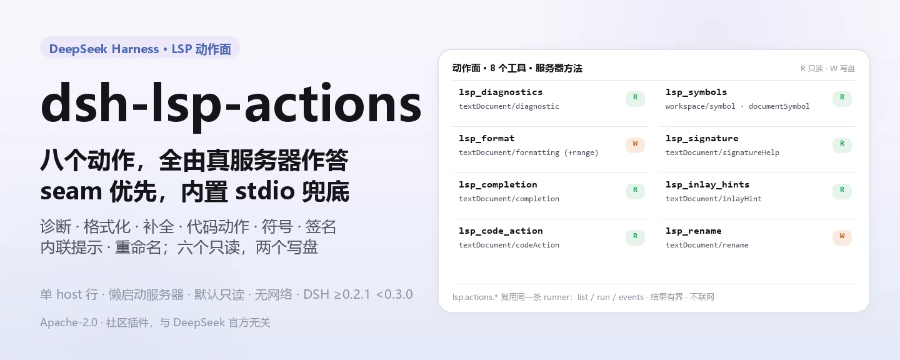
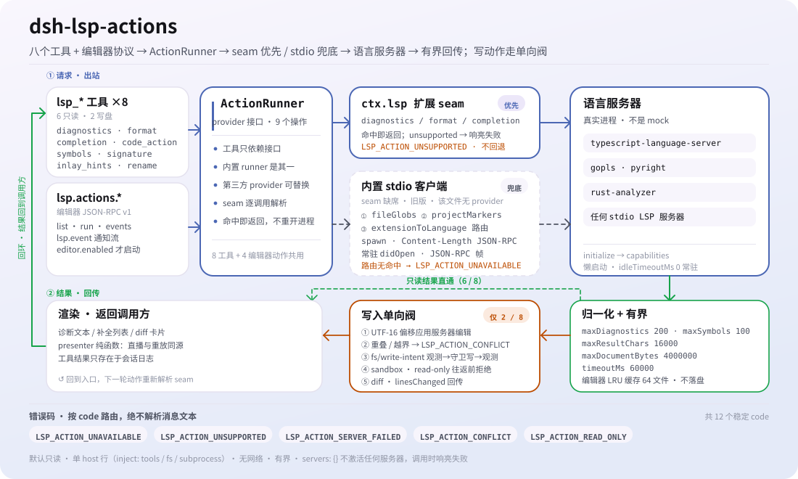

<div align="center">

<picture>
  <source media="(prefers-color-scheme: dark)" srcset="docs/assets/dsh-lsp-actions-hero-zh-dark.webp">
  
</picture>

# dsh-lsp-actions

**让 agent 在真实语言服务器上写代码、改代码——诊断、格式化、补全、代码动作、符号、签名、内联提示与重命名一步到位。**

面向 DeepSeek Harness 的 LSP 动作面：官方 `ctx.lsp` seam 负责导航，本插件补齐动作闭环，并附带稳定的编辑器 action 协议（`lsp.actions.*`），让 VS Code 等编辑器直接把它当 IDE 后端。

[安装](#三步上手) · [配置](#配置) · [FAQ](#faq) · [简体中文](README.md) · [English](README.en.md) · [Español](README.es.md) · [Português](README.pt.md) · [हिन्दी](README.hi.md)

[](LICENSE)
[](#兼容性)
[](https://www.npmjs.com/package/dsh-lsp-actions)
[](https://github.com/PerryLink/dsh-lsp-actions/actions/workflows/ci.yml)
[](#兼容性)

[](https://github.com/PerryLink/dsh-lsp-actions/stargazers)
[](https://www.npmjs.com/package/dsh-lsp-actions)
[](https://dshfind.com/plugins/PerryLink/dsh-lsp-actions?ref=badge)
[](https://securityscorecards.dev/viewer/?uri=github.com/PerryLink/dsh-lsp-actions)
[](https://dsh.market/)
[](https://gitee.com/perrylink/dsh-lsp-actions)

```sh
dsh plugin --profile <name> add dsh-lsp-actions
```

</div>

<sub>社区插件，与 DeepSeek 官方无关。唯一仓库：<https://github.com/PerryLink/dsh-lsp-actions>（Gitee 为镜像）。</sub>

## 它是什么

`dsh-lsp-actions` 把 agent 写代码时最需要的那圈反馈接到真实语言服务器上：诊断、格式化、补全、代码动作、符号、签名提示、内联提示与重命名，全部由你 IDE 正在用的那些服务器（`typescript-language-server`、gopls、pyright、rust-analyzer……）应答。官方 `ctx.lsp` seam 只覆盖导航（跳转定义、引用、实现、悬停），本插件补齐动作面——并把它包装成稳定的编辑器 action 协议（`lsp.actions.*`），让 VS Code 等编辑器不必自己实现 LSP 就能消费这些能力。它以单个 host 行挂载（`id: lsp-actions`、`inject: [tools, fs, subprocess]`），服务端进程按需懒启动，所有写操作走官方 `fs/write-intent` 与沙箱审批。

<picture>
  <source media="(prefers-color-scheme: dark)" srcset="docs/assets/dsh-lsp-actions-flow-v5-dark.svg">
  
</picture>

## 三步上手

1. **安装**（三选一）：

   ```sh
   # git 通道（最新 main；prepare 脚本会用 tsc 构建出 lib/）
   dsh plugin --profile web add github:PerryLink/dsh-lsp-actions
   # npm 通道（已发布版本）
   dsh plugin --profile web add dsh-lsp-actions
   # tarball 通道：本仓库 pnpm pack 后
   dsh plugin --profile web add ./dsh-lsp-actions-<version>.tgz
   ```

2. **最小配置**（默认 `servers: {}` 不激活任何服务器，至少加一条）：

   ```yaml
   - insert:
       - id: lsp-actions
         name: dsh-lsp-actions
         config:
           servers:
             typescript:
               command: typescript-language-server
               args: ["--stdio"]
               extensionToLanguage: { ".ts": typescript, ".tsx": typescriptreact }
               projectMarkers: ["package.json", "tsconfig.json"]
   ```

3. **验证已生效**：

   ```sh
   dsh --profile web --dump-config | grep -A3 'id: lsp-actions'
   ```

   ```text
   > lsp_diagnostics a.ts
   a.ts:1:3  [Error] boom [ts 2304]
   ```

**卸载**：`dsh plugin --profile web remove dsh-lsp-actions`（或从 profile patch 删掉该行）。

<details>
<summary>从 DSH Desktop 市场安装</summary>

所有 PerryLink 插件均可在 DSH Desktop 内置市场中浏览：**市场 → 来源 → 添加来源 → 粘贴** `https://perrylink-dsh-catalog.perrylink.workers.dev/catalog-source.json` **→ 选中**。安装仍需通过市场的 npm 身份校验与你的确认。

</details>

## 核心能力

本插件**只补齐动作面**：导航仍由官方 `ctx.lsp` seam 提供，动作在 seam 缺席、版本过旧或该文件没有 provider 时回落到插件自带的最小 stdio 客户端。

- **八个 `lsp_*` 工具** —— 诊断、格式化、补全、代码动作、符号、签名提示、内联提示与重命名，全部由真实语言服务器应答，不是 mock。
- **编辑器 action 协议 v1** —— 稳定的 JSON-RPC 面（`lsp.actions.list` / `lsp.actions.run` / `lsp.events`），任何编辑器（先行 VS Code）都能直接消费这些能力。
- **真实服务器验证** —— 测试套件含一次真实 `typescript-language-server` 运行与一次编辑器协议 e2e；CI 在 Node 22/24 × Linux/Windows/macOS 上跑。
- **写操作走官方通道** —— `lsp_format` / `lsp_rename` 经 `fs/write-intent` waterfall 与每次调用的沙箱策略；只读会话在服务器往返前就被拒绝。
- **默认只读** —— 八个工具里六个纯参考；只有格式化与重命名会改文件。
- **有界** —— 结果条数、字符数、文档字节数与每次调用超时都有上限；诊断缓存是有界 LRU。

```text
lsp_diagnostics / lsp_format / lsp_completion / lsp_code_action /
lsp_symbols / lsp_signature / lsp_inlay_hints / lsp_rename
        │
        ▼
   ctx.lsp seam（扩展后：diagnostics / formatDocument / completion）
        │  缺席 · 旧版 · 该文件无 provider
        ▼
   内置 stdio 客户端  ←  servers 表（ctx.subprocess.spawn + JSON-RPC）
```

### 工具与动作面

| 表面 | 类型 | 说明 |
|---|---|---|
| `lsp_diagnostics` | tool | `<file>` —— 编译器/分析器的错误、警告与提示，含严重级、范围、消息与来源服务器（只读） |
| `lsp_format` | tool | `<file> [range?]` —— 经语言服务器格式化文件/选区并应用，返回 diff（经 `fs/write-intent` 写盘） |
| `lsp_completion` | tool | `<file> <line> <character>` —— 光标处的补全建议，含插入文本（只读） |
| `lsp_code_action` | tool | `<file> [range?] [only?]` —— 服务器验证过的快速修复/重构（含其编辑），作用于某范围或首个诊断（仅参考） |
| `lsp_symbols` | tool | `<query?> <file_path?>` —— 按名字全局搜索符号，或列出单个文件的大纲（只读） |
| `lsp_signature` | tool | `<file> <line> <character>` —— 调用点处的签名提示（参数与文档）（只读） |
| `lsp_inlay_hints` | tool | `<file> [range?]` —— 服务器给出的类型标注与参数名提示（只读） |
| `lsp_rename` | tool | `<file> <line> <character> <new_name>` —— 服务器验证过的重命名，跨工作区应用并返回逐文件 diff（经 `fs/write-intent` 写盘） |
| `lsp.actions.*` | protocol | 编辑器 action 协议 v1：经 JSON-RPC 的 `lsp.actions.list` / `lsp.actions.run` / `lsp.events` |
| `examples/vscode/` | extension | 纯 UI 的 VS Code 扩展，及其所连接的 headless 后端组合 |

### 示例

以下为插件真实入口；安装后调用一个即可。

**详细示例** —— 命令 `lsp_diagnostics`，输入：

```json
{
  "file_path": "a.ts"
}
```

输出：

```text
a.ts:1:3  [Error] boom [ts 2304]
a.ts:3:1  [Hint] hint
```

*Observed from `plugins/dsh-lsp-actions/tests/render.spec.ts:32-37 (exact toBe); tool-level no-result render at plugins/dsh-lsp-actions/tests/tools.spec.ts:150-156`*

**失败分支** —— 输入：

```text
{"action":"format","requestId":"f1","params":{"filePath":"a.ts","workspaceRoot":"<session-workspace>"}} under a read-only permission preset
```

输出：

```text
{
  "requestId": "f1",
  "action": "format",
  "status": "failed",
  "error": {
    "code": "LSP_ACTION_READ_ONLY",
    "message": "[sandbox: file access denied under read-only mode]\n[sandbox: escalation available — retry this exact operation once with sandbox_permissions (the narrowest wider mode that suffices) + justification; the approval prompt asks the user]"
  }
}
```

*Observed from `plugins/dsh-lsp-actions/src/tools.ts:213-223; plugins/dsh-lsp-actions/src/editor/actions.ts:320-330; plugins/dsh-lsp-actions/tests/editor-protocol.spec.ts:305-325`*

**简短示例**：`lsp_format` · `lsp_completion`

### 编辑器 action 协议 v1

在专用 headless 组合中设置 `editor.enabled: true` 后，`dsh-lsp-actions` 通过换行分帧的 JSON-RPC 2.0（与官方 SDK/ACP 传输同一线格式）提供稳定的编辑器协议：

| 方法 | 作用 |
|---|---|
| `lsp.actions.list` | 返回 `lsp-actions/v1` 协议版本、动作目录（`diagnostics.get`、`completion.get`、`quickfix.apply`、`format`，逐个标注 `writes`）与可寻址的 DSH 会话 |
| `lsp.actions.run` | 执行一个动作，返回结构化 `{ requestId, action, status, result \| error }` 信封；错误携带稳定的 `LSP_ACTION_*` 码 |
| `lsp.events` | 订阅流式 `lsp.event` 通知：`diagnostics.updated`、`action.status`、`file.changed`、`sessions.changed` |

所有写动作（`quickfix.apply`、`format`）都走**官方权限预设与审批**：`read-only` 会话在任何服务器往返前以 `LSP_ACTION_READ_ONLY` 拒绝；编辑走 `fs/write-intent` waterfall；`sandbox_permissions` + `justification` 升级对经官方 `approveEscalation` 询问（无应答方时 fail-closed）。完整线上规范（双语）：[`docs/editor-protocol.md`](docs/editor-protocol.md) · [`docs/editor-protocol.zh-CN.md`](docs/editor-protocol.zh-CN.md)。

**版本化与向后兼容承诺**

- 协议带版本 —— `lsp.actions.list` 返回 `protocol: "lsp-actions/v1"`、`version: 1`。**v1 已冻结：**字段名、动作 id、事件类型与错误码永久稳定。
- 演进**只做加法**：新动作、新字段、新事件类型无需升版本；既有语义绝不原地变更；破坏性变更以新的 `protocol` 版本发布，服务端可并行服务多版本。
- 客户端必须忽略未知字段、未知事件类型与未知动作，并按稳定的错误 `code` 路由，绝不解析消息文本。

**错误码**

每个失败都携带稳定 `code`；模型与调用方按 code 路由，绝不解析消息文本。

| Code | 含义 |
|---|---|
| `LSP_ACTION_UNAVAILABLE` | 没有服务器 entry、seam provider 也不处理该文件 |
| `LSP_ACTION_UNSUPPORTED` | 服务器（或 seam provider）未广告该操作 |
| `LSP_ACTION_SERVER_FAILED` | 服务器失败（附 stderr 尾部）；启动失败重试一次 |
| `LSP_ACTION_MALFORMED_RESPONSE` | 服务器返回了结构非法的负载 |
| `LSP_ACTION_CONFLICT` | 文件读后已变，或编辑重叠 / 越界 / 越出工作区 |
| `LSP_ACTION_READ_ONLY` | 会话沙箱模式禁止格式化/重命名写入 |
| `LSP_ACTION_WORKSPACE_REQUIRED` | 调用会话没有可扎根的 workspace cwd |
| `LSP_ACTION_NO_SYMBOL` | 服务器在光标位置找不到可重命名的符号 |
| `LSP_ACTION_UNKNOWN` | 编辑器协议：未知动作 id，或没有 code action 匹配 `title`/`index` |
| `LSP_ACTION_INVALID_ARGS` | 编辑器协议：动作参数不合法 |
| `LSP_ACTION_APPROVAL_UNAVAILABLE` | 编辑器协议：审批路径未能授予更宽沙箱模式（fail-closed） |
| `LSP_PROTOCOL_VERSION_UNSUPPORTED` | 编辑器协议：所声明的协议版本不被支持 |

### VS Code 扩展

[`examples/vscode/`](examples/vscode/) 附带**纯 UI** 扩展（侧栏：DSH 会话、诊断列表、quickfix 一键应用、点击定位、格式化）及其经 ACP 风格 JSON-RPC 连接的 headless 后端组合（`backend/cordis.yml`）。扩展不实现任何 LSP 逻辑——所有能力与每一笔写入都属于插件。安装步骤、设置项与动图录制脚本见 [`examples/vscode/README.md`](examples/vscode/README.md)。

### 架构

动作**优先走官方 seam**，未命中则回落插件自带的最小 stdio 客户端。seam 扩展已向上游提案（[`upstream/lsp-action-seam.patch`](upstream/lsp-action-seam.patch)，PR 描述见 [`upstream/PR-description.md`](upstream/PR-description.md)）；合入后插件无需改动即自动迁移——内置客户端停止被使用即可。内置客户端会保留为 `servers` 表的独立兜底。**编辑器协议**复用同一 runner、同一写入路径与同一权限机制。

动作后端位于公开 provider 接口 `ActionRunner`（从包导出）之后：内置 runner 是其中一个实现，第三方 provider 可另行提供；八个工具只消费该接口，绝不依赖具体客户端。完整调研与设计笔记：[`docs/seam-extension-notes.md`](docs/seam-extension-notes.md)。

## 配置

所有可调项都是 Schemastery `Config` 字段（可从 cordis.yml 修改）。以 id 为目标的覆盖会替换整行——你需要重述每一个键。`cordis.patch.yml` 对每个键都有内联说明。

最常用键：

| 键 | 默认值 | 含义 |
|---|---|---|
| `servers` | `{}` | 命名的语言服务器；空表不激活任何服务器 |
| `editor.enabled` | `false` | 通过 JSON-RPC stdio 提供编辑器 action 协议（仅限 headless 后端） |
| `maxDiagnostics` | `200` | 每次结果的诊断上限 |
| `maxResultChars` | `16000` | 渲染结果上限（字符数） |
| `maxDocumentBytes` | `4000000` | 文档读取上限（字节数） |
| `timeoutMs` | `60000` | 每次调用的超时，由官方 timeout 策略执行 |

<details>
<summary>完整配置表（13 个键）</summary>

| 键 | 默认值 | 含义 |
|---|---|---|
| `servers` | `{}` | 命名的语言服务器；空表不激活任何服务器 |
| `editor.enabled` | `false` | 通过 JSON-RPC stdio 提供编辑器 action 协议（仅限 headless 后端） |
| `editor.requestTimeoutMs` | `60000` | 编辑器协议每次运行的超时预算（毫秒） |
| `editor.diagnosticsCacheMaxFiles` | `64` | 有界 LRU 诊断缓存大小（按文件数） |
| `maxDiagnostics` | `200` | 每次结果的诊断上限 |
| `maxCompletionItems` | `20` | 每次结果的补全项上限 |
| `maxCodeActions` | `50` | 每次结果的代码动作上限 |
| `maxSymbols` | `100` | 符号结果上限 |
| `maxSignatures` | `10` | 签名提示上限 |
| `maxInlayHints` | `200` | 内联提示上限 |
| `maxResultChars` | `16000` | 渲染结果上限（字符数） |
| `maxDocumentBytes` | `4000000` | 文档读取上限（字节数） |
| `timeoutMs` | `60000` | 每次调用的超时，由官方 timeout 策略执行 |

</details>

每个 `servers` 条目都是一个 `LspServerEntry`：`command`（可执行文件，加载期在 PATH 上解析）与 `extensionToLanguage`（`".ts"` → `typescript`）为必填；可选的 `fileGlobs`、`projectMarkers`、`args`、`env`、`initializationOptions`、`configuration`、`formattingOptions`、`maxMessageBytes`、`maxStderrBytes`、`killGraceMs`、`shutdownTimeoutMs`、`diagnosticsSettleMs`、`diagnosticsDebounceMs` 与 `idleTimeoutMs`（`0` = 保持服务器进程存活，这也是默认值）用于调校内置 stdio 客户端。

路由是确定性的，且完全由配置决定。每个文件按以下顺序取第一个命中：**(1)** 某条目的 `fileGlobs` 匹配该路径；**(2)** 从文件所在目录向上走到工作区根，最近的、含有某个条目 `projectMarkers` 所列工程配置文件的目录——且该条目同时映射该文件的扩展名；**(3)** 按配置顺序，`extensionToLanguage` 映射该扩展名的条目。因此同一工作区内的 `apps/node-app/{package.json,tsconfig.json,src/main.ts}` 与 `apps/deno-app/{deno.json,src/main.ts}` 会各自用本工程的服务器处理 `main.ts`：无需维护任何路径规则，新增、改名或移动工程也不必改动配置：

```yaml
servers:
  typescript:
    command: typescript-language-server
    args: ["--stdio"]
    extensionToLanguage: { ".ts": typescript, ".tsx": typescriptreact }
    projectMarkers: ["package.json", "tsconfig.json"]
  deno:
    command: deno
    args: ["lsp"]
    extensionToLanguage: { ".ts": typescript, ".tsx": typescriptreact }
    projectMarkers: ["deno.json", "deno.jsonc"]
```

工程标记只在该文件扩展名已被若干服务器映射的前提下做选择（绝不会扩大某个服务器的文件类型范围）；向上查找永不越过工作区根；某个目录里的工程配置绝不会作用于同级目录。第 **(1)** 步优先于工程标记：若某条目的 `fileGlobs` 命中该路径，仍以它为准——采用 `projectMarkers` 时请一并删掉项目级的 glob，否则残留的 `**/*.ts` 会继续把这些文件抢走。以上规则作用于内置 stdio 客户端；挂载的 `ctx.lsp` seam provider 自行决定路由。

## FAQ

<details>
<summary>默认 <code>servers: {}</code> 时会怎样？会静默失效吗？</summary>

不会静默。八个工具仍会注册，但每次调用在既无服务器条目、又无 `ctx.lsp` seam provider 处理该文件时，以 `LSP_ACTION_UNAVAILABLE` 响亮失败。seam 是逐次调用解析的，因此插件挂载之后再挂载 seam 也不需要重载。`editor.enabled: false`（默认）时编辑器协议根本不启动。

</details>

<details>
<summary>写文件会不会绕过沙箱与审批？</summary>

不会。只有 `lsp_format` 与 `lsp_rename` 会写入，且与官方 `write`/`edit` 走同一条通道：先过 `fs/write-intent` waterfall（观测 → 守卫写 → 观测）与本次调用的沙箱策略；`read-only` 会话在任何服务器往返之前就以 `LSP_ACTION_READ_ONLY` 拒绝；需要更宽权限时，`sandbox_permissions` + `justification` 升级对经官方 `approveEscalation` 询问用户，无应答方时 fail-closed 为 `LSP_ACTION_APPROVAL_UNAVAILABLE`。

</details>

<details>
<summary>会和别的插件抢工具名、事件或 slot 吗？</summary>

不会。工具全部带命名空间、不提供任何服务键、不注册客户端 slot、不注册 `webServer` 前缀、不改全局对象；组合包 patch 只 `insert` 自己那一行；唯一共享事件 `fs/write-intent` 一律经 `next()` 委托，绝不短路链条。逐条论证见「与其他 DSH 插件的互操作性」。

</details>

<details>
<summary>文件在我读完之后被改了，会被覆盖吗？</summary>

不会。文件读后已在磁盘上变化，动作以 `LSP_ACTION_CONFLICT` 失败；编辑重叠、越界或越出工作区同样报冲突。`lsp_rename` 在第一笔写入之前预检每一个待改文件。

</details>

<details>
<summary>资源开销多大？</summary>

服务器进程按需懒启动，每个实例的文档保持常驻直到进程回收；`idleTimeoutMs` 默认 `0`（常驻），设为正数即可在空闲后回收。每次调用的结果条数、字符数、文档字节数与总时长都有上限；编辑器协议的诊断缓存是有界 LRU（`editor.diagnosticsCacheMaxFiles`）；插件不发起任何网络请求。

</details>

## 安全边界

- **默认只读。** 八个工具中有六个仅作参考；只有 `lsp_format` 与 `lsp_rename` 会变更，且按真实的 `write`/`edit` 变更对待。
- **走官方 seam，而非另起炉灶。** 每个字节都经过 `fs/write-intent` waterfall（观测 → 守卫写 → 观测）与每次调用的沙箱策略；升级路径与官方 `write`/`edit` 工具一致。
- **响亮、快速、结构化地失败。** `servers` 为空且无 `ctx.lsp` seam → `LSP_ACTION_UNAVAILABLE`；只读会话在任何服务器往返前 → `LSP_ACTION_READ_ONLY`；命令形态只报告、绝不执行。
- **冲突绝不覆盖。** 文件读后已变则以 `LSP_ACTION_CONFLICT` 失败；`lsp_rename` 在第一笔写入前预检每个待改文件。
- **有界工作。** 结果上限、字节上限与平台的 timeout 策略约束每一次调用；诊断缓存是有界 LRU。
- **模型路径不缓存任何东西。** 工具结果只存在于会话日志；诊断缓存绝不跨重启持久化。
- **坏服务器响亮失败。** 命令缺失在加载期即失败；启动即死的服务器以 `LSP_ACTION_SERVER_FAILED` + stderr 尾部失败（启动失败先自动换新进程重试一次）。
- **提示词卫生。** 本插件不向会话系统提示词注入任何 persona 或提示词段落——面向模型的接口只有八个工具 Schema。

## 权限与数据

- **权限**：格式化与重命名走官方权限预设与审批——`fs/write-intent` waterfall 与 `sandbox_permissions` / `justification` 升级对，经 `ctx.approval` 裁决。插件在其 workshop manifest 中声明 `fs:read`、`fs:write`、`subprocess:spawn` 与 `network:none`。
- **数据**：不向磁盘写入任何东西；工具结果只存在于会话日志（无跨会话持久化）。编辑器协议只保留一个有界的内存 LRU 诊断缓存，带新鲜度戳，绝不跨重启持久化。隐私说明见 [`PRIVACY.md`](PRIVACY.md)。
- **无网络**：插件不发起任何网络请求；它通过本地子进程 stdio 与语言服务器通信。

## 已知限制

- **常驻文档。** 每个文档只打开一次，并在该服务器实例的整个生命周期内保持打开——后续请求若源码已变，会发一次全量 `didChange`；进程关闭时才收拢所有文档。因此基于工程的服务器（如 tsls）能应答 `textDocument/signatureHelp` 与不依赖打开文档的 `workspace/symbol`，而不是对刚关闭的文档返回 `null`。常驻集合以工作区为界，并随实例回收（空闲驱逐或插件释放）而清空。
- **范围格式化要求服务器的 range provider。** 只广告全文格式化的服务器对范围请求以 `LSP_ACTION_UNSUPPORTED` 失败。
- **重命名只应用文本编辑。** 服务器重命名结果中的资源操作（新建/删除/重命名文件）以 `LSP_ACTION_UNSUPPORTED` 拒绝；越出工作区的编辑在任何写入发生前以 `LSP_ACTION_CONFLICT` 失败。

## 与其他 DSH 插件的互操作性

已对照 **DSH `0.2.0-rc.2`**（本 README 面向的运行时）与 2026-10-05 实测的高星插件集验证。

本插件**不干扰**其他插件，包括广泛安装的高星插件：

- **无工具名冲突。** 所有工具都带命名空间，不占用任何已被内置工具或其他插件持有的裸名。
- **无服务键冲突。** 不提供任何服务键，因此不存在服务键冲突。
- **无 slot 冲突。** 不注册客户端 slot key，因此不参与 `shadows-shipped-ui` 座位争抢。
- **无 HTTP 路由冲突。** 不注册任何 `webServer` 前缀。
- **无 patch 层冲突。** 组合包 patch 只 `insert` 自己那一行，从不覆写内置行的 `config`。
- **无全局改写。** 不改原型、不改写 `process.env`、不替换全局 fetch dispatcher。

**共享事件监听器在构造上就不互相干扰。** 它用 `ctx.on()` 监听顺序敏感事件 `fs/write-intent` —— Cordis 的**广播**语义：每个监听器都会运行，任何一个都无法饿死其他监听器。**此处每个监听器都通过 `next()` 委托**，因此链条绝不会被短路；改写作用在 `next()` 产出的值上，而不是用它顶替返回。

静态证据：`dsh-plugin-doctor` 的 K10–K13 在本仓全部为 `pass`。

## 兼容性

| 维度 | 状态 |
|---|---|
| Harness | DeepSeek Harness `dsh-v0.2.1-alpha.1`（`engines.dsh`：`>=0.2.1-0 <0.3.0 \|\| >=0.2.2-0 <0.3.0`）；插件不自写会话事件——宿主记录标准 tool/call + tool/result 事件。已发布 seam 仍只有四个 legacy 操作，故插件保留自建客户端并在首次动作调用时记录该 vintage。已于 2026-09-24 核验（双 typecheck 尺子 + 全量测试 + self-contained/artifacts 门）。 |
| Node | `^22.19.0 \|\| >=24.9.0` |
| 平台 | 全部（纯 host；子进程 + 文件系统，无网络） |
| 模型 | 任意（工具与模型无关；插件从不调用模型） |

## 生态与质量

- [Gitee 镜像](https://gitee.com/perrylink/dsh-lsp-actions)（同步镜像，以 GitHub 为准）
- [dshfind 插件页](https://dshfind.com/plugins/PerryLink/dsh-lsp-actions)（安装量与排名）
- [OpenSSF Scorecard 报告](https://securityscorecards.dev/viewer/?uri=github.com/PerryLink/dsh-lsp-actions)（由 [.github/workflows/scorecard.yml](.github/workflows/scorecard.yml) 驱动）
- [dsh-plugin-doctor 验证报告](https://github.com/PerryLink/dsh-plugin-doctor#verified-徽章)（K10–K13 全 `pass`）
- [DSH Market](https://dsh.market/)（已上架）
- **1024 商店渠道**：先 `npm i -g dsh1024`，再 `dsh1024 plugin --profile web add dsh-lsp-actions`（计入 [deepseek1024.com](https://deepseek1024.com) 安装排行）
- [生态实测知识库](https://perrylink.github.io/dsh-plugin-guide/)：插件开发指南 · 选型实测数据 · 维护取舍判据

## 开发

```sh
pnpm install            # node ^22.19 || >=24.9
pnpm run lint           # oxlint over src/ and tests/
pnpm test               # vitest: 单元 + fixture-server 集成 + 编辑器协议 e2e + 真实 tsls e2e
pnpm run test:coverage  # 覆盖率门禁
pnpm build              # tsc --noEmitOnError && node scripts/fix-dts.mjs → lib/
pnpm run prepare        # 构建（安装时运行）
pnpm run prepublishOnly # 构建（发布前运行）
pnpm run check:readmes  # 五语 README 一致性门禁
pnpm run verify:self-contained  # 依赖 spec 均来自 registry
pnpm run verify:artifacts       # 发布文件齐全 + 产物可 import
pnpm run check:lockfile         # lockfile 漂移检查
```

目录布局：

```text
src/            插件主体：servers / client / runner / tools / editor / seam
tests/          vitest：单元 + fixture server + 编辑器协议 e2e + 真实 tsls e2e
examples/vscode 纯 UI 的 VS Code 扩展 + 它连接的 headless 后端组合
docs/           编辑器协议（双语）+ seam 扩展调研 + assets/
scripts/        构建产物修补与机械门禁（readme 同步 / self-contained / artifacts）
upstream/       seam 扩展的上游提案（补丁 + PR 描述）
verify/         编辑器后端的冒烟脚本与 scratch 组合
```

配图由 [`scripts/gen-readme-assets.py`](scripts/gen-readme-assets.py) 程序化生成（Pillow 出 1440×576 的 hero WebP，深浅 × 中英四版；手写 1100×660 的 SVG 请求-回传环），可重复执行。

Topics：`dsh`, `dsh-plugin`, `deepseek-harness`, `lsp`, `language-server`, `diagnostics`, `formatting`, `completion`, `code-action`, `symbols`, `signature-help`, `inlay-hints`, `rename`, `refactor`, `ide`, `editor`, `vscode`, `acp`, `json-rpc`

## 家族与致谢

本项目是 [PerryLink](https://github.com/PerryLink) 维护的 DeepSeek Harness 插件家族成员（全部 Apache-2.0）。如果这个插件帮到了你，**给个 star**——它不解锁任何功能，但会让下一个人更容易找到它。

- [@PerryLink](https://github.com/PerryLink) —— 创建者与维护者：LSP 动作客户端与服务器生命周期、全部八个工具、编辑器 action 协议、测试、CI，以及五语种文档。

<details>
<summary>展开全部插件</summary>

| 插件 | 状态 |
|---|---|
| **[dsh-aqua-input-check](https://github.com/PerryLink/dsh-aqua-input-check)** |  |
| **[dsh-archive-check](https://github.com/PerryLink/dsh-archive-check)** |  |
| **[dsh-auto-review](https://github.com/PerryLink/dsh-auto-review)** |  |
| **[dsh-autotier](https://github.com/PerryLink/dsh-autotier)** | 🧊 已冻结 — 见仓库 README |
| **[dsh-bid-ca-precheck](https://github.com/PerryLink/dsh-bid-ca-precheck)** |  |
| **[dsh-bid-qual-check](https://github.com/PerryLink/dsh-bid-qual-check)** |  |
| **[dsh-cert-mcp](https://github.com/PerryLink/dsh-cert-mcp)** | 🧊 已冻结 — 见仓库 README |
| **[dsh-checkpoint-rewind](https://github.com/PerryLink/dsh-checkpoint-rewind)** |  |
| **[dsh-click](https://github.com/PerryLink/dsh-click)** |  |
| **[dsh-composer-history](https://github.com/PerryLink/dsh-composer-history)** |  |
| **[dsh-contract-stance](https://github.com/PerryLink/dsh-contract-stance)** |  |
| **[dsh-customs-doc-check](https://github.com/PerryLink/dsh-customs-doc-check)** |  |
| **[dsh-data-quality](https://github.com/PerryLink/dsh-data-quality)** | 🧊 已冻结 — 见仓库 README |
| **[dsh-demurrage-ledger](https://github.com/PerryLink/dsh-demurrage-ledger)** |  |
| **[dsh-doublecheck](https://github.com/PerryLink/dsh-doublecheck)** |  |
| **[dsh-drill-script-check](https://github.com/PerryLink/dsh-drill-script-check)** |  |
| **[dsh-eia-guide-check](https://github.com/PerryLink/dsh-eia-guide-check)** |  |
| **[dsh-emergency-plan](https://github.com/PerryLink/dsh-emergency-plan)** |  |
| **[dsh-essay-rubric-check](https://github.com/PerryLink/dsh-essay-rubric-check)** |  |
| **[dsh-evidence-check](https://github.com/PerryLink/dsh-evidence-check)** |  |
| **[dsh-export-ctl-check](https://github.com/PerryLink/dsh-export-ctl-check)** |  |
| **[dsh-fast](https://github.com/PerryLink/dsh-fast)** |  |
| **[dsh-fmea-table-check](https://github.com/PerryLink/dsh-fmea-table-check)** |  |
| **[dsh-forecast-penalty](https://github.com/PerryLink/dsh-forecast-penalty)** |  |
| **[dsh-fund-research](https://github.com/PerryLink/dsh-fund-research)** |  |
| **[dsh-github](https://github.com/PerryLink/dsh-github)** |  |
| **[dsh-gongwen-flow-check](https://github.com/PerryLink/dsh-gongwen-flow-check)** |  |
| **[dsh-gongwen-word-check](https://github.com/PerryLink/dsh-gongwen-word-check)** |  |
| **[dsh-guard-plan-qc](https://github.com/PerryLink/dsh-guard-plan-qc)** |  |
| **[dsh-hazchem-check](https://github.com/PerryLink/dsh-hazchem-check)** |  |
| **[dsh-hazplan-check](https://github.com/PerryLink/dsh-hazplan-check)** |  |
| **[dsh-hidden-risk-map](https://github.com/PerryLink/dsh-hidden-risk-map)** |  |
| **[dsh-hs-classify](https://github.com/PerryLink/dsh-hs-classify)** |  |
| **[dsh-icd-rule-check](https://github.com/PerryLink/dsh-icd-rule-check)** |  |
| **[dsh-industry-research](https://github.com/PerryLink/dsh-industry-research)** |  |
| **[dsh-lawcite-adapter](https://github.com/PerryLink/dsh-lawcite-adapter)** |  |
| **[dsh-laya](https://github.com/PerryLink/dsh-laya)** |  |
| **[dsh-lc-doc-check](https://github.com/PerryLink/dsh-lc-doc-check)** |  |
| **[dsh-learning-gap-check](https://github.com/PerryLink/dsh-learning-gap-check)** |  |
| **[dsh-library](https://github.com/PerryLink/dsh-library)** |  |
| **[dsh-local-ai](https://github.com/PerryLink/dsh-local-ai)** |  |
| **[dsh-lsp-actions](https://github.com/PerryLink/dsh-lsp-actions)** |  |
| **[dsh-mask](https://github.com/PerryLink/dsh-mask)** |  |
| **[dsh-mcp-panel](https://github.com/PerryLink/dsh-mcp-panel)** |  |
| **[dsh-medrec-qc](https://github.com/PerryLink/dsh-medrec-qc)** |  |
| **[dsh-memento](https://github.com/PerryLink/dsh-memento)** | 🧊 已冻结 — 见仓库 README |
| **[dsh-nsfc-form-check](https://github.com/PerryLink/dsh-nsfc-form-check)** |  |
| **[dsh-nurse-record-check](https://github.com/PerryLink/dsh-nurse-record-check)** |  |
| **[dsh-observe](https://github.com/PerryLink/dsh-observe)** |  |
| **[dsh-origin-rvc-check](https://github.com/PerryLink/dsh-origin-rvc-check)** |  |
| **[dsh-ota-review-check](https://github.com/PerryLink/dsh-ota-review-check)** |  |
| **[dsh-output-styles](https://github.com/PerryLink/dsh-output-styles)** |  |
| **[dsh-paper-doc-adapter](https://github.com/PerryLink/dsh-paper-doc-adapter)** |  |
| **[dsh-permission-rules](https://github.com/PerryLink/dsh-permission-rules)** |  |
| **[dsh-permit-report-check](https://github.com/PerryLink/dsh-permit-report-check)** |  |
| **[dsh-pipeline-check](https://github.com/PerryLink/dsh-pipeline-check)** |  |
| **[dsh-pleading-draft](https://github.com/PerryLink/dsh-pleading-draft)** |  |
| **[dsh-plugin-doctor](https://github.com/PerryLink/dsh-plugin-doctor)** | 🚫 已退役（仓库已归档） |
| **[dsh-plugin-guide](https://github.com/PerryLink/dsh-plugin-guide)** |  |
| **[dsh-plugin-kit](https://github.com/PerryLink/dsh-plugin-kit)** | 🚫 已退役（仓库已归档） |
| **[dsh-plugin-upgrade](https://github.com/PerryLink/dsh-plugin-upgrade)** | 🚫 已退役（仓库已归档） |
| **[dsh-policy-brief-draft](https://github.com/PerryLink/dsh-policy-brief-draft)** |  |
| **[dsh-power-loss-split](https://github.com/PerryLink/dsh-power-loss-split)** |  |
| **[dsh-power-ticket-check](https://github.com/PerryLink/dsh-power-ticket-check)** |  |
| **[dsh-ppap-check](https://github.com/PerryLink/dsh-ppap-check)** |  |
| **[dsh-protest-deadline](https://github.com/PerryLink/dsh-protest-deadline)** |  |
| **[dsh-railway-window](https://github.com/PerryLink/dsh-railway-window)** |  |
| **[dsh-repair-order-qc](https://github.com/PerryLink/dsh-repair-order-qc)** |  |
| **[dsh-research-report](https://github.com/PerryLink/dsh-research-report)** |  |
| **[dsh-review-reply-check](https://github.com/PerryLink/dsh-review-reply-check)** |  |
| **[dsh-rulefile-check](https://github.com/PerryLink/dsh-rulefile-check)** |  |
| **[dsh-safety-brief-check](https://github.com/PerryLink/dsh-safety-brief-check)** |  |
| **[dsh-score](https://github.com/PerryLink/dsh-score)** | 🧊 已冻结 — 见仓库 README |
| **[dsh-session-sync](https://github.com/PerryLink/dsh-session-sync)** |  |
| **[dsh-site-log-check](https://github.com/PerryLink/dsh-site-log-check)** |  |
| **[dsh-skill-pack-security](https://github.com/PerryLink/dsh-skill-pack-security)** |  |
| **[dsh-soe-decision-check](https://github.com/PerryLink/dsh-soe-decision-check)** |  |
| **[dsh-soilwater-check](https://github.com/PerryLink/dsh-soilwater-check)** |  |
| **[dsh-sop-sync-check](https://github.com/PerryLink/dsh-sop-sync-check)** |  |
| **[dsh-spc-gbt-adapter](https://github.com/PerryLink/dsh-spc-gbt-adapter)** |  |
| **[dsh-talk](https://github.com/PerryLink/dsh-talk)** |  |
| **[dsh-tender-extract](https://github.com/PerryLink/dsh-tender-extract)** |  |
| **[dsh-tender-matrix](https://github.com/PerryLink/dsh-tender-matrix)** |  |
| **[dsh-test-drive](https://github.com/PerryLink/dsh-test-drive)** |  |
| **[dsh-ticktick](https://github.com/PerryLink/dsh-ticktick)** | 🚫 已退役（仓库已归档） |
| **[dsh-translate](https://github.com/PerryLink/dsh-translate)** |  |
| **[dsh-warranty-calc](https://github.com/PerryLink/dsh-warranty-calc)** |  |
| **[dsh-budget](https://github.com/PerryLink/dsh-budget)** | 🧊 已冻结 — 见仓库 README |
| **[dsh-claude-move](https://github.com/PerryLink/dsh-claude-move)** | 🧊 已冻结 — 见仓库 README |
| **[dsh-defend](https://github.com/PerryLink/dsh-defend)** | 🧊 已冻结 — 见仓库 README |
| **[dsh-draw](https://github.com/PerryLink/dsh-draw)** | 🧊 已冻结 — 见仓库 README |
| **[dsh-reach](https://github.com/PerryLink/dsh-reach)** | 🧊 已冻结 — 见仓库 README |
| **[dsh-background-agents](https://github.com/PerryLink/dsh-background-agents)** | 🚫 已退役（仓库已归档） |
| **[dsh-session-pin](https://github.com/PerryLink/dsh-session-pin)** | 🚫 已退役（仓库已归档） |
| **[dsh-team-rooms](https://github.com/PerryLink/dsh-team-rooms)** | 🚫 已退役（仓库已归档） |

</details>

## License

[LICENSE](LICENSE)（Apache License 2.0）© 2026 dsh-lsp-actions contributors

<p align="center"><sub>Apache-2.0 · 社区插件，与 DeepSeek 无关。</sub></p>

<p align="center"><sub>工具链：<a href="https://github.com/PerryLink/dsh-plugin-guide">dsh-plugin-guide</a> · <a href="https://github.com/PerryLink/dsh-standards">dsh-standards</a> · <a href="https://github.com/PerryLink/dsh-plugin-start">dsh-plugin-start</a></sub></p>
