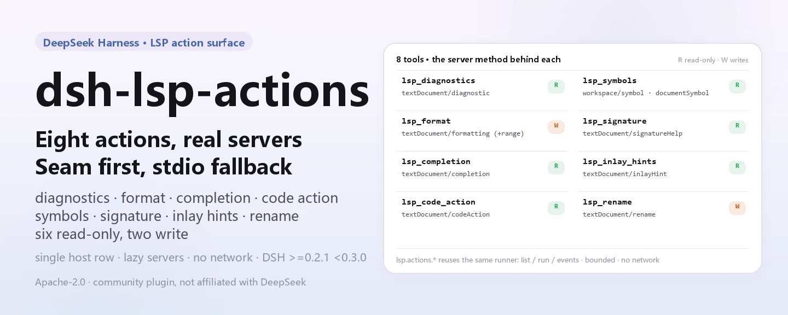
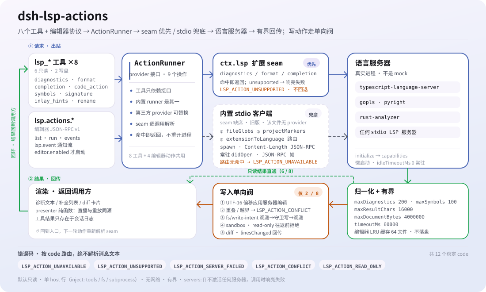

<div align="center">

<picture>
  <source media="(prefers-color-scheme: dark)" srcset="docs/assets/dsh-lsp-actions-hero-en-dark.webp">
  
</picture>

# dsh-lsp-actions

**Deixe seu agente escrever e corrigir código contra servidores de linguagem reais — diagnósticos, formatação, autocompletar, ações de código, símbolos, ajuda de assinatura, dicas inline e renomeação em uma única superfície de ações.**

A superfície de ações LSP para o DeepSeek Harness: o seam oficial `ctx.lsp` cobre a navegação, este plugin completa o ciclo de ações e o protocolo estável de ações do editor (`lsp.actions.*`) deixa editores como o VS Code usá-lo como backend de IDE.

[Instalar](#instalação-em-três-passos) · [Configuração](#configuração) · [FAQ](#faq) · [简体中文](README.md) · [English](README.en.md) · [Español](README.es.md) · [Português](README.pt.md) · [हिन्दी](README.hi.md)

[](LICENSE)
[](#compatibilidade)
[](https://www.npmjs.com/package/dsh-lsp-actions)
[](https://github.com/PerryLink/dsh-lsp-actions/actions/workflows/ci.yml)
[](#compatibilidade)

[](https://github.com/PerryLink/dsh-lsp-actions/stargazers)
[](https://www.npmjs.com/package/dsh-lsp-actions)
[](https://dshfind.com/plugins/PerryLink/dsh-lsp-actions?ref=badge)
[](https://securityscorecards.dev/viewer/?uri=github.com/PerryLink/dsh-lsp-actions)
[](https://dsh.market/)
[](https://gitee.com/perrylink/dsh-lsp-actions)

```sh
dsh plugin --profile <name> add dsh-lsp-actions
```

</div>

<sub>Plugin da comunidade, sem afiliação com a DeepSeek. Repositório canônico: <https://github.com/PerryLink/dsh-lsp-actions> (o Gitee é um espelho).</sub>

## O que é

O `dsh-lsp-actions` conecta o ciclo de feedback de que um agente precisa enquanto escreve código a servidores de linguagem reais: diagnósticos, formatação, autocompletar, ações de código, símbolos, ajuda de assinatura, dicas inline e renomeação são respondidos pelo mesmo servidor que o seu IDE usa (`typescript-language-server`, gopls, pyright, rust-analyzer…). O seam oficial `ctx.lsp` cobre apenas a navegação (ir para definição, referências, implementação, hover); este plugin completa a superfície de ações e a empacota como o protocolo estável de ações do editor (`lsp.actions.*`), para que editores como o VS Code consumam essas capacidades sem implementar LSP por conta própria. Ele monta como uma única linha host (`id: lsp-actions`, `inject: [tools, fs, subprocess]`), inicia os processos de servidor sob demanda e faz cada escrita passar pelo waterfall oficial `fs/write-intent` e pela aprovação do sandbox.

<picture>
  <source media="(prefers-color-scheme: dark)" srcset="docs/assets/dsh-lsp-actions-flow-v5-dark.svg">
  
</picture>

## Instalação em três passos

1. **Instalar** (escolha um canal):

   ```sh
   # canal git (main mais recente; o script prepare compila lib/ com tsc)
   dsh plugin --profile web add github:PerryLink/dsh-lsp-actions
   # canal npm (versões publicadas)
   dsh plugin --profile web add dsh-lsp-actions
   # canal tarball: pnpm pack neste repositório e então
   dsh plugin --profile web add ./dsh-lsp-actions-<version>.tgz
   ```

2. **Configuração mínima** (o padrão `servers: {}` não ativa nenhum servidor; adicione ao menos uma entrada):

   ```yaml
   - insert:
       - id: lsp-actions
         name: dsh-lsp-actions
         config:
           servers:
             typescript:
               command: typescript-language-server
               args: ["--stdio"]
               extensionToLanguage: { ".ts": typescript, ".tsx": typescriptreact }
               projectMarkers: ["package.json", "tsconfig.json"]
   ```

3. **Verificar se montou**:

   ```sh
   dsh --profile web --dump-config | grep -A3 'id: lsp-actions'
   ```

   ```text
   > lsp_diagnostics a.ts
   a.ts:1:3  [Error] boom [ts 2304]
   ```

**Desinstalar**: `dsh plugin --profile web remove dsh-lsp-actions` (ou remova a linha do patch do perfil).

<details>
<summary>Instalar pelo mercado do DSH Desktop</summary>

Todos os plugins da PerryLink aparecem no mercado embutido do DSH Desktop: **Mercado → Fontes → Adicionar fonte → cole** `https://perrylink-dsh-catalog.perrylink.workers.dev/catalog-source.json` **→ selecione**. A instalação continua exigindo a verificação de identidade npm do mercado e a sua confirmação.

</details>

## Capacidades principais

Este plugin completa **apenas a superfície de ações**: a navegação continua vindo do seam oficial `ctx.lsp`, e as ações caem para o cliente stdio mínimo próprio quando o seam está ausente, é de uma versão antiga ou não tem provedor para aquele arquivo.

- **Oito ferramentas `lsp_*`** — diagnósticos, formatação, autocompletar, ações de código, símbolos, ajuda de assinatura, dicas inline e renomeação, todas respondidas por servidores de linguagem reais, não por mocks.
- **Protocolo de ações do editor v1** — uma superfície JSON-RPC estável (`lsp.actions.list` / `lsp.actions.run` / `lsp.events`) que permite a qualquer editor (VS Code primeiro) consumir essas capacidades diretamente.
- **Verificação com servidor real** — a suíte inclui uma execução real de `typescript-language-server` e um e2e do protocolo do editor; a CI roda em Node 22/24 no Linux, Windows e macOS.
- **Escritas pela via oficial** — `lsp_format` / `lsp_rename` passam pelo waterfall `fs/write-intent` e pela política de sandbox de cada chamada; uma sessão `read-only` é recusada antes de qualquer ida e volta ao servidor.
- **Somente leitura por padrão** — seis das oito ferramentas são apenas de referência; só formatação e renomeação alteram.
- **Limitado** — quantidade de resultados, caracteres, bytes de documento e tempo por chamada têm teto; o cache de diagnósticos é uma LRU limitada.

```text
lsp_diagnostics / lsp_format / lsp_completion / lsp_code_action /
lsp_symbols / lsp_signature / lsp_inlay_hints / lsp_rename
        │
        ▼
   ctx.lsp seam (estendido: diagnostics / formatDocument / completion)
        │  ausente · versão antiga · sem provedor para este arquivo
        ▼
   cliente stdio embutido  ←  tabela servers (ctx.subprocess.spawn + JSON-RPC)
```

### Ferramentas e superfícies

| Superfície | Tipo | Notas |
|---|---|---|
| `lsp_diagnostics` | tool | `<file>` — erros, avisos e dicas do compilador/analisador com severidade, intervalo, mensagem e servidor de origem (somente leitura) |
| `lsp_format` | tool | `<file> [range?]` — formata um arquivo/seleção pelo servidor de linguagem e aplica, retornando o diff (escreve via `fs/write-intent`) |
| `lsp_completion` | tool | `<file> <line> <character>` — sugestões de autocompletar em uma posição do cursor, incluindo o texto de inserção (somente leitura) |
| `lsp_code_action` | tool | `<file> [range?] [only?]` — quickfixes/refatorações verificados pelo servidor com suas edições, para um intervalo ou o primeiro diagnóstico (apenas referência) |
| `lsp_symbols` | tool | `<query?> <file_path?>` — busca de símbolos por nome em todo o workspace, ou o esqueleto de um arquivo (somente leitura) |
| `lsp_signature` | tool | `<file> <line> <character>` — ajuda de assinatura (parâmetros e documentação) dentro de uma chamada (somente leitura) |
| `lsp_inlay_hints` | tool | `<file> [range?]` — anotações de tipo e nomes de parâmetro fornecidos pelo servidor (somente leitura) |
| `lsp_rename` | tool | `<file> <line> <character> <new_name>` — renomeação verificada pelo servidor, aplicada em todo o workspace com diffs por arquivo (escreve via `fs/write-intent`) |
| `lsp.actions.*` | protocol | Protocolo de ações do editor v1: `lsp.actions.list` / `lsp.actions.run` / `lsp.events` sobre JSON-RPC |
| `examples/vscode/` | extension | Extensão do VS Code apenas de UI mais a composição headless do backend à qual se conecta |

### Exemplos

Estes são os pontos de entrada reais do plugin; instale uma vez e chame um.

**Exemplo detalhado** — comando `lsp_diagnostics`, entrada:

```json
{
  "file_path": "a.ts"
}
```

Saída:

```text
a.ts:1:3  [Error] boom [ts 2304]
a.ts:3:1  [Hint] hint
```

*Observed from `plugins/dsh-lsp-actions/tests/render.spec.ts:32-37 (exact toBe); tool-level no-result render at plugins/dsh-lsp-actions/tests/tools.spec.ts:150-156`*

**Ramo de falha** — entrada:

```text
{"action":"format","requestId":"f1","params":{"filePath":"a.ts","workspaceRoot":"<session-workspace>"}} under a read-only permission preset
```

Saída:

```text
{
  "requestId": "f1",
  "action": "format",
  "status": "failed",
  "error": {
    "code": "LSP_ACTION_READ_ONLY",
    "message": "[sandbox: file access denied under read-only mode]\n[sandbox: escalation available — retry this exact operation once with sandbox_permissions (the narrowest wider mode that suffices) + justification; the approval prompt asks the user]"
  }
}
```

*Observed from `plugins/dsh-lsp-actions/src/tools.ts:213-223; plugins/dsh-lsp-actions/src/editor/actions.ts:320-330; plugins/dsh-lsp-actions/tests/editor-protocol.spec.ts:305-325`*

**Exemplos curtos**: `lsp_format` · `lsp_completion`

### Protocolo de ações do editor v1

Com `editor.enabled: true` em uma composição headless dedicada, o `dsh-lsp-actions` serve um protocolo de editor estável sobre JSON-RPC 2.0 delimitado por quebras de linha (o mesmo enquadramento dos transportes oficiais SDK/ACP):

| Método | O que faz |
|---|---|
| `lsp.actions.list` | Retorna a versão de protocolo `lsp-actions/v1`, o catálogo de ações (`diagnostics.get`, `completion.get`, `quickfix.apply`, `format`, cada uma marcada com `writes`) e as sessões DSH endereçáveis |
| `lsp.actions.run` | Executa uma ação com um envelope estruturado `{ requestId, action, status, result \| error }`; os erros carregam os códigos estáveis `LSP_ACTION_*` |
| `lsp.events` | Assina as notificações `lsp.event` em streaming: `diagnostics.updated`, `action.status`, `file.changed`, `sessions.changed` |

Todas as ações de escrita (`quickfix.apply`, `format`) passam pelos **presets de permissão e pela aprovação oficiais**: uma sessão `read-only` é recusada com `LSP_ACTION_READ_ONLY` antes de qualquer ida e volta ao servidor, as edições viajam pelo waterfall `fs/write-intent`, e o par de escalonamento `sandbox_permissions` + `justification` é resolvido pelo ask oficial `approveEscalation` (fail-closed quando nenhum respondente pode decidir). Especificação completa do protocolo, bilíngue: [`docs/editor-protocol.md`](docs/editor-protocol.md) · [`docs/editor-protocol.zh-CN.md`](docs/editor-protocol.zh-CN.md).

**Versionamento e a promessa de compatibilidade retroativa**

- O protocolo é versionado — `lsp.actions.list` retorna `protocol: "lsp-actions/v1"`, `version: 1`. **v1 está congelado:** nomes de campo, ids de ação, tipos de evento e códigos de erro permanecem estáveis para sempre.
- A evolução é **apenas aditiva**: novas ações, campos e tipos de evento chegam sem subir a versão; a semântica existente nunca muda no lugar; uma mudança incompatível sai sob uma nova versão de `protocol`, que os servidores podem servir em paralelo.
- Os clientes devem ignorar campos, tipos de evento e ações desconhecidos, e rotear pelo `code` estável do erro, nunca pelo texto da mensagem.

**Códigos de erro**

Cada falha carrega um `code` estável; modelos e chamadores roteiam pelo código, nunca pelo texto da mensagem.

| Código | Significado |
|---|---|
| `LSP_ACTION_UNAVAILABLE` | Nenhuma entrada de servidor e nenhum provedor do seam trata este arquivo |
| `LSP_ACTION_UNSUPPORTED` | O servidor (ou provedor do seam) não anuncia a operação |
| `LSP_ACTION_SERVER_FAILED` | O servidor falhou (com a cauda do stderr); falhas de inicialização tentam de novo uma vez |
| `LSP_ACTION_MALFORMED_RESPONSE` | O servidor enviou um payload estruturalmente inválido |
| `LSP_ACTION_CONFLICT` | O arquivo mudou desde a leitura, ou as edições se sobrepõem / saem do intervalo / saem do workspace |
| `LSP_ACTION_READ_ONLY` | O modo de sandbox da sessão proíbe a escrita de formatação/renomeação |
| `LSP_ACTION_WORKSPACE_REQUIRED` | A sessão chamadora não tem um cwd de workspace para enraizar o servidor |
| `LSP_ACTION_NO_SYMBOL` | O servidor não encontrou nenhum símbolo renomeável na posição do cursor |
| `LSP_ACTION_UNKNOWN` | Protocolo do editor: id de ação desconhecido, ou nenhuma ação de código corresponde a `title`/`index` |
| `LSP_ACTION_INVALID_ARGS` | Protocolo do editor: parâmetros de ação malformados |
| `LSP_ACTION_APPROVAL_UNAVAILABLE` | Protocolo do editor: o caminho de aprovação não conseguiu conceder um modo de sandbox mais amplo (fail-closed) |
| `LSP_PROTOCOL_VERSION_UNSUPPORTED` | Protocolo do editor: a versão de protocolo declarada não é suportada |

### Extensão do VS Code

[`examples/vscode/`](examples/vscode/) traz uma extensão **apenas de UI** (barra lateral com as sessões DSH, a lista de diagnósticos, aplicação de quickfix com um clique, abertura no intervalo e formatação) mais a composição headless do backend (`backend/cordis.yml`) à qual se conecta por JSON-RPC no estilo ACP. A extensão não implementa nada de LSP: cada capacidade e cada byte escrito pertencem ao plugin. Passos de instalação, configurações e o script de gravação do gif de demonstração estão em [`examples/vscode/README.md`](examples/vscode/README.md).

### Arquitetura

As ações vão **primeiro ao seam oficial** e caem para o cliente stdio mínimo próprio quando não há correspondência. A extensão do seam está proposta upstream ([`upstream/lsp-action-seam.patch`](upstream/lsp-action-seam.patch), descrição do PR em [`upstream/PR-description.md`](upstream/PR-description.md)); quando ela chegar, o plugin continua funcionando sem mudanças — o cliente embutido simplesmente deixa de ser usado. O cliente embutido permanece como fallback autônomo para a tabela `servers`. O **protocolo do editor** usa o mesmo runner, o mesmo caminho de escrita e a mesma maquinaria de permissões.

O backend de ações fica atrás de uma interface pública de provedor — `ActionRunner` (exportada pelo pacote) — implementada pelo runner embutido e aberta a provedores de terceiros: as oito ferramentas consomem apenas essa interface, nunca um cliente concreto. Notas completas de pesquisa e design: [`docs/seam-extension-notes.md`](docs/seam-extension-notes.md).

## Configuração

Todos os ajustes são campos Schemastery `Config` (alteráveis pelo cordis.yml). Uma sobrescrita direcionada por id substitui a linha inteira — repita todas as chaves de que precisa. O `cordis.patch.yml` documenta cada chave inline.

Chaves mais usadas:

| Chave | Padrão | Significado |
|---|---|---|
| `servers` | `{}` | Servidores de linguagem nomeados; uma tabela vazia não ativa nenhum |
| `editor.enabled` | `false` | Serve o protocolo de ações do editor por JSON-RPC stdio (apenas backend headless) |
| `maxDiagnostics` | `200` | Teto de diagnósticos por resultado |
| `maxResultChars` | `16000` | Teto do resultado renderizado (caracteres) |
| `maxDocumentBytes` | `4000000` | Teto de leitura de documento (bytes) |
| `timeoutMs` | `60000` | Tempo limite por chamada, aplicado pela política de timeout oficial |

<details>
<summary>Tabela de configuração completa (13 chaves)</summary>

| Chave | Padrão | Significado |
|---|---|---|
| `servers` | `{}` | Servidores de linguagem nomeados; uma tabela vazia não ativa nenhum |
| `editor.enabled` | `false` | Serve o protocolo de ações do editor por JSON-RPC stdio (apenas backend headless) |
| `editor.requestTimeoutMs` | `60000` | Orçamento de timeout por execução (ms) do protocolo do editor |
| `editor.diagnosticsCacheMaxFiles` | `64` | Tamanho do cache LRU de diagnósticos (arquivos) |
| `maxDiagnostics` | `200` | Teto de diagnósticos por resultado |
| `maxCompletionItems` | `20` | Teto de itens de autocompletar por resultado |
| `maxCodeActions` | `50` | Teto de ações de código por resultado |
| `maxSymbols` | `100` | Teto de resultados de símbolos |
| `maxSignatures` | `10` | Teto da ajuda de assinatura |
| `maxInlayHints` | `200` | Teto de dicas inline |
| `maxResultChars` | `16000` | Teto do resultado renderizado (caracteres) |
| `maxDocumentBytes` | `4000000` | Teto de leitura de documento (bytes) |
| `timeoutMs` | `60000` | Tempo limite por chamada, aplicado pela política de timeout oficial |

</details>

Cada entrada de `servers` é um `LspServerEntry`: `command` (executável resolvido no PATH ao carregar) e `extensionToLanguage` (`".ts"` → `typescript`) são obrigatórios; os opcionais `fileGlobs`, `projectMarkers`, `args`, `env`, `initializationOptions`, `configuration`, `formattingOptions`, `maxMessageBytes`, `maxStderrBytes`, `killGraceMs`, `shutdownTimeoutMs`, `diagnosticsSettleMs`, `diagnosticsDebounceMs` e `idleTimeoutMs` (`0` = manter o processo do servidor vivo, que também é o padrão) ajustam o cliente stdio embutido.

O roteamento é determinístico e guiado pela configuração. Cada arquivo pega a primeira correspondência de: **(1)** uma entrada de servidor cujos `fileGlobs` correspondam ao caminho; **(2)** o diretório ancestral mais próximo — subindo até a raiz do workspace — que contenha um arquivo de configuração de projeto listado nos `projectMarkers` de alguma entrada, comparado apenas contra as entradas que também mapeiam a extensão do arquivo; **(3)** a entrada cujo `extensionToLanguage` mapeia a extensão do arquivo, na ordem da configuração. Um workspace com `apps/node-app/{package.json,tsconfig.json,src/main.ts}` e `apps/deno-app/{deno.json,src/main.ts}` serve assim cada `main.ts` a partir do servidor do próprio projeto, sem regra de caminho para manter e sem nada a mudar quando um projeto é adicionado, renomeado ou movido:

```yaml
servers:
  typescript:
    command: typescript-language-server
    args: ["--stdio"]
    extensionToLanguage: { ".ts": typescript, ".tsx": typescriptreact }
    projectMarkers: ["package.json", "tsconfig.json"]
  deno:
    command: deno
    args: ["lsp"]
    extensionToLanguage: { ".ts": typescript, ".tsx": typescriptreact }
    projectMarkers: ["deno.json", "deno.jsonc"]
```

Um marcador de projeto só decide entre servidores que já mapeiam a extensão do arquivo (nunca amplia os tipos de arquivo de uma entrada); a caminhada nunca sai da raiz do workspace, e a configuração de projeto de um diretório nunca se aplica a um diretório irmão. O passo **(1)** tem prioridade sobre o marcador de projeto: uma entrada cujos `fileGlobs` correspondam ao caminho ainda vence, então remova os globs de nível de projeto ao adotar `projectMarkers` — um `**/*.ts` remanescente continuará reivindicando esses arquivos. Essas regras regem o cliente stdio embutido; um provedor do seam `ctx.lsp` montado decide o próprio roteamento.

## FAQ

<details>
<summary>O que acontece com o padrão <code>servers: {}</code>? Falha em silêncio?</summary>

Nada é silencioso. As oito ferramentas continuam registradas, mas uma chamada falha de forma ruidosa com `LSP_ACTION_UNAVAILABLE` quando nem uma entrada de servidor nem um provedor do seam `ctx.lsp` tratam o arquivo. O seam é resolvido a cada chamada, então um seam montado depois deste plugin é atendido sem recarregar. Com `editor.enabled: false` (o padrão) o protocolo do editor não inicia.

</details>

<details>
<summary>Uma escrita pode burlar o sandbox e a aprovação?</summary>

Não. Apenas `lsp_format` e `lsp_rename` escrevem, e fazem isso pelo mesmo caminho das ferramentas oficiais `write`/`edit`: o waterfall `fs/write-intent` (observação → escrita protegida → observação) e a política de sandbox de cada chamada. Uma sessão `read-only` é recusada com `LSP_ACTION_READ_ONLY` antes de qualquer ida e volta ao servidor; quando é preciso um modo mais amplo, o par de escalonamento `sandbox_permissions` + `justification` passa pelo ask oficial `approveEscalation` e falha fechado como `LSP_ACTION_APPROVAL_UNAVAILABLE` se nenhum respondente puder decidir.

</details>

<details>
<summary>Ele disputa com outros plugins nomes de ferramenta, eventos ou slots?</summary>

Não. Cada ferramenta tem namespace, ele não fornece nenhuma chave de serviço, não registra slots de cliente nem prefixos `webServer`, e não muta globais; o patch do bundle apenas `insert`a a própria linha; o único evento compartilhado, `fs/write-intent`, é sempre delegado por `next()` e nunca curto-circuita a cadeia. O argumento ponto a ponto está em «Interoperabilidade com outros plugins DSH».

</details>

<details>
<summary>E se o arquivo mudar em disco depois que eu o li?</summary>

Ele nunca é sobrescrito. A ação falha com `LSP_ACTION_CONFLICT` quando o arquivo mudou desde a leitura; edições sobrepostas, fora do intervalo ou fora do workspace conflitam do mesmo jeito. `lsp_rename` pré-verifica cada arquivo afetado antes da primeira escrita.

</details>

<details>
<summary>Qual é o custo de recursos?</summary>

Os processos de servidor são iniciados sob demanda e cada instância mantém seus documentos residentes até o processo ser recolhido; `idleTimeoutMs` é `0` por padrão (permanecer vivo), e um valor positivo recolhe a instância quando ociosa. Quantidade de resultados, caracteres, bytes de documento e duração total têm teto por chamada; o cache de diagnósticos do protocolo do editor é uma LRU limitada (`editor.diagnosticsCacheMaxFiles`); o plugin não faz nenhuma requisição de rede.

</details>

## Limites de segurança

- **Somente leitura por padrão.** Seis das oito ferramentas são apenas de referência; só `lsp_format` e `lsp_rename` alteram, e o fazem como mutações reais `write`/`edit`.
- **Seams oficiais, não reimplementados.** Cada byte passa pelo waterfall `fs/write-intent` (observação → escrita protegida → observação) e pela política de sandbox de cada chamada; o escalonamento corresponde às ferramentas oficiais `write`/`edit`.
- **Falha ruidosa, rápida e estruturada.** `servers` vazio + sem seam `ctx.lsp` → `LSP_ACTION_UNAVAILABLE`; sessões somente leitura → `LSP_ACTION_READ_ONLY` antes de qualquer ida e volta ao servidor; formas de comando são reportadas e nunca executadas.
- **Conflitos nunca sobrescrevem.** Um arquivo alterado em disco depois da leitura falha com `LSP_ACTION_CONFLICT`; `lsp_rename` pré-verifica cada arquivo afetado antes da primeira escrita.
- **Trabalho limitado.** Tetos de resultado, de bytes e a política de timeout da plataforma limitam cada chamada; o cache de diagnósticos é uma LRU limitada.
- **Nada em cache no caminho do modelo.** Os resultados de ferramentas vivem apenas no log da sessão; o cache de diagnósticos nunca persiste entre reinícios.
- **Servidores ruins falham de forma ruidosa.** Um executável ausente falha no carregamento; um servidor que morre na inicialização falha a chamada com `LSP_ACTION_SERVER_FAILED` mais a cauda do stderr (após uma nova tentativa com processo novo).
- **Higiene de prompt.** O plugin não injeta persona nem prosa de prompt no system prompt da sessão — sua superfície voltada ao modelo são os oito esquemas de ferramenta.

## Permissões e dados

- **Permissões**: formatação e renomeação usam os presets de permissão e a aprovação oficiais — o waterfall `fs/write-intent` e o par de escalonamento `sandbox_permissions` / `justification` resolvido por `ctx.approval`. O plugin declara `fs:read`, `fs:write`, `subprocess:spawn` e `network:none` no seu manifest de workshop.
- **Dados**: nada é gravado em disco; os resultados de ferramentas vivem apenas no log da sessão (sem persistência entre sessões). O protocolo do editor mantém um único cache LRU de diagnósticos em memória, limitado, com marca de frescor e nunca persistido entre reinícios. A nota de privacidade está em [`PRIVACY.md`](PRIVACY.md).
- **Sem rede**: o plugin não faz requisições de rede; ele fala com os servidores de linguagem por stdio de subprocesso local.

## Limitações conhecidas

- **Documentos residentes.** Cada documento abre uma vez e permanece aberto por toda a vida da instância do servidor — uma requisição posterior com o fonte alterado envia um `didChange` de documento completo, e o encerramento do processo fecha todos os documentos. Assim, servidores baseados em projeto como o tsls atendem `textDocument/signatureHelp` e `workspace/symbol` sem documento aberto em vez de responder `null` sobre um documento recém-fechado. O conjunto residente é limitado pelo workspace e limpo com a instância (despejo por ociosidade ou descarte do plugin).
- **Formatação de intervalo exige o provedor de intervalo do servidor.** Servidores que só anunciam formatação de documento inteiro falham requisições de intervalo com `LSP_ACTION_UNSUPPORTED`.
- **A renomeação aplica apenas edições de texto.** Operações de recurso (criar/apagar/renomear arquivos) na resposta de renomeação de um servidor são recusadas com `LSP_ACTION_UNSUPPORTED`, e edições fora do workspace falham como `LSP_ACTION_CONFLICT` antes de qualquer escrita.

## Interoperabilidade com outros plugins DSH

Verificado contra **DSH `0.2.0-rc.2`** (o runtime para o qual este README é publicado) e o conjunto de plugins de muitas estrelas sondado em 2026-10-05.

Este plugin **não interfere** com outros plugins, incluindo os de muitas estrelas amplamente instalados:

- **Sem colisão de nome de ferramenta.** Cada ferramenta tem namespace; nenhum nome nu pertencente a uma ferramenta embutida ou a outro plugin é registrado.
- **Sem colisão de chave de serviço.** Ele não fornece nenhuma chave de serviço, então não pode colidir em uma.
- **Sem colisão de slot.** Ele não registra nenhuma chave de slot de cliente, então não pode disputar um assento de `shadows-shipped-ui`.
- **Sem colisão de rota HTTP.** Ele não registra nenhum prefixo `webServer`.
- **Sem colisão de camada de patch.** O patch do bundle apenas `insert`a a própria linha; nunca sobrescreve o `config` de uma linha embutida.
- **Sem mutação global.** Ele não faz patch de protótipos, não reescreve `process.env` nem substitui o dispatcher global de fetch.

**Listeners de eventos compartilhados não interferem por construção.** Ele observa o evento sensível à ordem `fs/write-intent` com `ctx.on()` — o registro de broadcast do Cordis, em que cada listener roda e nenhum pode deixar outro sem vez. **Cada listener aqui delega por `next()`**, então a cadeia nunca é curto-circuitada, e a mutação é aplicada ao valor que `next()` produziu em vez de ser devolvida no lugar dele.

Evidência estática: `dsh-plugin-doctor` K10–K13 reportam `pass` em todas as verificações deste repositório.

## Compatibilidade

| Superfície | Estado |
|---|---|
| Harness | DeepSeek Harness `dsh-v0.2.1-alpha.1` (`engines.dsh`: `>=0.2.1-0 <0.3.0 \|\| >=0.2.2-0 <0.3.0`); o plugin não escreve eventos de sessão por conta própria — o host registra os eventos padrão tool/call + tool/result. O seam publicado ainda carrega apenas as quatro operações legacy, então o plugin mantém o próprio cliente e registra essa vintage na primeira chamada de ação. Verificado em 2026-09-24 (réguas duplas de typecheck + suíte completa + portões self-contained/artifacts). |
| Node | `^22.19.0 \|\| >=24.9.0` |
| Plataformas | Todas (host puro; subprocesso + sistema de arquivos, sem rede) |
| Modelo | Qualquer (as ferramentas são agnósticas ao modelo; o plugin nunca chama um modelo) |

## Ecossistema e qualidade

- [Espelho no Gitee](https://gitee.com/perrylink/dsh-lsp-actions) (espelho sincronizado; o GitHub é a referência)
- [Página do plugin no dshfind](https://dshfind.com/plugins/PerryLink/dsh-lsp-actions) (instalações e ranking)
- [Relatório OpenSSF Scorecard](https://securityscorecards.dev/viewer/?uri=github.com/PerryLink/dsh-lsp-actions) (movido por [.github/workflows/scorecard.yml](.github/workflows/scorecard.yml))
- [Relatório de verificação do dsh-plugin-doctor](https://github.com/PerryLink/dsh-plugin-doctor#verified-徽章) (K10–K13 todos `pass`)
- [DSH Market](https://dsh.market/) (listado)
- **Canal da loja 1024**: `npm i -g dsh1024` uma vez e então `dsh1024 plugin --profile web add dsh-lsp-actions` (conta para o ranking de instalações do [deepseek1024.com](https://deepseek1024.com))
- [Base de conhecimento do ecossistema](https://perrylink.github.io/dsh-plugin-guide/): dados medidos, não marketing: guia de desenvolvimento de plugins · dados de seleção de plugins · critérios de manutenção

## Desenvolvimento

```sh
pnpm install            # node ^22.19 || >=24.9
pnpm run lint           # oxlint sobre src/ e tests/
pnpm test               # vitest: unidade + integração com servidor fixture + e2e do protocolo do editor + e2e real de tsls
pnpm run test:coverage  # portão de cobertura
pnpm build              # tsc --noEmitOnError && node scripts/fix-dts.mjs → lib/
pnpm run prepare        # build (roda na instalação)
pnpm run prepublishOnly # build (roda antes de publicar)
pnpm run check:readmes  # portão de consistência dos READMEs em cinco idiomas
pnpm run verify:self-contained  # specs de dependência resolvem no registry
pnpm run verify:artifacts       # arquivos publicados presentes + artefatos importáveis
pnpm run check:lockfile         # verificação de desvio do lockfile
```

Estrutura do repositório:

```text
src/            corpo do plugin: servers / client / runner / tools / editor / seam
tests/          vitest: unidade + servidor fixture + e2e do protocolo do editor + e2e real de tsls
examples/vscode extensão do VS Code apenas de UI + o backend headless ao qual se conecta
docs/           protocolo do editor (bilíngue) + pesquisa do seam + assets/
scripts/        correções de artefatos e portões mecânicos (readme sync / self-contained / artifacts)
upstream/       proposta upstream para a extensão do seam (patch + descrição do PR)
verify/         scripts de fumaça do backend do editor e composição scratch
```

As imagens do README são geradas programaticamente por [`scripts/gen-readme-assets.py`](scripts/gen-readme-assets.py) (Pillow gera o hero WebP de 1440×576 em quatro variantes — claro/escuro × zh/en — e um diagrama SVG de ida e volta de 1100×660 escrito à mão) e podem ser reexecutadas sem risco.

Topics: `dsh`, `dsh-plugin`, `deepseek-harness`, `lsp`, `language-server`, `diagnostics`, `formatting`, `completion`, `code-action`, `symbols`, `signature-help`, `inlay-hints`, `rename`, `refactor`, `ide`, `editor`, `vscode`, `acp`, `json-rpc`

## Família e agradecimentos

Este projeto faz parte da família de plugins do DeepSeek Harness da [PerryLink](https://github.com/PerryLink) (todos Apache-2.0). Se for útil, **uma estrela ajuda a próxima pessoa a encontrá-lo** — nada é bloqueado por trás dela.

- [@PerryLink](https://github.com/PerryLink) — criador e mantenedor: o cliente de ações LSP e o ciclo de vida dos servidores, as oito ferramentas, o protocolo de ações do editor, os testes, a CI e a documentação em cinco idiomas.

<details>
<summary>Expandir todos os plugins</summary>

| Plugin | Estado |
|---|---|
| **[dsh-aqua-input-check](https://github.com/PerryLink/dsh-aqua-input-check)** |  |
| **[dsh-archive-check](https://github.com/PerryLink/dsh-archive-check)** |  |
| **[dsh-auto-review](https://github.com/PerryLink/dsh-auto-review)** |  |
| **[dsh-autotier](https://github.com/PerryLink/dsh-autotier)** | 🧊 CONGELADO — ver o README do repo |
| **[dsh-bid-ca-precheck](https://github.com/PerryLink/dsh-bid-ca-precheck)** |  |
| **[dsh-bid-qual-check](https://github.com/PerryLink/dsh-bid-qual-check)** |  |
| **[dsh-cert-mcp](https://github.com/PerryLink/dsh-cert-mcp)** | 🧊 CONGELADO — ver o README do repo |
| **[dsh-checkpoint-rewind](https://github.com/PerryLink/dsh-checkpoint-rewind)** |  |
| **[dsh-click](https://github.com/PerryLink/dsh-click)** |  |
| **[dsh-composer-history](https://github.com/PerryLink/dsh-composer-history)** |  |
| **[dsh-contract-stance](https://github.com/PerryLink/dsh-contract-stance)** |  |
| **[dsh-customs-doc-check](https://github.com/PerryLink/dsh-customs-doc-check)** |  |
| **[dsh-data-quality](https://github.com/PerryLink/dsh-data-quality)** | 🧊 CONGELADO — ver o README do repo |
| **[dsh-demurrage-ledger](https://github.com/PerryLink/dsh-demurrage-ledger)** |  |
| **[dsh-doublecheck](https://github.com/PerryLink/dsh-doublecheck)** |  |
| **[dsh-drill-script-check](https://github.com/PerryLink/dsh-drill-script-check)** |  |
| **[dsh-eia-guide-check](https://github.com/PerryLink/dsh-eia-guide-check)** |  |
| **[dsh-emergency-plan](https://github.com/PerryLink/dsh-emergency-plan)** |  |
| **[dsh-essay-rubric-check](https://github.com/PerryLink/dsh-essay-rubric-check)** |  |
| **[dsh-evidence-check](https://github.com/PerryLink/dsh-evidence-check)** |  |
| **[dsh-export-ctl-check](https://github.com/PerryLink/dsh-export-ctl-check)** |  |
| **[dsh-fast](https://github.com/PerryLink/dsh-fast)** |  |
| **[dsh-fmea-table-check](https://github.com/PerryLink/dsh-fmea-table-check)** |  |
| **[dsh-forecast-penalty](https://github.com/PerryLink/dsh-forecast-penalty)** |  |
| **[dsh-fund-research](https://github.com/PerryLink/dsh-fund-research)** |  |
| **[dsh-github](https://github.com/PerryLink/dsh-github)** |  |
| **[dsh-gongwen-flow-check](https://github.com/PerryLink/dsh-gongwen-flow-check)** |  |
| **[dsh-gongwen-word-check](https://github.com/PerryLink/dsh-gongwen-word-check)** |  |
| **[dsh-guard-plan-qc](https://github.com/PerryLink/dsh-guard-plan-qc)** |  |
| **[dsh-hazchem-check](https://github.com/PerryLink/dsh-hazchem-check)** |  |
| **[dsh-hazplan-check](https://github.com/PerryLink/dsh-hazplan-check)** |  |
| **[dsh-hidden-risk-map](https://github.com/PerryLink/dsh-hidden-risk-map)** |  |
| **[dsh-hs-classify](https://github.com/PerryLink/dsh-hs-classify)** |  |
| **[dsh-icd-rule-check](https://github.com/PerryLink/dsh-icd-rule-check)** |  |
| **[dsh-industry-research](https://github.com/PerryLink/dsh-industry-research)** |  |
| **[dsh-lawcite-adapter](https://github.com/PerryLink/dsh-lawcite-adapter)** |  |
| **[dsh-laya](https://github.com/PerryLink/dsh-laya)** |  |
| **[dsh-lc-doc-check](https://github.com/PerryLink/dsh-lc-doc-check)** |  |
| **[dsh-learning-gap-check](https://github.com/PerryLink/dsh-learning-gap-check)** |  |
| **[dsh-library](https://github.com/PerryLink/dsh-library)** |  |
| **[dsh-local-ai](https://github.com/PerryLink/dsh-local-ai)** |  |
| **[dsh-lsp-actions](https://github.com/PerryLink/dsh-lsp-actions)** |  |
| **[dsh-mask](https://github.com/PerryLink/dsh-mask)** |  |
| **[dsh-mcp-panel](https://github.com/PerryLink/dsh-mcp-panel)** |  |
| **[dsh-medrec-qc](https://github.com/PerryLink/dsh-medrec-qc)** |  |
| **[dsh-memento](https://github.com/PerryLink/dsh-memento)** | 🧊 CONGELADO — ver o README do repo |
| **[dsh-nsfc-form-check](https://github.com/PerryLink/dsh-nsfc-form-check)** |  |
| **[dsh-nurse-record-check](https://github.com/PerryLink/dsh-nurse-record-check)** |  |
| **[dsh-observe](https://github.com/PerryLink/dsh-observe)** |  |
| **[dsh-origin-rvc-check](https://github.com/PerryLink/dsh-origin-rvc-check)** |  |
| **[dsh-ota-review-check](https://github.com/PerryLink/dsh-ota-review-check)** |  |
| **[dsh-output-styles](https://github.com/PerryLink/dsh-output-styles)** |  |
| **[dsh-paper-doc-adapter](https://github.com/PerryLink/dsh-paper-doc-adapter)** |  |
| **[dsh-permission-rules](https://github.com/PerryLink/dsh-permission-rules)** |  |
| **[dsh-permit-report-check](https://github.com/PerryLink/dsh-permit-report-check)** |  |
| **[dsh-pipeline-check](https://github.com/PerryLink/dsh-pipeline-check)** |  |
| **[dsh-pleading-draft](https://github.com/PerryLink/dsh-pleading-draft)** |  |
| **[dsh-plugin-doctor](https://github.com/PerryLink/dsh-plugin-doctor)** | 🚫 APOSENTADO (repo arquivado) |
| **[dsh-plugin-guide](https://github.com/PerryLink/dsh-plugin-guide)** |  |
| **[dsh-plugin-kit](https://github.com/PerryLink/dsh-plugin-kit)** | 🚫 APOSENTADO (repo arquivado) |
| **[dsh-plugin-upgrade](https://github.com/PerryLink/dsh-plugin-upgrade)** | 🚫 APOSENTADO (repo arquivado) |
| **[dsh-policy-brief-draft](https://github.com/PerryLink/dsh-policy-brief-draft)** |  |
| **[dsh-power-loss-split](https://github.com/PerryLink/dsh-power-loss-split)** |  |
| **[dsh-power-ticket-check](https://github.com/PerryLink/dsh-power-ticket-check)** |  |
| **[dsh-ppap-check](https://github.com/PerryLink/dsh-ppap-check)** |  |
| **[dsh-protest-deadline](https://github.com/PerryLink/dsh-protest-deadline)** |  |
| **[dsh-railway-window](https://github.com/PerryLink/dsh-railway-window)** |  |
| **[dsh-repair-order-qc](https://github.com/PerryLink/dsh-repair-order-qc)** |  |
| **[dsh-research-report](https://github.com/PerryLink/dsh-research-report)** |  |
| **[dsh-review-reply-check](https://github.com/PerryLink/dsh-review-reply-check)** |  |
| **[dsh-rulefile-check](https://github.com/PerryLink/dsh-rulefile-check)** |  |
| **[dsh-safety-brief-check](https://github.com/PerryLink/dsh-safety-brief-check)** |  |
| **[dsh-score](https://github.com/PerryLink/dsh-score)** | 🧊 CONGELADO — ver o README do repo |
| **[dsh-session-sync](https://github.com/PerryLink/dsh-session-sync)** |  |
| **[dsh-site-log-check](https://github.com/PerryLink/dsh-site-log-check)** |  |
| **[dsh-skill-pack-security](https://github.com/PerryLink/dsh-skill-pack-security)** |  |
| **[dsh-soe-decision-check](https://github.com/PerryLink/dsh-soe-decision-check)** |  |
| **[dsh-soilwater-check](https://github.com/PerryLink/dsh-soilwater-check)** |  |
| **[dsh-sop-sync-check](https://github.com/PerryLink/dsh-sop-sync-check)** |  |
| **[dsh-spc-gbt-adapter](https://github.com/PerryLink/dsh-spc-gbt-adapter)** |  |
| **[dsh-talk](https://github.com/PerryLink/dsh-talk)** |  |
| **[dsh-tender-extract](https://github.com/PerryLink/dsh-tender-extract)** |  |
| **[dsh-tender-matrix](https://github.com/PerryLink/dsh-tender-matrix)** |  |
| **[dsh-test-drive](https://github.com/PerryLink/dsh-test-drive)** |  |
| **[dsh-ticktick](https://github.com/PerryLink/dsh-ticktick)** | 🚫 APOSENTADO (repo arquivado) |
| **[dsh-translate](https://github.com/PerryLink/dsh-translate)** |  |
| **[dsh-warranty-calc](https://github.com/PerryLink/dsh-warranty-calc)** |  |
| **[dsh-budget](https://github.com/PerryLink/dsh-budget)** | 🧊 CONGELADO — ver o README do repo |
| **[dsh-claude-move](https://github.com/PerryLink/dsh-claude-move)** | 🧊 CONGELADO — ver o README do repo |
| **[dsh-defend](https://github.com/PerryLink/dsh-defend)** | 🧊 CONGELADO — ver o README do repo |
| **[dsh-draw](https://github.com/PerryLink/dsh-draw)** | 🧊 CONGELADO — ver o README do repo |
| **[dsh-reach](https://github.com/PerryLink/dsh-reach)** | 🧊 CONGELADO — ver o README do repo |
| **[dsh-background-agents](https://github.com/PerryLink/dsh-background-agents)** | 🚫 APOSENTADO (repo arquivado) |
| **[dsh-session-pin](https://github.com/PerryLink/dsh-session-pin)** | 🚫 APOSENTADO (repo arquivado) |
| **[dsh-team-rooms](https://github.com/PerryLink/dsh-team-rooms)** | 🚫 APOSENTADO (repo arquivado) |

</details>

## Licença

[LICENSE](LICENSE) (Apache License 2.0) © 2026 dsh-lsp-actions contributors

<p align="center"><sub>Apache-2.0 · Plugin da comunidade, sem afiliação com a DeepSeek.</sub></p>
